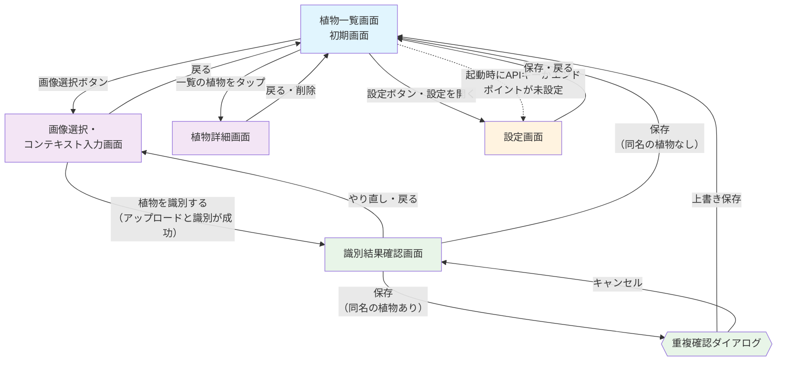

# SnapPlant 画面設計・ワイヤーフレーム

Flutter アプリ（`mobile/lib/`）の画面を、利用者から見える振る舞い（画面の要素・文言・遷移・ダイアログ・エラーの出方）で記述する。
実装の写しであり、実装に無い振る舞いは書かない。ワイヤーフレームは要素の並びを示すもので、大きさや色は実装による。

## 画面一覧

| 画面 | 画面上部の表示 | ソース（`mobile/lib/`） |
|---|---|---|
| 植物一覧画面（初期画面） | SnapPlant | `screens/plant_list_screen.dart`（一覧の各カードは `widgets/plant_card.dart`） |
| 画像選択・コンテキスト入力画面 | 植物を撮影・情報入力 | `screens/camera_screen.dart` |
| 識別結果確認画面 | 識別結果 | `screens/identification_screen.dart` |
| 植物詳細画面 | 植物名（読み込み中とエラー時は「植物詳細」） | `screens/plant_detail_screen.dart` |
| 設定画面 | 設定 | `screens/settings_screen.dart` |

重複確認は独立した画面ではなく、識別結果確認画面の上に出るダイアログである。

## 画面遷移図



- 識別結果確認画面から植物一覧画面へ戻るとき（保存の成功、または 409 `IMAGE_ALREADY_SAVED`）は、
  画像選択・コンテキスト入力画面も閉じて一覧まで戻る
- 保存の失敗（409 `IMAGE_ALREADY_SAVED` を除く）では識別結果確認画面に留まる
- 植物詳細画面の削除は、削除確認ダイアログを経て行う

## 全画面共通

- 処理の結果は、画面下部に浮かぶ通知（スナックバー）で知らせる
- API 呼び出しが失敗したときに表示する文言は HTTP ステータスで決まる
  （[技術選定](./05_technology_selection.md) §4.2「エラー表示」の表）。
  0 / 401 / 404 / 429 / 500 / 502 / 503 は固定の文言、それ以外（400・409・413・415 など）は
  サーバの `error.message` をそのまま表示する
- 自動での再試行はしない。再試行は利用者の操作（ボタンの押し直し、一覧・詳細画面の「再試行」）による
- 信頼度は整数に切り捨てて「95%」の形で表示する。バッジで表示する箇所（一覧・識別結果の候補・詳細）は、
  値に応じて色が変わる（90 以上・70 以上・50 以上・50 未満の4段階）
- 科名は、受け取った値の末尾に「科」を付けて表示する
- 画面左上の戻るボタンと端末の戻る操作は同じ動きをする
- 端末の文字サイズ設定は反映しない（倍率 1.0 に固定）

## 各画面の詳細設計

### 1. 植物一覧画面（初期画面）

```
┌─────────────────────────────────────────┐
│ SnapPlant                        [設定] │ ← ヘッダー（アプリ名 + 設定ボタン）
├─────────────────────────────────────────┤
│ ┌─────────────────────────────────────┐ │
│ │                                     │ │
│ │             植物の画像              │ │ ← 画像（カードの幅いっぱい）
│ │                                     │ │
│ ├─────────────────────────────────────┤ │
│ │ 桜                            [95%] │ │ ← 植物名 + 信頼度
│ │ 春に美しいピンクの花を咲かせる      │ │ ← 特徴（2行まで）
│ │ 3日前                               │ │ ← 保存からの経過時間
│ └─────────────────────────────────────┘ │
│ ┌─────────────────────────────────────┐ │
│ │                                     │ │
│ │             植物の画像              │ │
│ │                                     │ │
│ ├─────────────────────────────────────┤ │
│ │ 梅                            [88%] │ │
│ │ 早春に香りのよい白や紅の花を咲かせる│ │
│ │ 2週間前                             │ │
│ └─────────────────────────────────────┘ │
│              (以下同様...)              │
│                                         │
│                              [画像選択] │ ← 画像選択ボタン（右下に浮かぶ）
└─────────────────────────────────────────┘
```

**画面要素：**
- ヘッダー: アプリ名「SnapPlant」と、右上の設定ボタン（設定画面へ）
- 植物一覧: 保存済みの植物を `GET /api/plants` が返す順（作成日時の降順）にカードで並べる。下に引っ張ると読み込み直す
- 各カード: 画像、植物名（1行。はみ出す分は省略）、信頼度、特徴（2行まで。はみ出す分は省略）、保存からの経過時間。タップで植物詳細画面へ
  - 画像の読み込み中は「読み込み中...」、読み込めないときは「画像を読み込めません」を表示する
  - 経過時間は、24時間未満が「今日」、48時間未満が「昨日」、7日未満が「N日前」、30日未満が「N週間前」、
    365日未満が「Nヶ月前」（30日を1か月として数える）、それ以上が「N年前」
- 画像選択ボタン（右下に浮かぶ「画像選択」）: 画像選択・コンテキスト入力画面へ

**一覧以外の表示：**

| 状態 | 表示 |
|---|---|
| 読み込み中 | 「植物一覧を読み込み中...」 |
| 0件 | 「まだ植物が登録されていません」「画像選択ボタンをタップして最初の植物を登録しましょう」と「画像を選択」ボタン（画像選択・コンテキスト入力画面へ） |
| API設定が未完了 | APIキーとエンドポイントのどちらかが保存されていない（空を含む）とき。一覧は読み込まない。「API設定が完了していません」「設定画面で API キーとエンドポイントを入力してください」と「設定を開く」ボタン（設定画面へ）。どちらが無い場合も文言は同じ |
| 一覧の取得に失敗 | 「エラーが発生しました」、エラーの文言（`ApiException` 以外の失敗では「植物一覧の読み込みに失敗しました」）、「再試行」ボタン（一覧を取り直す） |
| 保存済みの設定を読めない | 「エラーが発生しました」「API設定の読み込みに失敗しました」と「再試行」ボタン。起動時と、設定画面から戻ったときのどちらでもこの表示になり、それまでの設定のままで一覧を読み込むことはしない。設定画面へは自動で移らない。「再試行」は保存済みの設定の読み込みからやり直し、APIキーとエンドポイントが両方あれば一覧を読み込み、どちらかが無ければ「API設定が未完了」の表示になる（このときも設定画面へは自動で移らない） |

401（APIキーが無効）のときも上の「一覧の取得に失敗」の表示になり、設定画面へは自動で移らない。

「API設定が未完了」と「保存済みの設定を読めない」の表示の間も画像選択ボタン（右下）は出ており、
押すと画像選択・コンテキスト入力画面へは進まず、スナックバーに「API設定が完了していません」を表示する。

**起動時の挙動：**

保存済みの APIキーとエンドポイントを読む。エンドポイントに既定値は無く（本番の URL をアプリに組み込んでいない）、APIキーと同じく利用者が設定画面で入力する。
どちらかが無ければ一覧を読み込まず「API設定が未完了」の表示にする。
あわせて設定画面を自動で開く（APIキーだけ、エンドポイントだけが無いときも同じ）。
設定画面を自動で開くのは起動時だけで、設定画面から戻ったときや「再試行」では開き直さない。

設定画面から戻ると、保存したかどうかによらず、保存されている設定を読み直す。APIキーとエンドポイントが両方あれば一覧を読み込み、
どちらかが無ければ「API設定が未完了」の表示になる（「設定を開く」かヘッダーの設定ボタンから設定して保存すれば読み込まれる）。

**一覧を読み込み直すタイミング：**
- 植物詳細画面から戻ったとき（削除したかどうかによらない）
- 植物を保存して戻ったとき（409 `IMAGE_ALREADY_SAVED` で戻ったときを含む）
- 設定画面から戻ったとき（保存したかどうか、リセットしたかどうかによらず、保存されている設定を読み直してから。
  APIキーかエンドポイントが無ければ読み込まず「API設定が未完了」の表示に、設定を読めなければ読み込まず「保存済みの設定を読めない」の表示になる）
- 一覧を下に引っ張ったとき

### 2. 画像選択・コンテキスト入力画面

```
┌─────────────────────────────────────────┐
│ [<] 植物を撮影・情報入力                │ ← ヘッダー（戻るボタン + タイトル）
├─────────────────────────────────────────┤
│ ┌─────────────────────────────────────┐ │
│ │     植物の画像をギャラリーから      │ │ ← 説明
│ │          選択してください           │ │
│ │  葉や花がはっきり写っている画像を   │ │
│ │   選択すると識別精度が向上します    │ │
│ └─────────────────────────────────────┘ │
│                                         │
│ ┌─────────────────────────────────────┐ │
│ │                                     │ │
│ │        タップして画像を選択         │ │ ← 画像エリア
│ │     ギャラリーから植物の画像を      │ │    （選択後は選んだ画像を表示）
│ │            選択できます             │ │
│ │                                     │ │
│ └─────────────────────────────────────┘ │
│                                         │
│ ┌─────────────────────────────────────┐ │
│ │ コンテキスト情報（任意）            │ │ ← コンテキスト情報の入力
│ │ 撮影場所や環境について入力すると    │ │
│ │ 識別精度が向上します                │ │
│ │ ┌─────────────────────────────────┐ │ │
│ │ │例：〇〇山の標高1300m、          │ │ │ ← 入力欄（3行・最大500文字）
│ │ │日当たりの良い場所               │ │ │
│ │ │                                 │ │ │
│ │ └─────────────────────────────────┘ │ │
│ │                               0/500 │ │ ← 入力済みの文字数
│ └─────────────────────────────────────┘ │
│                                         │
│          [ギャラリーから選択]           │ ← 画像の選択前
│                                         │
│            [別の画像を選択]             │ ← 画像の選択後
│            [植物を識別する]             │
└─────────────────────────────────────────┘
```

**画面要素：**
- ヘッダー: 戻るボタン（植物一覧画面へ）とタイトル「植物を撮影・情報入力」。タイトルに「撮影」とあるが、カメラでの撮影はできず、画像はギャラリーから選ぶ
- 説明: 「植物の画像をギャラリーから選択してください」「葉や花がはっきり写っている画像を選択すると識別精度が向上します」
- 画像エリア: 選ぶ前は「タップして画像を選択」「ギャラリーから植物の画像を選択できます」を表示し、タップでギャラリーを開く。
  選んだ後は選んだ画像を表示する（このときエリアをタップしても何も起きない。選び直しは「別の画像を選択」）
- コンテキスト情報入力: 見出し「コンテキスト情報（任意）」と「撮影場所や環境について入力すると識別精度が向上します」、
  3行の入力欄（ヒント「例：〇〇山の標高1300m、日当たりの良い場所」）。500文字までしか入力できず、入力欄の下に文字数を表示する
- ボタン: 画像を選ぶ前は「ギャラリーから選択」だけ。選んだ後は「別の画像を選択」と「植物を識別する」

画像はギャラリーから取り込む際に、最大 1920×1920・画質 85 を指定している。

**「植物を識別する」の挙動：**

画像とコンテキスト情報を `POST /api/images/upload` で送り、アップロードと AI 識別をまとめて行う。
コンテキスト情報は前後の空白を除いて送り、空なら送らない。
処理中は「植物を識別する」と「別の画像を選択」が押せなくなり、「植物を識別する」の位置にスピナーと「アップロード中...」を表示する
（識別が終わるまで同じ表示）。戻るボタン（端末の戻る操作も同じ）は処理中も押せる。

- 成功: 識別結果確認画面へ進む
- 失敗: 画面に留まり、エラーの文言をスナックバーに表示する（`ApiException` 以外の失敗では「画像の処理に失敗しました」）。
  選んだ画像と入力したコンテキスト情報は残るので、そのまま押し直せる
  - 植物でない画像（400 `NOT_A_PLANT`）は識別結果確認画面に進まず、ここで「アップロードされた画像は植物ではありません」を表示する

処理中に戻った場合は、処理が終わっても、成功・失敗のどちらでも何も表示せず、識別結果確認画面にも進まない。
送信済みのリクエストは取り消さないので、サーバ側の処理はそのまま続く。植物の画像なら、アップロードした画像は
永続コンテナへ移り、どの植物からも参照されないままサーバに残る。

ギャラリーからの取り込みに失敗した場合は、スナックバーに「画像の読み込みに失敗しました」を表示する（例外の内容は表示しない）。
ギャラリーで画像を選ばずに閉じた場合は何もしない。

識別結果確認画面から保存せずに戻ってきたときは、選んだ画像と入力したコンテキスト情報がそのまま残っている。

### 3. 識別結果確認画面

```
┌─────────────────────────────────────────┐
│ [<]                                     │ ← 戻るボタン
│                                         │
│           選んだ画像（背景）            │ ← ヘッダー（選んだ画像を背景に表示し、
│                                         │    スクロールすると縮む）
│ 識別結果                                │
├─────────────────────────────────────────┤
│ ┌─────────────────────────────────────┐ │
│ │      植物として識別されました       │ │ ← 識別成功の表示
│ │          全体の信頼度: 95%          │ │
│ └─────────────────────────────────────┘ │
│                                         │
│ 候補一覧                                │
│ ┌─────────────────────────────────────┐ │
│ │ (v) 桜                        [95%] │ │ ← 候補（選択中）
│ │     Prunus serrulata                │ │ ← 学名・科名は値があるときだけ
│ │     バラ科                          │ │
│ └─────────────────────────────────────┘ │
│ ┌─────────────────────────────────────┐ │
│ │ ( ) 桜桃                      [78%] │ │ ← 候補
│ └─────────────────────────────────────┘ │
│ ┌─────────────────────────────────────┐ │
│ │ ( ) 梨                        [65%] │ │
│ └─────────────────────────────────────┘ │
│                                         │
│ ┌─────────────────────────────────────┐ │
│ │ 選択された植物の詳細                │ │ ← 選択中の候補の詳細
│ │ 植物名: 桜                          │ │
│ │ 学名:   Prunus serrulata            │ │
│ │ 科名:   バラ科                      │ │
│ │ 信頼度: 95%                         │ │
│ │ 特徴                                │ │
│ │ 春に美しいピンクの花を咲かせる      │ │
│ │ 詳細説明                            │ │
│ │ 日本を代表する花木                  │ │
│ └─────────────────────────────────────┘ │
│                                         │
│     [やり直し]            [保存]        │ ← アクションボタン
└─────────────────────────────────────────┘
```

**画面要素：**
- ヘッダー: 選んだ画像を背景に、タイトル「識別結果」と戻るボタン。内容をスクロールするとヘッダーが縮む
- 識別成功の表示: 「植物として識別されました」と「全体の信頼度: N%」
- 候補一覧: AI が返した候補を返された順に並べる（サーバは AI に最大3件・信頼度順を指示している）。開いた時点では先頭の候補が選ばれている。
  タップした候補が選択中になる。各候補は名前・信頼度と、値があれば学名・科名を表示する
- 選択された植物の詳細: 選択中の候補の植物名・信頼度と、値があれば学名・科名・特徴・詳細説明
- アクションボタン: 「やり直し」と「保存」

候補が0件のときは識別成功の表示だけを出し、候補一覧・詳細・アクションボタンは出さない（戻るボタンで戻る）。

**やり直し・戻る：**

画像選択・コンテキスト入力画面へ戻る。アップロードした画像は削除しない。
画像はアップロードの時点で永続コンテナへ移っているため、どの植物からも参照されないままサーバに残る。
戻ってもう一度「植物を識別する」を押すと、同じ画像でも新しい画像としてアップロードし直す。

**保存時の挙動：**

保存ボタンは、まず選択中の候補の名前で重複確認（`GET /api/plants/check-duplicate`）を行い、
その結果に応じて新規保存（`POST /api/plants/save`）または既存レコードの更新（`PUT /api/plants/{id}`）を行う。
処理中は保存ボタンが押せなくなり、重複確認の間は「重複確認中...」、保存・更新の間は「保存中...」を表示する。

- 同名の植物が無い: 選択中の候補の名前・学名・科名・詳細説明・特徴・信頼度と、アップロードした画像で新規保存する
- 同名の植物がある: 重複確認ダイアログ（下記）を出す
  - 「上書き保存」: 既存の植物の画像と信頼度を、今回の画像と選択中の候補の信頼度に置き換える。
    名前・学名・科名・特徴・詳細説明は既存のまま変わらない。置き換え前の画像はサーバが削除する
  - 「キャンセル」（ダイアログの外をタップした場合も同じ）: 何もせず識別結果確認画面に留まる。保存ボタンは再び押せる

成功した場合は「植物を保存しました」を表示して植物一覧画面へ戻る（一覧は再読み込みされる）。

- 409 `IMAGE_ALREADY_SAVED`（この画像は別の名前で既に図鑑にある）: 保存済みとして扱い、
  サーバの文言（`error.message`）をそのまま表示して植物一覧画面へ戻る。新規保存・更新のどちらで
  返っても同じ。同じ画像は1レコードにしか保存できず、この画面で候補を選び直しても保存できないため、
  エラーとして扱うと保存を繰り返しても毎回 409 になり抜け出せない
- それ以外の失敗（409 `DATABASE_ERROR` を含む）: 画面に留まり、エラーの文言
  （`ApiException` 以外の失敗では「植物の保存に失敗しました」）を表示する。
  保存ボタンは再び押せる状態に戻り、押し直すと重複確認からやり直す
- 409 の2種類はステータスではなく、封筒の `error.code` で区別する
- 重複確認（名前）が失敗した場合: 新規保存にも更新にも進まず、上と同じく画面に留まってエラーの文言を表示する

**重複確認ダイアログ：**

```
┌─────────────────────────────────────┐
│ 重複する植物が見つかりました        │
│                                     │
│ 「桜」は既に登録されています。      │
│                                     │
│ 新しい写真で上書きしますか？        │
│                                     │
│           [キャンセル] [上書き保存] │
└─────────────────────────────────────┘
```

既存の写真と新しい写真を並べて見せる表示や、どちらの写真を残すかを選ぶ選択肢は無い。

### 4. 植物詳細画面

```
┌─────────────────────────────────────────┐
│ [<]                              [削除] │ ← 戻るボタン・削除ボタン
│                                         │
│          保存した画像（背景）           │ ← ヘッダー（保存した画像を背景に表示し、
│                                         │    スクロールすると縮む）
│ 桜                                      │ ← 植物名
├─────────────────────────────────────────┤
│ ┌─────────────────────────────────────┐ │
│ │ 基本情報                            │ │
│ │ 植物名: 桜                          │ │
│ │ 学名:   Prunus serrulata            │ │ ← 学名・科名は値があるときだけ
│ │ 科名:   バラ科                      │ │
│ │ 信頼度: [95%]                       │ │
│ └─────────────────────────────────────┘ │
│ ┌─────────────────────────────────────┐ │
│ │ 特徴                                │ │
│ │ 春に美しいピンクの花を咲かせる      │ │
│ └─────────────────────────────────────┘ │
│ ┌─────────────────────────────────────┐ │
│ │ 詳細説明                            │ │ ← 詳細説明があるときだけ
│ │ 日本を代表する花木                  │ │
│ └─────────────────────────────────────┘ │
│ ┌─────────────────────────────────────┐ │
│ │ 保存情報                            │ │
│ │ 保存日時: 2026年10月11日 00:30      │ │
│ │ 更新日時: 2026年10月12日 01:00      │ │ ← 更新されたときだけ
│ │ 植物ID:   123e4567-e89b-...         │ │
│ └─────────────────────────────────────┘ │
│                                         │
│              [植物を削除]               │ ← 削除ボタン
└─────────────────────────────────────────┘
```

開くたびに `GET /api/plants/{id}` で詳細を取り直す。

**画面要素：**
- ヘッダー: 保存した画像を背景に、植物名、戻るボタン、右上の削除ボタン。内容をスクロールするとヘッダーが縮む。
  画像を読み込めないときは画像の代わりにアイコンを表示する
- 基本情報: 植物名・信頼度と、値が空でなければ学名・科名
- 特徴
- 詳細説明（値が空でないときだけ）
- 保存情報: 保存日時、更新日時（保存日時と異なるときだけ。つまり上書き保存されたことがあるとき）、植物ID。
  日時は「2026年10月11日 00:30」の形式（月・日は0で埋めず、時・分は2桁）。サーバの値（UTC）を端末のタイムゾーンの時刻に直して表示する
  （日本時間の端末では、`2026-10-11T15:30:00.000Z` に保存した植物は「2026年10月12日 00:30」と表示する）
- 削除ボタン（下部の「植物を削除」）

**読み込み中・エラー時の表示：**

| 状態 | 表示 |
|---|---|
| 読み込み中 | タイトル「植物詳細」と「植物情報を読み込み中...」 |
| 取得に失敗 | タイトル「植物詳細」、「エラーが発生しました」、エラーの文言（`ApiException` 以外の失敗では「植物詳細の読み込みに失敗しました」）、「再試行」ボタン（取り直す） |

**削除：**

ヘッダーの削除ボタンと下部の「植物を削除」のどちらを押しても、削除確認ダイアログを出す。

```
┌─────────────────────────────────────┐
│ 植物を削除                          │
│                                     │
│ 「桜」を削除しますか？              │
│ この操作は元に戻せません。          │
│                                     │
│                 [キャンセル] [削除] │
└─────────────────────────────────────┘
```

- 「削除」: `DELETE /api/plants/{id}` で植物を削除する（画像もサーバが削除する）。
  処理中は下部のボタンが「削除中...」になり、どちらの削除ボタンも押せない
  - 成功: 「植物を削除しました」を表示して植物一覧画面へ戻る（一覧は再読み込みされる）
  - 失敗: 画面に留まり、エラーの文言（`ApiException` 以外の失敗では「植物の削除に失敗しました」）を表示する。削除ボタンは再び押せる
- 「キャンセル」（ダイアログの外をタップした場合も同じ）: 何もしない

### 5. 設定画面

```
┌─────────────────────────────────────────┐
│ [<] 設定                                │ ← ヘッダー（戻るボタン + タイトル）
├─────────────────────────────────────────┤
│ API設定                                 │ ← セクション
│                                         │
│ APIキー                                 │
│ ************************         [表示] │ ← APIキー（伏せ字。ボタンで表示を切り替える）
│ Azure Portal で取得したFunction Keyを   │
│ 入力してください                        │
│                                         │
│ APIエンドポイント                       │
│ https://your-function-app.              │ ← エンドポイント
│ azurewebsites.net                       │    （保存済みの値。未保存なら空）
│ Azure Functions のエンドポイントURLを   │
│ 入力してください                        │
│                                         │
│ ┌─────────────────────────────────────┐ │
│ │ 接続成功                            │ │ ← 接続テストの結果（テスト後に表示）
│ └─────────────────────────────────────┘ │
│                                         │
│    [接続テスト]          [保存]         │ ← アクションボタン
│            [設定をリセット]             │
│                                         │
│ アプリ情報                              │ ← セクション
│ ┌─────────────────────────────────────┐ │
│ │ アプリ名                  SnapPlant │ │
│ │ バージョン                    1.0.0 │ │
│ │ 開発者               SnapPlant Team │ │
│ └─────────────────────────────────────┘ │
└─────────────────────────────────────────┘
```

**画面要素：**
- ヘッダー: 戻るボタンとタイトル「設定」
- API設定:
  - APIキー: 伏せ字で表示し、右端のボタンで表示・非表示を切り替える。ヒント「Azure Functions のAPIキーを入力」、
    補足「Azure Portal で取得したFunction Keyを入力してください」
  - APIエンドポイント: ヒント「https://your-function-app.azurewebsites.net」、
    補足「Azure Functions のエンドポイントURLを入力してください」
  - 接続テストの結果: 接続テストの後に「接続成功」または「接続失敗」を表示する。APIキーかエンドポイントを編集すると消える
- アクションボタン: 「接続テスト」「保存」「設定をリセット」
- アプリ情報: アプリ名「SnapPlant」、バージョン「1.0.0」、開発者「SnapPlant Team」（固定の表示）

開くと保存済みの値を入力欄に入れる。APIキーもエンドポイントも、未保存なら空（エンドポイントの既定値は無い）。読み込み中は「設定を読み込み中...」を表示し、
読み込みに失敗すると「設定の読み込みに失敗しました」を表示する。

**保存：**

入力を検証し、通らなければ入力欄の下にエラーを表示して保存しない。

| 入力欄 | 条件 | 表示 |
|---|---|---|
| APIキー | 空（空白だけの場合を含む） | APIキーを入力してください |
| APIキー | 前後の空白を除いて10文字未満 | APIキーが短すぎます |
| APIエンドポイント | 空（空白だけの場合を含む） | エンドポイントを入力してください |
| APIエンドポイント | スキームが無い、またはスキームが `http` で始まらない | 有効なURLを入力してください（http://またはhttps://） |
| APIエンドポイント | URL として解釈できない | 有効なURLを入力してください |

検証を通れば、前後の空白を除いて保存し（APIキーは端末の安全な保存領域、エンドポイントは通常の設定領域）、
「設定を保存しました」を表示して植物一覧画面へ戻る。一覧は新しい設定で読み込み直す。
保存に失敗した場合は「設定の保存に失敗しました」を表示して画面に留まる。処理中は保存ボタンが「保存中...」になり押せない。

**接続テスト：**

入力欄の検証はしない。APIキーかエンドポイントのどちらかが空（空白だけの場合を含む）なら
「APIキーとエンドポイントを入力してください」を表示して何もしない。
そうでなければ、入力中の値（保存前の値）で `GET /api/plants` を呼ぶ。設定は保存しない。
処理中はボタンが「テスト中...」になり押せない。

- 2xx: 結果に「接続成功」、スナックバーに「接続に成功しました」
- それ以外（2xx 以外の応答、通信の失敗）: 結果に「接続失敗」、スナックバーに「接続に失敗しました。設定を確認してください。」

**設定をリセット：**

```
┌─────────────────────────────────────┐
│ 設定をリセット                      │
│                                     │
│ すべての設定がリセットされます。    │
│ この操作は元に戻せません。          │
│                                     │
│             [キャンセル] [リセット] │
└─────────────────────────────────────┘
```

- 「リセット」: 保存済みの設定をすべて消し、入力欄を APIキー・エンドポイントとも空にして「設定をリセットしました」を表示する。
  画面には留まる。保存ボタンを押さなくても、この時点で保存済みの設定は消えている。
  失敗した場合は「設定のリセットに失敗しました」を表示する
- 「キャンセル」（ダイアログの外をタップした場合も同じ）: 何もしない

**戻る：**

保存せずに戻ると、入力した変更は保存されない（リセットだけは既に反映されている）。
植物一覧は保存されている設定を読み直し、APIキーとエンドポイントが両方あれば一覧を読み込み直す。
リセットしてから保存せずに戻った場合は APIキーもエンドポイントも消えているので、植物一覧は「API設定が未完了」の表示
（「API設定が完了していません」）になり、リセット前の APIキーとエンドポイントでは通信しない。
設定画面は自動では開き直さない。

## 画面遷移のパターン

### メインフロー（新規追加）

1. 植物一覧画面（起動）
2. → 画像選択・コンテキスト入力画面（画像選択ボタン。0件のときは「画像を選択」ボタンも同じ）
3. 画像を選び、必要ならコンテキスト情報を入力して「植物を識別する」
4. → 識別結果確認画面（アップロードと識別が成功）
5. 候補を選んで「保存」（同名の植物があれば、重複確認ダイアログで「上書き保存」）
6. → 植物一覧画面（保存完了。画像選択・コンテキスト入力画面も閉じ、一覧を読み込み直す）

### 詳細確認・削除フロー

1. 植物一覧画面
2. → 植物詳細画面（一覧の植物をタップ）
3. → 植物一覧画面（戻るボタン、または削除確認ダイアログで「削除」して成功。どちらでも一覧を読み込み直す）

### 設定フロー

1. 植物一覧画面
2. → 設定画面（設定ボタン、または「API設定が未完了」の表示の「設定を開く」。起動時に APIキーかエンドポイントが未設定なら自動で開く）
3. → 植物一覧画面（保存したかどうかによらず、保存されている設定を読み直す。APIキーとエンドポイントが両方あれば一覧を読み込み直し、
   どちらかが無ければ「API設定が完了していません」の表示になる）

### やり直し・キャンセル

- 各画面の戻るボタン（端末の戻る操作も同じ）で前の画面に戻る
- 識別結果確認画面の「やり直し」は、戻るボタンと同じく画像選択・コンテキスト入力画面に戻る（選んだ画像と入力は残る）。
  アップロードした画像はサーバに残り、削除されない
- 重複確認ダイアログ・削除確認ダイアログ・リセット確認ダイアログの「キャンセル」では、その画面に留まる
- 設定画面で保存せずに戻った場合、変更は保存されない（リセットだけは即座に反映される）
