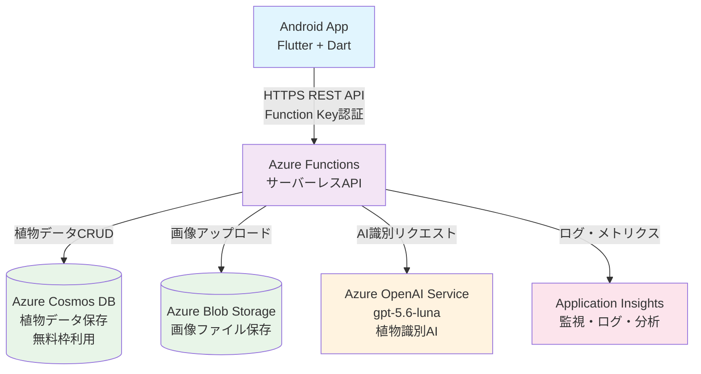

# SnapPlant 技術選定・アーキテクチャ設計書

## 1. 概要

植物図鑑アプリ「SnapPlant」のMVP版をAzureサービスを活用して構築するための技術選定とアーキテクチャ設計を行います。

## 2. アーキテクチャ概要図



Azure API Management は**導入していない**。クライアントは Function Key 認証で
Azure Functions を直接呼ぶ（3.6 参照）。レート制限も未実装で、
[バックログ](./09_backlog.md)に分離している。

Application Insights へ送るのは Function App 側のログ・メトリクスのみ。
モバイルアプリからのテレメトリ送信は実装していない（`mobile/` に SDK 依存が無い）。

## 3. 技術選定

### 3.1 フロントエンド（モバイルアプリ）

#### 選定：Flutter + Dart
- **理由**:
  - **UI品質**: Material Design 3.0による美しいネイティブ級UI
  - **パフォーマンス**: ネイティブコンパイルによる60fps保証
  - **画像処理**: 植物図鑑に最適な高速画像レンダリング
  - **アニメーション**: 滑らかな画面遷移とマイクロインタラクション
  - **クロスプラットフォーム**: iOS展開時の拡張性
  - **開発効率**: ホットリロードによる高速開発サイクル

#### 主要パッケージ
- **Flutter SDK**: 3.16.x (安定版)
- **Dart**: 3.2.x
- **flutter/material**: Material Design 3.0 UI
- **image_picker**: ギャラリーからの画像選択（カメラ撮影は画面から呼び出していない）
- **http**: HTTP通信・Azure API連携
- **shared_preferences**: 設定データ永続化
- **flutter_secure_storage**: APIキーのセキュア保存
- **cached_network_image**: 画像キャッシュ・表示最適化

### 3.2 バックエンド

#### 選定：Azure Functions (Node.js + TypeScript)
- **理由**:
  - サーバーレスでコスト効率が良い
  - 自動スケーリング
  - 開発・運用の簡易性
  - 従量課金でMVPに適している

#### Functions構成
- **HTTP Trigger**: REST API提供（`api/src/app.ts` が全関数を import して登録）

Timer Trigger（定期処理）と Blob Trigger（画像処理の非同期実行）は検討したが**未実装**。
現在の関数はすべて HTTP Trigger（`app.http(...)`）である。

### 3.3 データベース

#### 選定：Azure Cosmos DB (無料枠)
- **理由**:
  - **永続無料枠**を有効化（`azurerm_cosmosdb_account.main` の `free_tier_enabled = true`）。
    コンテナへの割り当ては **400 RU/s**（`cosmos_db_throughput` の既定値）
  - MVPの小規模利用には十分
  - 自動スケーリング・高可用性
  - JSON形式でDart/Flutterとの親和性が高い
  - グローバル分散可能

#### データ構造調整
```json
// plantsコンテナのドキュメント構造
{
  "id": "uuid",
  "name": "桜",
  "scientificName": "Prunus serrulata", 
  "familyName": "バラ科",
  "description": "詳細説明",
  "characteristics": "春に美しいピンクの花を咲かせる",
  "confidence": 95.5,
  "imagePath": "https://storage.../image.jpg",
  "createdAt": "2024-01-15T10:30:00Z",
  "updatedAt": "2024-01-15T10:30:00Z"
}
```

### 3.4 画像ストレージ

#### 選定：Azure Blob Storage (Hot Tier)
- **理由**:
  - 大容量画像ファイルの効率的な保存
  - CDN連携可能
  - REST API経由でのアクセス
  - コスト効率が良い

### 3.5 植物識別AI

#### 選定：Azure OpenAI Service（デプロイメント `gpt-5.6-luna`、画像入力）
- **理由**:
  - 高精度な画像認識・植物識別能力
  - 専門知識による詳細な植物情報提供
  - REST API経由での利用
  - Azure OpenAI ServiceまたはOpenAI APIで利用可能
    （`AZURE_OPENAI_ENDPOINT` の有無で分岐。未設定時のみ OpenAI 公式 API へフォールバック）
  - カスタムプロンプトによる柔軟な応答制御
  - Structured Outputs（`response_format: json_schema`, `strict: true`）で応答構造を強制

モデル名は `AZURE_OPENAI_DEPLOYMENT_NAME` から取り、Terraform の
`azurerm_cognitive_deployment.gpt5_luna`（`gpt-5.6-luna` / GlobalStandard SKU）と一致させる。

#### 要求の形を縛っている制約（なぜそうなっているか）

要求の要素（モデル、メッセージ、画像の渡し方、応答の形、トークン上限、送らないパラメータ）は
`06_api_design.md` §5.9「AI 識別サービスへ渡すもの」が正で、ここには形をそう選んだ理由だけを書く。

- **推論モデルの制約**: トークン上限は `max_completion_tokens` で指定する（`max_tokens` を送ると 400
  `Unsupported parameter`）。推論トークンもここから消費するため、値には余裕を持たせている。
  `temperature` は既定値 1 のみサポートで、それ以外を送ると 400 `Unsupported value` になるため送らない
- **strict モードの制約**: Structured Outputs の `strict: true` は、全プロパティを `required` に列挙し
  `additionalProperties: false` にすることを求める。そのため任意項目（候補の `scientificName` /
  `familyName` / `description`、植物でない場合の `plantAnalysis`）は null 許容で表し、null で返った項目は
  サーバ側で省略してクライアントに返す（`06_api_design.md` §4.2）。`minimum` / `maximum` / `maxItems` は
  使えないため、信頼度の範囲はサーバ側で検証し（範囲外は 502）、候補の件数はプロンプトで指示する
- **トークン節約**: 画像は `detail: "low"` で渡す（§9.2）

### 3.6 API管理・セキュリティ

#### MVP段階：Azure Functions 標準機能
- **認証方式**: Function Key認証
  - 追加コストなし（APIMの月額¥7,000を回避）
  - 個人開発に適した単純な認証
  - クエリパラメータでの認証（`?code={key}`）

- **セキュリティ対策**:
  - HTTPS通信強制（Azure Functions標準）
  - Application Insightsでの監視・ログ
  - CORS は全オリジン許可（`infrastructure/main.tf` の `allowed_origins = ["*"]`）。
    呼び出し元の制限はしていない

#### 将来検討：Azure API Management
- **移行タイミング**: 商用化・大規模化時
- **追加機能**: レート制限、高度な認証、API バージョニング

### 3.7 監視・ログ

#### 選定：Azure Application Insights
- **機能**:
  - アプリケーション パフォーマンス監視
  - エラー追跡

## 4. 詳細技術仕様

### 4.1 Azure Functions 構成

#### API エンドポイント設計
```typescript
// GET    /api/plants                 - 植物一覧取得
// GET    /api/plants/{id}            - 植物詳細取得
// POST   /api/plants/save            - 植物新規登録
// PUT    /api/plants/{id}            - 植物情報更新
// DELETE /api/plants/{id}            - 植物削除
// POST   /api/plants/identify        - 植物識別
// GET    /api/plants/check-duplicate - 重複チェック
// POST   /api/images/upload          - 画像アップロード＋AI識別（統合）
```

#### 使用パッケージ（`api/package.json` の dependencies）
- **@azure/functions**: Azure Functions ランタイム
- **@azure/cosmos**: Cosmos DB接続
- **@azure/storage-blob**: Blob Storage操作
- **openai**: Azure OpenAI / OpenAI API連携
- **uuid**: Blob名の生成（植物IDは `CosmosService.generateId()` の自前実装で生成しており、このパッケージは使っていない。統一するかは 09_backlog の「UUID の生成方法が2つある」）

ファイルアップロードは Azure Functions v4 の `request.formData()` で処理する。
multer は導入していない。

### 4.2 Flutter アプリ構成

#### フォルダ構造（実装の現状）
```
lib/
├── main.dart              # アプリエントリーポイント・画面遷移の定義（手書き）
├── models/                # データモデル・型定義
│   ├── plant.dart         # Plant / PlantSummary / PlantCandidate /
│   │                      # IdentificationResult / DuplicateCheckResult など
│   └── api_response.dart
├── screens/               # 画面ウィジェット
│   ├── plant_list_screen.dart
│   ├── camera_screen.dart
│   ├── identification_screen.dart
│   ├── plant_detail_screen.dart
│   └── settings_screen.dart
├── widgets/               # 共通ウィジェット
│   └── plant_card.dart
├── services/              # API通信・ビジネスロジック
│   ├── api_service.dart
│   └── settings_service.dart
├── utils/                 # ユーティリティ
│   └── image_mime_type.dart  # 先頭バイトのシグネチャから画像の MIME タイプを判定
└── theme/                 # テーマ・スタイル
    ├── app_theme.dart
    ├── app_colors.dart
    └── app_text_styles.dart
```

ルーティング専用のディレクトリ（`navigation/`）は無い。
状態管理は `setState` で、`ApiService` などは画面のコンストラクタで渡す。
画面遷移は `Navigator.push` / `pop`（`MaterialPageRoute`）で、名前付きルートは使わない。
状態管理ライブラリ（`provider` など）やルーティングライブラリ（`go_router` など）は導入していない。

#### セキュリティ関連パッケージ
- **shared_preferences**: 設定データ保存
- **flutter_secure_storage**: APIキーのセキュア保存

ネットワーク状態監視（`connectivity_plus`）は導入していない。
通信失敗は `ApiService._handleError()` が例外から判別している。

#### API通信設定
- **http package**: REST API通信（multipart の Content-Type の指定に `http_parser` も使う）
- **認証**: Function Keyをクエリパラメータで送信（`ApiService._buildUrl()` が `?code=` を付与）
- **エラーハンドリング**: `ApiService._handleError()` が例外を `ApiException` に正規化し、
  `userMessage` でステータスコードごとの日本語メッセージを返す
- **JSON変換**: dart:convert による型安全なシリアライゼーション

##### エラー表示

非 2xx の応答は `ApiException.fromResponse()` が例外にする。ボディをサーバの封筒
（`{ success: false, error: { code, message } }`）として読めれば、`error.code` / `error.message` を
`ApiException` の `code` / `message` に入れる。封筒として読めないボディ（Azure Functions
ランタイムが返す 401、従量課金プランの過負荷時に返る 429 "Too Busy" など）では `code` は null、
`message` はステータス付きの固定文言「サーバーでエラーが発生しました（ステータス: {ステータス}）」になる。
それ以外の例外（通信例外や 2xx 応答の解析失敗など）は、`_handleError()` が
ステータス 0 の `ApiException` にする。

画面に出す文言は `ApiException.userMessage` がステータスから決める。

| ステータス | 表示文言 |
|---|---|
| 0 | ネットワークに接続できません。インターネット接続を確認してください。 |
| 401 | APIキーが無効です。設定を確認してください。 |
| 404 | 要求されたデータが見つかりません。 |
| 429 | サーバーが混雑しています。しばらく待ってから再試行してください。 |
| 500 | サーバーで問題が発生しています。しばらく待ってから再試行してください。 |
| 502 | 外部サービスでエラーが発生しました。繰り返し発生する場合は、時間を置いてからお試しください。 |
| 503 | サービスに一時的に接続できません。しばらく待ってから再試行してください。 |
| それ以外（400・409・413・415 など） | `message`（サーバの `error.message`。封筒を読めなければ上記の固定文言） |

ただし識別結果確認画面の 409 `IMAGE_ALREADY_SAVED` だけは、`userMessage` ではなくサーバの
`message` をそのまま表示する（[画面設計](./03_screen_design.md)の「保存時の挙動」参照）。

自動リトライは実装していない。再試行はユーザー操作（一覧・詳細画面の「再試行」ボタン）による。

### 4.3 データフロー

#### 植物識別フロー
1. **認証確認**: 設定画面からAPIキー取得（flutter_secure_storage）
2. **画像選択**: Flutter image_picker → ギャラリーから画像を選択（カメラ撮影は画面から呼び出していない）
3. **画像アップロード**: Flutter http → Azure Functions → Blob Storage (Function Key認証)
4. **AI識別**: Azure Functions → Azure OpenAI Service → `gpt-5.6-luna`（画像入力・SAS URL対応）
5. **結果表示**: API Response → Flutter UI (Material Design)
6. **データ保存**: Flutter → Azure Functions → Cosmos DB (Function Key認証)

#### 認証フロー
1. **初回設定**: ユーザーが設定画面でAPIキー入力
2. **セキュア保存**: flutter_secure_storage にキーを暗号化保存
3. **API呼び出し**: 全リクエストでクエリパラメータに認証キー付与
4. **キー未設定時**: 一覧画面の起動時の初期化で設定画面へ遷移（`Navigator.push`）。
   設定画面から戻ると、保存の有無によらず保存されている設定を読み直す。キーがまだ無ければ設定画面へは移り直さず、
   一覧画面に「API設定が完了していません」と「設定を開く」ボタンを表示する
   （リセットでキーを消した後も同じで、消したキーでは通信しない。詳細は [画面設計](./03_screen_design.md) の植物一覧画面）
5. **エラー処理**: 401 はエラーメッセージ表示のみ
   （`ApiException.userMessage` が「APIキーが無効です。設定を確認してください。」を返す）。
   401 を検知して自動で設定画面へ遷移する実装は無い

## 5. コスト見積もり（月額・東日本リージョン）

### 5.1 MVP段階（月間100ユーザー想定）
- **Azure Functions**: ¥500-800
- **Azure Cosmos DB**: **¥0** (無料枠内)
- **Azure Blob Storage (Hot)**: ¥200-400
- **Azure API Management**: **¥0**（未導入。Function Key認証で代替している）
- **Azure OpenAI Service**: ¥1,500-3,000
- **Application Insights**: ¥300-500

**月額合計**: 約¥2,500-4,700（API Management を導入していない分だけ低い）

### 5.2 成長段階（月間1,000ユーザー想定）
- **Azure Cosmos DB**: 無料枠超過で¥1,000-2,000追加
- その他サービスのスケールアップが必要
- **月額合計**: 約¥12,000-15,000

## 6. 開発・デプロイ戦略

### 6.1 CI/CD パイプライン

#### 選定：GitHub Actions
ソースコード管理は GitHub、CI/CD も GitHub Actions で完結させている
（Azure DevOps / Azure Pipelines は使っていない）。ワークフローは5本。

| ワークフロー | トリガー | 内容 |
|---|---|---|
| `.github/workflows/ci.yml` | `main` / `develop` への push、`main` への PR（いずれも `api/` または `.github/workflows/` の変更時）、deploy-functions.yml からの `workflow_call` | 2ジョブが並列に走る。Test and Build: `npm ci` → テスト → カバレッジ → `npm run build` → 成果物アーカイブ。Security Scan: `npm ci` → CodeQL（解析ステップは `continue-on-error: true`） |
| `.github/workflows/audit.yml` | `main` への push と `main` への PR（いずれも `api/package.json`・`api/package-lock.json`・`.github/workflows/audit.yml` の変更時）、毎週月曜 0:00 UTC（9:00 JST）の定期実行、手動実行 | `api/` で `npm audit --audit-level=high`。開発用の依存も対象に含む。high 以上の脆弱性があれば失敗する（`continue-on-error` なし）。デプロイの前提にはしていない |
| `.github/workflows/terraform.yml` | `main` / `develop` への push、`main` への PR（いずれも `infrastructure/` または `.github/workflows/terraform.yml` の変更時） | `terraform fmt -check -recursive` と `terraform init -backend=false` → `terraform validate`。Azure へは通信しない |
| `.github/workflows/deploy-functions.yml` | `main` への push（`api/` または `.github/workflows/` の変更時）、手動実行 | ci.yml を `workflow_call` で呼び、成功後に Azure Functions へデプロイ |
| `.github/workflows/flutter.yml` | `main` への push と `main` への PR（いずれも `mobile/` または `.github/workflows/flutter.yml` の変更時）、手動実行 | Flutter 3.32.8（stable）で、`mobile/` で `flutter pub get` → `flutter analyze` → `flutter test`（`TZ=Asia/Tokyo`）。`flutter analyze` は info も含めて指摘があれば失敗する（`continue-on-error` なし）。デプロイの前提にはしていない |

リンターは未設定のため、ci.yml の lint ステップはスキップされる。

audit.yml・terraform.yml・flutter.yml を ci.yml から分けているのは、deploy-functions.yml が
ci.yml の成功をデプロイの前提にしているため。audit.yml が失敗してもデプロイは止まらない
（検知はするが、止めるまではしない判断）。moderate を失敗条件に含めていないのは、
Jest の間接依存の `sprintf-js` に修正版が出ておらず、含めると常に失敗するため。

#### デプロイフロー
```
開発者 → git push (main) → deploy-functions.yml →
ci.yml（テスト・ビルド）→ npm ci → npm run build → npm prune --omit=dev → Azure Functions へデプロイ →
Function App の応答確認 → 完了
```

audit.yml はこの流れに含まれない（`api/package*.json` を変えた push では並行して走るが、
結果はデプロイに影響しない）。

サーバ側ビルドは行わない（`scm-do-build-during-deployment: false` /
`enable-oryx-build: false`）ため、ワークフロー内でビルドした `dist/` が
そのままパッケージされる。ビルドの後に `npm prune --omit=dev` で開発用の依存（Jest・TypeScript など）を
外してから `api/` を丸ごと送るので、実行時に読み込むパッケージは `dependencies` に置く
（`devDependencies` に置くと、テストは通るが本番で読み込みに失敗する）。

### 6.2 環境構成
- **ローカル開発**: `api/local.settings.json`（Functions Core Tools）+ 実 Azure リソース
- **本番環境**: Azure（Terraform で定義。`production` GitHub Environment 経由でデプロイ）

ステージング環境と Dev/Test サブスクリプションは用意していない。
インフラ定義も単一環境分のみ（`infrastructure/main.tf`）。

## 7. セキュリティ設計

### 7.1 認証・認可

#### MVP段階: Azure Function Key認証
- **選定理由**:
  - Azure Functionsの標準機能で追加実装不要
  - 個人開発に適したシンプルな認証方式
  - API呼び出し時のクエリパラメータで認証

- **実装方式**:
  ```
  GET /api/plants?code={FUNCTION_KEY}
  POST /api/plants/identify?code={FUNCTION_KEY}
  ```

- **キー管理**:
  - Azure Portalでの手動生成・取得
  - モバイルアプリの設定画面で設定
  - flutter_secure_storage でのセキュア保存

#### 将来拡張: Azure Active Directory B2C
- **段階的移行計画**:
  - Phase 1: Function Key（MVP）
  - Phase 2: ユーザー登録・ログイン機能追加時にAAD B2C導入
  - Phase 3: OAuth 2.0 / OpenID Connect対応

- **HTTPS通信**: 全API通信の暗号化必須

### 7.2 データ保護
- **Azure Cosmos DB**: 保存時暗号化・ネットワーク暗号化
- **Azure Blob Storage**: アクセス制御・暗号化
  - 永続コンテナ `images` は公開読み取り、一時コンテナ `temp-images` は非公開
  - AI 識別サービスには、一時 Blob 1つに対する読み取り専用・発行から15分で失効する SAS 付き URL で読ませる。
    この URL はクライアントには返さず、一時保存の完了ログにも SAS を出さない
    （[APIワークフロー設計書](./07_api_workflow.md)の 2.3）

## 8. 将来拡張性

### 8.1 スケーラビリティ対応
- **Azure Functions Premium Plan**: 高負荷時の対応
- **Azure Cosmos DB**: 無料枠から有料プランへの移行・自動スケーリング
- **Azure Content Delivery Network**: グローバル配信

### 8.2 機能拡張
- **プッシュ通知**: Azure Notification Hubs
- **リアルタイム通信**: Azure SignalR Service
- **機械学習強化**: Azure Machine Learning

## 9. リスク評価

### 9.1 技術リスク
- **Azure OpenAI Service**: APIコストと利用制限、モデル・APIバージョンの変更追従
- **Flutter**: ネイティブ機能の制限
- **Azure Functions**: Consumption Plan のコールドスタート

### 9.2 対策
- **コスト最適化**: 画像は `detail: "low"` で渡しトークン消費を抑制（渡すものの全体は `06_api_design.md` §5.9）
- **ハイブリッド開発**: 必要に応じてネイティブコード併用
- **Premium Plan**: パフォーマンス要件に応じた移行