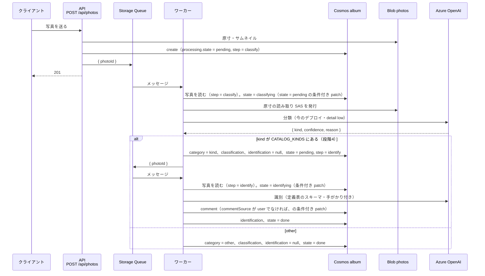

# 旅行アルバム 裏の処理の設計

## この文書の位置づけ

送信を待たせずに裏で行う処理（分類・識別・地名の埋め直し）の設計を書く。段階3・4が中心で、
段階2に関係するのは地名変換（§4 の端末側）だけ。**未実装を含む目指す姿**で、骨格の粒度。
実装した部分には「実装済み」の印を付ける（2026-10-25 に、旅行アルバムの設計一式（以前の `docs/travel-album/`）をこの `docs/` に移した）。

データの項目は [04_data_design.md](./04_data_design.md)、やり直しの API は [05 §5.7](./05_api_design.md#57-post-apiphotosphotoidprocess段階3)、
インフラは [07_infrastructure_design.md](./07_infrastructure_design.md) を参照する。
キューの名前・再試行の回数・タイマーの間隔・モデルの環境変数名は第3版に無く、この文書で決めた。

---

## 1. キューとワーカー（段階3）

### 1.1 構成

| 項目 | 値 | 理由 |
|---|---|---|
| キュー | Azure Storage Queue `photo-processing`（既存のストレージアカウント。`AzureWebJobsStorage` と同じ） | 追加のリソースが要らず、Functions のトリガーが標準で使える。Service Bus は過剰 |
| メッセージ | `{ "photoId": "<id>" }`（JSON を UTF-8 で base64 にした本文。Functions のキューのトリガーは本文を base64 として読む（`host.json` の `messageEncoding` の既定）ので、JSON をそのまま積むと読めずに poison に落ちる） | ワーカーは写真を読み直し、やる処理（`processing.step`）も手がかり（`hint`）も写真から取る。メッセージは「この写真を見ろ」という合図に過ぎない。メッセージに `step` や `hint` を載せると、再投入や重複配信で写真の中身と食い違ったものが届きうる（[04 §7.4](./04_data_design.md#74-ワーカーの書き込みの決まり)） |
| 投入 | API（Azure Functions）から `@azure/storage-queue` の `QueueClient.sendMessage()`（**`dependencies` に置く**） | 投入の失敗を握って応答を変えない、という制御をコードで書ける（出力バインディングは関数の戻り値で送るので、失敗時の扱いを制御しにくい）。`devDependencies` だと本番で読み込めない（CLAUDE.md「CI/CD」） |
| ワーカー | `api/src/functions/processPhoto.ts`。`app.storageQueue('processPhoto', { queueName: '%PHOTO_QUEUE_NAME%', connection: 'AzureWebJobsStorage', handler })` | API と同じ Function App（Azure 上の1つのアプリ）に同居 |
| 直列化 | `host.json` の `extensions.queues` で `batchSize: 1`・`newBatchThreshold: 0` | AI のレート上限（TPM）と費用を抑える。1回の旅行で数百枚を一気に投入しても、順に流れる |
| 可視性タイムアウト・再試行 | `visibilityTimeout: 00:01:00`、`maxDequeueCount: 3`。3回失敗すると `photo-processing-poison` に落ちる。**poison キューに特別な対処はしない**（§5） | 一時的な失敗（429・503）は自動で再試行され、恒久的な失敗は止まる。処理の状態は写真の文書が正で、poison の中身は使わない |
| 再投入のタイマー | **実装済み**（3-3b）。`api/src/functions/requeueStalePhotos.ts`。`app.timer('requeueStalePhotos')`、10 分ごと（`0 */10 * * * *`）。`processing.state` が `pending` / `classifying` / `identifying` のまま、`processing.updatedAt` が 10 分（`PHOTO_REQUEUE_AFTER_MINUTES`。コードの定数）より前の写真を再投入（`{ photoId }`。やる処理は写真の `processing.step` にある）。**処理中（`classifying` / `identifying`）の写真も、先に `pending` に戻してから（`step`・`attempts`・`lastError` はそのまま、`updatedAt` は今）投入する**（ワーカーは `pending` の写真しか担当しないので、処理中のまま投入しても担当されない）。**`failed` と `none`（と `done`）は拾わない**。クエリの条件（[04 §5](./04_data_design.md#5-クエリ) の 5.8）と同じ条件をコードでも見直し、外れた写真は読んでも触らない（SQL の絞り込みは単体テストで確かめられないので、崩れても `failed`・`none` を拾わないように） | poison に落ちたもの、投入前にプロセスが落ちたもの、投入に失敗したものを拾う。`attempts` が上限（3 回）なら再投入せず `failed` にする。`failed` を拾わないので、同じ画像で永遠に失敗し続けることが無い（§1.3） |
| 掃除のタイマー | **実装済み**（3-3b）。`api/src/functions/sweepAlbum.ts`。`app.timer('sweepAlbum')`、1日1回、日本時間の午前3時（cron は UTC で `0 0 18 * * *`）。文書の無い Blob（最終更新から1日より古いもの）を消し、消えた旅行を指す写真を未所属に戻し、原寸の Blob の無い文書をログに出す | 途中で止まった操作の残骸を消す（[04 §7.2](./04_data_design.md#72-掃除のタイマー段階3)） |

キュー名は環境変数 `PHOTO_QUEUE_NAME`。**投入する側もワーカーも必須で、既定値は無い**（ワーカーのトリガーはアプリの設定から `%PHOTO_QUEUE_NAME%` を解決するので既定値を持てず、投入する側だけ既定のキューに積むと誰も拾わないキューに溜まるため）。投入する側（`PhotoQueueService`）は、未設定・空・空白だけなら投げる（前後の空白は落とさずに、設定の値のまま使う。ワーカーのトリガーも設定の値をそのまま使うので、落とすと別のキューに送ることになる）。`POST /api/photos` ではこれも投入の失敗として扱い、ログだけで 201 を返す（[05 §5.1](./05_api_design.md#51-post-apiphotos)）。キューと設定は Terraform で作る（[07 §2](./07_infrastructure_design.md#2-段階3)・[07 §6.1](./07_infrastructure_design.md#61-api-の環境変数)）。

再投入のタイマーの細部（3-3b）:

- 識別の待ち（`step: "identify"`）の写真も同じく拾う。ワーカーが `identify` を担当する（4-1a）ので、積んだ写真は識別に進む。
  キューに 10 分以上溜まっている写真も解析待ちとして拾い、もう一通積む（`updatedAt` を今にするので 1枚につき 10 分に 1通まで。重複したメッセージは担当の条件で何もせずに終わり、AI は呼ばない。2026-10-18 に許容）
- 写真ごとに、`processing` を `FROM c WHERE c.processing.state = "<読んだ state>" AND c.processing.step = "<読んだ step>" AND c.processing.attempts = <読んだ attempts> AND c.processing.updatedAt = "<同じときの processing.updatedAt>"` の条件付き patch で書き換える（`AlbumService.writeProcessing()`。条件は `processingCondition()`）。
  412（読んだ後にワーカーが担当した・やり直しの受付が入ったなど）か 404（消えた）なら、その写真には触らず（積まず）次へ進む
- 上限（`attempts >= PHOTO_PROCESSING_MAX_ATTEMPTS`）の写真は `failed` にして積まない。それ以外は `pending` にしてから積む。
  投入に失敗した写真はログだけ出して残りを続ける（写真は `pending` のまま残り、次の回に拾う）
- 写真の読み取り（クエリ）に失敗したら例外を投げる（何も変えず、次の回に読み直す）
- 件数（止まっていた写真・積んだ写真・失敗にした写真）をログに出す
- 同じタイマーが、写真の後にタイムラインの下書きも拾う（5-1a で実装済み。[§8.1](#81-構成)）

### 1.2 流れ



- 段階2の `POST /api/photos` は `processing.state: "none"`・`step: null` で保存し、キューには投入しない。段階3で `pending`・`step: "classify"` + 投入に変える
- 段階3で、段階2に送った既存の写真（`state: "none"`）を分類するには、`POST /api/photos/{photoId}/process` を1枚ずつ呼ぶか、
  一度だけ走らせる手動のスクリプトで投入する。タイマーには `none` を拾わせない（意図せず全件に課金しないため）。
  **スクリプトはまだ作っていない**（段階3では使わなかった）。作るなら手で回すスクリプトの置き場（`api/README.md`「手で回すスクリプト」）に合わせて `api/src/scripts/enqueueUnclassified.ts` にする
- 段階4で、段階3で分類まで済んだ写真（`state: "done"`、種類が識別対象で `identification` が無いもの）を識別するには、`POST /api/photos/{photoId}/process` を1枚ずつ呼ぶか、
  一度だけ走らせる手動のスクリプト（`api/src/scripts/enqueueUnidentified.ts`。人間が実行する）で識別の待ち（`pending`・`step: "identify"`・回数 0）にする。対象でない写真をタイマーが自分から識別に回すことはしない（上と同じ理由。2026-10-18 に決定。[02 §5](./02_design_overview.md#5-人間に決めてもらう点推奨付き) #30）
  - 対象は「`state: "done"`・`category` が `CATALOG_KINDS` のどれか・`identification` が `null`」の写真。クエリで絞り、同じ条件をコードでも見る（クエリの絞り込みはテストで確かめられない）
  - 書き込みは読んだときの `processing` の条件付き patch（[04 §7.4](./04_data_design.md#74-ワーカーの書き込みの決まり) と同じ `processingCondition()`）。読んだ後にやり直しの受付やワーカーが書き換えた写真は飛ばす
  - **キューには積まない。** 識別の待ちにした写真は、再投入のタイマーが 10〜20 分後に積む（待ちのまま 10 分たった写真を拾う。§1.1）。スクリプトを手元で回すときに、本番のキューへの接続を要らなくするため（手元の設定の `AzureWebJobsStorage` はローカルの偽物を指していることがある）
  - **既定は数えるだけで、何も書かない。** `--apply` を付けたときだけ書く（本番のデータを書くので、先に件数を見てから回す）。手順は `api/README.md`
  - 対象の枚数と、識別の待ちにした枚数をログに出す（飛ばした写真は ID も）。途中で止まっても回し直してよい（待ちにした写真は `done` でなくなるので、次の回の対象から外れる）
  - 読むクエリは `AlbumService.listUnidentifiedPhotos()`（[04 §5](./04_data_design.md#5-クエリ) の 5.11）、書くのは `writeProcessing()`
- `step: "classify"` のやり直しは、結果の種類が識別対象なら続けて `identify` も投入する（要件 5.5.1「カテゴリの分類も、図鑑の項目の識別も対象」）。
  分類の結果を書くときに `identification` を `null` に戻す（識別が終わるまで図鑑からは一時的に消える。種類が変わったのに古い名前の下に残り続けるよりよい）
- ワーカーの書き込みの決まり（AI の担当の欄だけを patch する、結果と失敗は担当したときの `processing`（`state`・`step`・`attempts`・`updatedAt`）の条件付き patch、コメント（識別だけ）は同じ条件に `commentSource` の条件を足した patch、ロックや `_etag` の条件は置かない）は [04 §7.4](./04_data_design.md#74-ワーカーの書き込みの決まり)。
  利用者は解析中でもコメント・タグ・旅行を変えられる

### 1.3 状態と失敗

`processing` の遷移。`step` は「次にやる（またはやっている）処理」で、タイマーが再投入するときと、ワーカーがメッセージを受けたときに見る。

| 状態 | 意味 | `step` | 次 |
|---|---|---|---|
| `none` | 裏の処理の対象になっていない（段階2の写真） | `null` | `process` で `pending` |
| `pending` | キューに入っている（または入れようとした） | `classify` / `identify` | ワーカーが取ると `classifying` / `identifying` |
| `classifying` / `identifying` | 処理中 | 同上 | 成功で `done`（分類の後に識別が続くなら `pending`・`identify`）、失敗で `pending`（再試行）か `failed` |
| `done` | 済み | 最後にやった処理 | `process` で `pending` |
| `failed` | 上限まで失敗した。**自動では再試行しない** | 失敗した処理 | `process` で `pending`（`attempts` を 0 に戻す）。これ以外に `failed` から出る経路は無い |

- ワーカーは担当するたびに（担当の条件付き patch で）`attempts` を +1 し、`updatedAt` を更新する。成功しても `attempts` は 0 に戻さない（戻すのは `process` だけ）。失敗したら `lastError` にどこで失敗したかだけを書く（`UpstreamError` の `service`（分類・識別では `"ai"`）か、それ以外（設定の誤りを含む）なら `"internal"`）。例外のメッセージは入れない（SDK 由来の文言が残り続けるため）。成功したら `null` に戻す
- 失敗したとき、`attempts >= 3`（`PHOTO_PROCESSING_MAX_ATTEMPTS`、環境変数。`constants/album.ts` の `photoProcessingMaxAttempts()` が呼ぶたびに読む。[07 §6](./07_infrastructure_design.md#6-設定値の一覧)）なら `failed` にして**例外を投げずに終える**（メッセージは消え、poison には落ちない）。それ未満は `state` を `pending` に戻して（`step` はそのまま）例外を投げ、キューの再試行（可視性タイムアウトの後）で担当し直す。結果の欄（`category`・`classification`・`identification`）には書かない
- `PHOTO_PROCESSING_MAX_ATTEMPTS` は `host.json` の `maxDequeueCount`（3）以下にする。大きくすると、上限に達する前にメッセージが poison に落ち、残りの回は再投入のタイマー（10 分ごと）だけで進む
- 写真の `processing.step` を見て、`classify` なら分類、`identify` なら識別を担当する（`identify` は 4-1a で実装済み）。それ以外（`step: null` の `none` の写真）なら何もしない（AI を呼ばず、写真も変えない）。
  処理中の `state` は `classify` なら `classifying`、`identify` なら `identifying`。失敗の書き込みも `step` はそのまま（識別の失敗は識別の待ちに戻り、分類からやり直さない）
- 担当するときの `state` を処理中にする patch は `FROM c WHERE c.processing.state = "pending" AND c.processing.step = "<読んだ step>" AND c.processing.attempts = <読んだ attempts> AND c.processing.updatedAt = "<同じときの processing.updatedAt>"` の条件付き。412 なら別のインスタンスが担当済み（古いメッセージの重複配信）で、何もしない。読んでから担当するまでに写真が消されていた（404）ときも何もしない。
  `step` も条件に入れるのは、読んでから担当するまでに別の処理が `step` を変えていた（分類を済ませて識別の待ちにした。段階4）ときに、識別を捨てて分類し直さないため。`processing.updatedAt` も条件に入れるのは、やり直しの受付が回数を 0 に戻すため（受付の後に取り直された担当は、古い担当と state・step・回数が同じ値になる。`updatedAt` は processing を書くたびに変わるので担当ごとの印になる）。担当・結果と失敗の書き込み・再投入のタイマーのリセット・識別に回すスクリプト（§1.2）が、どれも同じ形の条件を使う（`albumService.ts` の `processingCondition()`。担当以外は `writeProcessing()` などの `patchIfStillClaimed()` を通る）。`attempts` も条件に入れるのは、読んでから担当するまでの間に別のインスタンスが担当して失敗し `pending` に戻していた場合を見分けるため（`state` だけでは同じに見え、古い回数から数え直して上限で止まらなくなる）。
  読んだ写真の `state` が `done` / `failed` / `none` / 処理中でも何もしない（どれも担当の条件付き patch が 412 になる。読んだ値で先に判断しない）
- 結果の書き込みと失敗の書き込み（`pending` に戻す・`failed` にする）は、`FROM c WHERE c.processing.state = "<担当したときの state（classifying / identifying）>" AND c.processing.step = "<step>" AND c.processing.attempts = <担当した回数> AND c.processing.updatedAt = "<同じときの processing.updatedAt>"` の条件付き patch（3-3b）。
  412 か 404 なら何も書かずに終える（失敗でも例外を投げない）。分類・識別の間にやり直しの受付（[05 §5.7](./05_api_design.md#57-post-apiphotosphotoidprocess段階3)。`pending`・`attempts: 0`）が入ったとき、
  古い処理の結果や失敗でやり直しを上書きすると、やり直しで積んだメッセージが担当できずに捨てられ、やり直しが黙って消えるため。やり直しは、受付で積んだメッセージが改めて担当する
- メッセージに写真 ID（文字列の `photoId`）が無いとき・写真が無いとき（消された後のメッセージ）は、何もせずに終える（例外にしない。何度送り直しても結果は同じで、poison に落ちるだけなので）。写真 ID が写真 ID の形式（SHA-256 の16進・小文字 64 文字）でないときも同じ（Cosmos の SDK は `/` `` `#` を含む id や空の id で通信の前に投げるので、形式を見ないと例外になって poison に落ちる）
- 写真の読み取り（担当の前）に失敗したら、写真を変えずに例外を投げる（`attempts` は増えない）。キューの再試行が 3 回とも失敗すれば poison に落ち、写真は `pending` のまま残って再投入のタイマーが拾う
- AI の 429 は `UpstreamError('ai')` のまま投げ、キューの再試行（可視性タイムアウト後）で吸収する

**永遠に回り続けない。** 画像によっては AI が毎回失敗する（応答の検証違反・内容による拒否など）。その写真が自動の再試行を占有し続けないよう、上限で止める。

| 経路 | 止め方 |
|---|---|
| キューの再試行 | 担当した後の失敗は、ワーカーが `attempts` を数えて上限で `failed` にし、例外を投げずに終える（メッセージは消える）。担当の前の失敗（写真の読み取りなど）は `maxDequeueCount: 3` で poison キューに落ちる（[07 §4](./07_infrastructure_design.md#4-hostjson-の変更)）。poison からは戻さず、中身も読まない（§5） |
| 再投入のタイマー | `attempts` が上限なら再投入せず `failed` にする。**`failed` は再投入のクエリに含めない**（[04 §5](./04_data_design.md#5-クエリ) の 5.8） |
| 利用者のやり直し（`process`） | `attempts` を 0 に戻してもう一度だけ 3 回まで試す。やり直しの回数に上限は置かず、費用は AI のデプロイの容量と予算アラートで抑える（§6） |

`failed` の写真は画面に「失敗」と「やり直す」が出る（[03 §5.1](./03_screen_design.md#51-写真ビューアへの追加)）。整合性の表は [04 §7.1](./04_data_design.md#71-操作ごとの表)。

- ワーカーの 1 回の処理は `functionTimeout`（5 分）に収める。AI の呼び出しは 1 枚 1 回なので十分
- 画面は `state` を見て「分類中...」「分類に失敗しました」「やり直す」を出す（[03 §5.1](./03_screen_design.md#51-写真ビューアへの追加)）

## 2. 分類（段階3）

### 2.1 モデルとサービス

| 項目 | 値 |
|---|---|
| デプロイ | 環境変数 `AZURE_OPENAI_CLASSIFY_DEPLOYMENT_NAME`。**未設定なら `AZURE_OPENAI_DEPLOYMENT_NAME`（今のデプロイ）を使う。** 当面は分類にも今のデプロイ（`gpt-6-luna`。Terraform の `azurerm_cognitive_deployment.gpt6_luna`）をそのまま使い、分類用のデプロイは足さない（2026-10-12 に人間が決定。2026-10-17 に今のデプロイを `gpt-5.6-luna` から `gpt-6-luna` に替えた。[02 §5](./02_design_overview.md#5-人間に決めてもらう点推奨付き) #17）。分類と識別を別のモデルにするときは、Terraform でデプロイを1つ足して環境変数を書き換えるだけ（[07 §2](./07_infrastructure_design.md#2-段階3)） |
| デプロイ名の入る所 | 空文字列・空白だけの `AZURE_OPENAI_CLASSIFY_DEPLOYMENT_NAME` は未設定と同じに扱い、どちらの環境変数も前後の空白を取り除いて使う。分類用のデプロイ名があれば、`AZURE_OPENAI_DEPLOYMENT_NAME` が無くても分類できる。Azure OpenAI Service（`AZURE_OPENAI_ENDPOINT` がある）では、選んだデプロイ名が `baseURL`（`<AZURE_OPENAI_ENDPOINT>/openai/deployments/<デプロイ名>`）と `model` の両方に入る。OpenAI API に直接つなぐときは `model` だけで、どちらの環境変数も無ければ `gpt-5.6-luna`。`api-version`・`api-key` ヘッダの付け方は [05 §9.5](./05_api_design.md#95-ai-識別サービスへの接続) |
| 設定の誤り | 次のどちらも、AI を呼ばずに失敗する。AI の障害ではないので `UpstreamError` にはしない（AI の失敗にすると、ワーカーが一時的な障害として送り直し続ける）。<br>・Azure OpenAI Service で送り先のデプロイ名が決まらない（`AZURE_OPENAI_CLASSIFY_DEPLOYMENT_NAME` も `AZURE_OPENAI_DEPLOYMENT_NAME` も未設定。空文字列・空白だけを含む）<br>・AI のクライアントを作れない（API キーが無いなど。SDK がクライアントのコンストラクタで例外を投げる） |
| 画像 | 原寸（サムネイルではない）の Blob の読み取り SAS を `image_url` に、`detail: "low"`。有効期限は 15 分（`constants/album.ts` の定数 `CLASSIFY_IMAGE_SAS_MINUTES`。環境変数では変えられない。関数の実行時間の上限（`api/host.json` の `functionTimeout` = 5 分）にサーバ間の時計のずれの余裕を足した値で、植物図鑑の一時画像の SAS（4-6 で削除）と同じ理由）。写真の表示用の URL と同じ `PhotoStorageService.readUrl()` で作るので、`startsOn` は発行の 5 分前（[07 §6.2](./07_infrastructure_design.md#62-api-のコードの定数)） |
| 要求の形 | `user` ロールのメッセージ1件に、テキスト（プロンプト）と画像の2パート。`response_format` は `json_schema`（名前 `photo_classification`、`strict: true`、スキーマは §2.2）。`max_completion_tokens: 4000`（`max_tokens` は送らない）。`temperature` は送らない |
| サービス | `api/src/services/photoClassifierService.ts` の `classify(imageUrl, { placeName, hint })`（手がかり。どちらも無ければ `null`）。`new OpenAIVisionService(AZURE_OPENAI_CLASSIFY_DEPLOYMENT_NAME)` を作り（`PhotoClassifierService` のコンストラクタ）、一般化した `analyze({ schemaName, schema, prompt, imageUrl })` を呼ぶ（`detail` は `"low"` で固定） |
| 返すもの | `{ kind, confidence, model }`。`model` は要求を送ったデプロイ名（§2.3 の `classification.model`）。`reason` は返さない |
| 失敗 | `UpstreamError('ai')`。AI の呼び出しの失敗（SDK のエラー応答など）、応答が空・JSON として読めない、応答の検証違反（`kind` が選択肢に無い、`confidence` が数値でないか 0〜100 の範囲外。0 と 100 は受け付ける。`reason` は検査しない）のどれも同じ（植物図鑑の `identifyPlant()`（4-6 で削除）と同じ扱いだった） |

`OpenAIVisionService` の一般化（3-2 で実装）: スキーマ・プロンプトを引数で受ける `analyze()` を足し、`identifyPlant()` もこれを通した（`identifyPlant()` は 4-6 で削除）。
Azure / OpenAI API の分岐、`api-version`、`max_completion_tokens`、`temperature` を指定しない点はそのまま。
送り先のデプロイはコンストラクタの引数で決める（省略・空・空白だけなら `AZURE_OPENAI_DEPLOYMENT_NAME`。前後の空白は落とす）。写真の識別は引数なしで作る。
クライアントもコンストラクタで1つ作り、設定の誤り（デプロイ名が無い、SDK がクライアントを作れない）はコンストラクタで例外にする
（`analyze()` の中で作ると、呼び出し側が AI の失敗に包んで AI の障害に見える）。
5-1b で、`imageUrl` を省くと画像のパートを付けずに文字だけを送る形と、`maxCompletionTokens`（省くと 4,000）を足した（タイムラインの区切り案。§8.4）。分類・識別は今までどおり画像を渡し、上限を渡さない。

### 2.2 契約（Structured Outputs）

```json
{
  "type": "object",
  "properties": {
    "kind": { "type": "string", "enum": ["plant", "food", "landscape", "other"],
              "description": "写真の主題のカテゴリ。plant（植物）・food（食べ物）・landscape（風景） のどれでもなければ other" },
    "confidence": { "type": "number", "description": "分類の信頼度（0-100）" },
    "reason": { "type": "string", "description": "判定理由（日本語で簡潔に）" }
  },
  "required": ["kind", "confidence", "reason"],
  "additionalProperties": false
}
```

- `enum` は `Object.keys(CATALOG_KINDS)` + `'other'`（`catalog/kinds.ts` の `PHOTO_KINDS`。`GET /api/photos` の `category` の検証と同じ一覧）から組み立てる（定義表に種類を足すと追従する）。`description` の種類の一覧も、定義表のキーと `label` から組み立てる
- `description` の文言はプロンプトと同じく契約外（契約は項目・型・選択肢・`required`・`additionalProperties` まで）
- strict モードの制約（`openAIVisionService.ts` 5〜14行）はそのまま: `minimum` / `maximum` が使えないので 0〜100 はコードで検証する
- プロンプトは「主題を、選択肢（定義表のキーと `label`。例 `plant（植物）`）から1つ選ぶ。人や動物、建物の内装など当てはまらないものは other」。手がかりとして、やり直しで利用者が書いた `hint`（写真に保存したもの。メッセージには載せない）と撮影地（`placeName`）を、あるものだけテキストに含める
- `reason` は受け取るが保存しない（§2.3）。AI に判断を言葉にさせるために残している

### 2.3 書き込み

AI の担当の欄だけを1回の patch で `set` する。条件は担当したときのままか（`state = "classifying"`・`step = "classify"`・`attempts` が担当した回数・`processing.updatedAt` が担当したときの時刻。`processingCondition()`）だけで、`_etag` の条件は付けない（§1.3・[04 §7.4](./04_data_design.md#74-ワーカーの書き込みの決まり)）。`tags`・`comment`・`tripId` には触らない。

- `category = kind`（`other` を含む）。専用の欄なので、利用者のタグと選り分ける処理は無い（[04 §2](./04_data_design.md#2-カテゴリとタグ)）
- `classification = { kind, confidence, model: <デプロイ名>, at: <ISO> }`
- `identification = null`（やり直しで種類が変わったとき、古い識別が図鑑の別の種類に残らないように）
- `kind` が `CATALOG_KINDS` にあれば（段階4。4-1a で実装済み）`processing = { state: "pending", step: "identify", attempts: 0, lastError: null, updatedAt: <今> }` とし、patch の後に `{ photoId }` を投入する。投入に失敗してもログだけ出して例外にしない（タイマーが拾う）。`other` なら `done`

## 3. 識別（段階4）

### 3.1 契約

**実装済み**（4-1a。`api/src/services/photoIdentifierService.ts`、ワーカーは `api/src/functions/processPhoto.ts`）。

名前は AI が確定し、第2候補以降は残さない（要件 5.5）。

```
{
  matchesKind: boolean,            // 分類どおりの種類が写っているか。false なら以下は null 可
  name: string | null,             // 命名規則どおりの最も細かい粒度
  confidence: number,              // 0〜100（範囲はコードで検証）
  description: string | null,      // 種類の説明
  characteristics: string | null,  // 見た目の特徴（一言）
  comment: string,                 // 写っているものについての一言。確証が無いときは「〇〇の可能性もある」と補足。手がかり・追加情報・識別の過程には触れない
  attributes: { <CATALOG_KINDS[kind].fields から> }
}
```

- スキーマは `kind` ごとに定義表から組み立てる（[04 §3.2](./04_data_design.md#32-定義表-catalog_kindsapisrccatalogkindsts)）。`attributes` の各項目は `required` に入れ、任意は `["string","null"]`、`string[]` は `["array","null"]`
- `candidates` は無い。プロンプトで「候補を列挙せず1つに決める。信頼度が低いときは `comment` で補足する」と指示する
- `comment` は写真ビューアに出て、後で見返すときに読む文なので、プロンプトで「写っているものについての一言にし、手がかり・追加情報・識別の過程（「手がかりと一致する」など）には触れない」と指示する（2026-10-22。実機で「手がかりの『ジャンダルム』と、写真中央の特徴的な岩峰が一致します。」のようなコメントが出て、時間がたつと手がかりが何のことか分からなかった）。指示の文言は契約外
- 命名規則は定義表の `namingRule` をプロンプト本文に入れる
- 手がかりは植物図鑑の識別のプロンプトの `contextSection`（4-6 で削除）と同じ形で渡す:

  ```
  追加情報：
  利用者からの手がかり: <hint>
  撮影地: 北海道旭川市
  撮影日時: 2026-10-05 12:30
  この情報を参考にして、識別の精度を向上させてください。
  ```

  `hint` は `POST /api/photos/{photoId}/process` が保存したもの。無い行は出さない。撮影日時は写真の `takenAt`（TZ 無し）を `YYYY-MM-DD HH:mm` で出す

| 項目 | 内容 |
|---|---|
| デプロイ | 今のデプロイ（`AZURE_OPENAI_DEPLOYMENT_NAME`）。識別用の環境変数は置かない（[02 §5](./02_design_overview.md#5-人間に決めてもらう点推奨付き) #17。分けるときに足す）。設定の誤り（デプロイ名が無い、クライアントを作れない）は分類と同じく AI の失敗にしない（§2.1） |
| 種類 | 写真の `category`。ワーカーは識別の待ちを担当した後、`category` が `CATALOG_KINDS` に無ければ AI を呼ばずに内部の失敗（`lastError: "internal"`）として数える（分類を経ずに識別の待ちになった写真。ふつうは起きない。`process` の `identify` はカテゴリを見てから受け付けるが、読んでから書くまでに分類がカテゴリを `other` に変えたときに起きうる。[05 §5.7](./05_api_design.md#57-post-apiphotosphotoidprocess段階3)） |
| 画像・要求の形 | 分類と同じ（原寸の 15 分の SAS、`detail: "low"`、`max_completion_tokens: 4000`、`temperature` を送らない）。`response_format` の名前は `photo_identification`、`strict: true` |
| スキーマ | 共通項目（`matchesKind` は boolean、`name`・`description`・`characteristics` は `["string","null"]`、`comment` は string、`confidence` は number）と `attributes`（object。`fields` の各 `key` を `required` に入れ、`string` は `["string","null"]`、`string[]` は `["array","null"]` で `items` は string、`additionalProperties: false`）。`fields` の `prompt` は各項目の `description` に入れる。`description` の文言は契約外 |
| サービス | `api/src/services/photoIdentifierService.ts` の `identify(imageUrl, kind, { placeName, takenAt, hint })` |
| 返すもの | `{ matchesKind, name, confidence, description, characteristics, comment, attributes, model }`。`name`・`comment` は前後の空白を除いたもの。`matchesKind: false` なら `name` は応答によらず `null`。`comment` は前後の空白を除いて空なら `null`。`model` は要求を送ったデプロイ名 |
| 応答の検証 | どれも AI の失敗（`UpstreamError('ai')`。分類と同じ扱い）: AI の呼び出しの失敗、応答が空・JSON として読めない、`matchesKind` が boolean でない、`confidence` が数値でないか 0〜100 の外（0 と 100 は受け付ける。`matchesKind: false` でも検証する）、`matchesKind: true` なのに `name` が前後の空白を除いて空か 100 文字（`CATALOG_VALIDATION.NAME_MAX_LENGTH`）を超える、`attributes` の値が型（`string` は文字列か `null`、`string[]` は文字列の配列か `null`）に合わない。`attributes` は `fields` のキーだけを残し（定義に無いキーは捨てる）、応答に無いキーは `null` にする。`description`・`characteristics` は検査しない。`comment` が前後の空白を除いて空なら、写真のコメントは書かない（`null` で上書きしない） |

### 3.2 書き込み

**実装済み**（4-1a。`AlbumService.writeAiComment()`・`writeIdentification()`）。

項目の文書は無い（[04 §3](./04_data_design.md#3-図鑑の項目と定義表段階4)）ので、書くのは**写真1枚だけ**（[04 §7.4](./04_data_design.md#74-ワーカーの書き込みの決まり)）。
コメントの条件付き patch と、結果（`identification`・`processing`）の patch の2回で、`_etag` の条件も読み直しも無い。
どちらも担当したときのまま（`processingCondition()`）を条件にする。識別の間にやり直しの受付が入っていたら、コメントも結果も書かない（捨てる結果のコメントを、やり直しの写真に残さない）。
項目を探す・作る・併合する処理も、写真を付け替える処理も無い。図鑑はこの `identification` を読んでまとめる。

| 結果 | `identification` | `comment` / `commentSource` | `processing` |
|---|---|---|---|
| `matchesKind: true` | `{ kind, matchesKind: true, name: name.trim(), confidence, description, characteristics, attributes, reason: null, model, at }` | `comment`（前後の空白を除いたもの）・`"ai"`（下の決まり）。空白だけなら触らない | `{ state: "done", step: "identify", attempts: <担当した回数>, lastError: null, updatedAt: <今> }` |
| `matchesKind: false` | `{ kind, matchesKind: false, name: null, confidence, description: null, characteristics: null, attributes: {}, reason: comment, model, at }`（応答が説明・特徴・項目を返していても持たない。`comment` が空白だけなら `reason: null`）。図鑑には出ない | 触らない | 同上。画面は「分類と合わない」と出す |

`kind` は写真の `category`、`at` と `updatedAt` は書いた時刻。`tags`・`tripId`・`category`・`classification`・`hint` には触らない。

`comment` の決まり:

- `comment`・`commentSource: "ai"` の patch に、担当したときのままの条件と `(IS_NULL(c.commentSource) OR c.commentSource = "ai")` を `AND` でつないだ条件を付ける。412（利用者がその間にコメントを書いた、またはやり直しの受付が入った）なら書かずに結果の patch へ進む（やり直しなら結果の patch も 412 で書かれない）
  （送信直後の自動の解析が、利用者がその間に書いたコメントを消さないように）。Cosmos が条件を原子的に評価するので、読んでから書くまでの間を気にしなくてよい
- やり直し（`process`）は受付の時点で `comment` を `null` にする（[05 §5.7](./05_api_design.md#57-post-apiphotosphotoidprocess段階3)）ので、やり直しの結果は必ず書かれる
  （[02 §5](./02_design_overview.md#5-人間に決めてもらう点推奨付き) #9「やり直しは利用者のコメントを上書きする」）。
  利用者の文を失わないよう、アプリのやり直し画面は `commentSource == "user"` なら現在のコメントを、無ければ前回の `hint` を、手がかりに事前入力する

### 3.3 植物図鑑の `identifyPlant()` との関係

**消した**（4-6。§7 の手順 5）。`PLANT_IDENTIFICATION_SCHEMA` と `identifyPlant()` は植物図鑑の API と一緒に消し、`OpenAIVisionService` は `analyze()` だけになった。
`validateAnalysisResult()` の「範囲はコードで検証」の方針は、分類と識別の検証（§2.1・§3.1）に引き継いでいる。

## 4. 地名への変換

要件 5.3「緯度・経度を地名（市区町村など）に変換して表示する」と §8「段階と方法は設計で決める」。

### 4.1 比較

| 案 | 費用（推測。要確認） | どこで・いつ | 利点 | 欠点 |
|---|---|---|---|---|
| **a. 端末の Geocoder**（`geocoding` パッケージ → Android `Geocoder.getFromLocation`） | 0 円。API キー不要 | クライアント、送る前（段階2） | 追加のインフラ・秘密情報が無い。端末のロケール（日本語）で返る（推測） | Google Play 開発者サービスが要る（要実測）。応答が無い・遅いことがある。サーバで後から埋め直せない。結果の文字列をクライアントから受け取る（長さの検証のみ） |
| **b. Azure Maps Search（Reverse Geocode）** | Gen2 で月 1,000 トランザクションまで無料、超過は 1,000 件あたり数百円（推測。価格表で確認） | サーバのワーカー、段階3 | Terraform で同じ請求にまとまる。`language=ja-JP`。既存の写真も裏で埋められる | アカウントとキーが増える。1旅行 300 枚で丸めキャッシュ無しだと無料枠に迫る |
| c. OpenStreetMap Nominatim | 無料 | サーバのワーカー | キー不要 | 1 req/s・一括利用禁止で、裏の処理の一斉実行と相性が悪い。稼働率の保証が無い |
| d. 分類 LLM に座標から地名を答えさせる | LLM の費用に含まれる | 段階3 | 追加サービス無し | 市区町村の精度は信頼できない。却下 |
| e. 国土数値情報の行政区域をサーバに同梱 | 0 円 | サーバ | 外部通信無し | データが数十 MB、海外が無い、更新の手間。個人規模には重い |

**決定（2026-10-12）: 段階2で a。b（Azure Maps）は任意で、a が足りないときに「地名が無い写真だけ裏で埋める」補助として足す。iOS に対応するときに改めて検討する**
（a は Google Play 開発者サービスが入っている Android で動く。SC-03K は可。オフラインでは変換できず `placeName: null` で送る。[02 §6](./02_design_overview.md#6-リスク)）。

### 4.2 段階2（端末）

**実装済み**（PR 7c。`mobile/lib/services/upload_queue.dart`）。

- 送信キューの準備で、EXIF から緯度・経度を読んだ後、小数3桁（≒ 100 m）に丸めた座標をキーにした端末内のキャッシュ（`shared_preferences`）を引き、無ければ `Geocoder` を呼ぶ
  （ロケールは `ja_JP` を指定する）。緯度・経度とも丸めて同じなら同じ場所とみなし、2枚目からは Geocoder を呼ばない
- キャッシュに残すのは地名が引けたときだけ。失敗・空の結果・都道府県も市区町村も無い結果は残さず、同じ場所の次の写真でもう一度引く
  （一時的に引けなかった場所の地名が、ずっと付かなくならないように）。残した地名に期限は無い
- 市区町村の粒度: 結果の先頭の `Placemark` の `administrativeArea`（都道府県）+ `locality`（市区町村）を連結する（例: 「北海道旭川市」）。
  片方だけならその分だけ（例: 「東京都」）。番地・町名（`subLocality` など）・国は使わない。どちらも空（null か空文字）なら `null`。
  つないだ地名の前後の空白を除き、空になるか 100 文字を超えるなら `null`（サーバは空白だけの地名と 100 文字超を 400 にし、写真ごと送れなくなるため。地名は手がかりに過ぎない）
- 失敗・空応答・タイムアウト（Geocoder の呼び出しを 5 秒で打ち切る）は `placeName: null` で送る（**送信を止めない**）。`placeName` があればサーバが `placeSource: "device"` を入れる。
  Android 13 以上ではエラーのときに応答が返らず、写真ごとに 5 秒待つと見られる件（プラグインのソースからの判断で、実機では未確認）は `docs/09_backlog.md`
- 地名は緯度・経度と一緒にだけ送る（[05 §5.1](./05_api_design.md#51-post-apiphotos) の 16）。`null` ならパートごと省く
- サーバは `placeName` を 1〜100 文字として検証して保存するだけ。写真ビューアに `placeName` を出し、無ければ緯度・経度を出す
- **実測済み**（2026-10-14、SC-03K）: 端末の Geocoder は「〇丁目」まで返した（`docs/09_backlog.md`「段階2の結果」）

### 4.3 段階3（サーバ・任意）

- `api/src/services/geocodingService.ts` の interface `reverse(lat, lon): Promise<{ placeName: string } | null>` と、Azure Maps の実装
- ワーカーの `classify` の前に、`location` があり `placeName` が無い写真だけ呼ぶ。結果は `type: "geocache"`（[04 §1.5](./04_data_design.md#15-地名のキャッシュtype-geocache段階3任意)）に置いて使い回す
- 呼び出し回数の上限は置かない。費用は AI と同じ考え方（§6）で、Azure Maps 側の設定（無料枠の 1,000 件/月を超えたら予算アラート。可能なら Azure Maps のクォータ）で抑える。
  丸めたキャッシュ（`geocache`）があるので、同じ場所の写真は1回しか呼ばない
- `UpstreamService` に `'geocoding'` を足す。失敗しても分類は続ける（地名は手がかりに過ぎない）
- キー `AZURE_MAPS_KEY` は Terraform の `azurerm_maps_account` から `app_settings` へ

### 4.4 段階4

識別のプロンプトに「撮影地: 北海道旭川市、撮影日時: 2026-10-05 12:30」を `contextSection` と同じ形で入れる（§3.1）。特に風景で効く（要件 5.5）。

## 5. 失敗と再試行のまとめ

| 失敗 | どこで | 扱い |
|---|---|---|
| キューへの投入の失敗（API・ワーカー） | `POST /api/photos`・`process`・分類の後の識別の投入 | どれも写真に `pending`・`step` を書いた後なので、投入に失敗しても成功を返し（201 / 202）、タイマーが `step` を見て再投入する。失敗を返すと「失敗したのに後で勝手に走る」ことになる |
| AI の 429 / 503 | ワーカー | `pending` に戻し `lastError: "ai"` を書いて例外を投げ、キューの再試行。上限（3 回目）の失敗は `failed` にして例外を投げない（poison には落ちない。§1.3） |
| 写真の読み取りの失敗（Cosmos） | ワーカー（担当の前） | 写真を変えずに例外を投げ、キューの再試行。3 回で poison。写真は `pending` のままなのでタイマーが再投入する |
| メッセージに写真 ID が無い・写真が無い | ワーカー | 何もせずに終える（例外にしない） |
| 設定の誤り（デプロイ名が無い・AI のクライアントを作れない・写真の保存先の設定が無いなど） | ワーカー | AI の失敗と同じ回数の扱いで、`lastError: "internal"`（§2.1） |
| poison キュー（`photo-processing-poison`）に落ちたメッセージ | — | **特別な対処は要らない**（2026-10-12 に人間が決定）。処理の状態は写真の文書（`processing.state` が `failed` など）が正で、poison の中身は使わない。Storage Queue のメッセージは既定の TTL（7 日）で消える。失敗した写真はアプリに「失敗」と「やり直す」が出る（[03 §5.1](./03_screen_design.md#51-写真ビューアへの追加)）。必要になったら poison キューの件数を監視する程度 |
| AI の応答の検証違反 | ワーカー | 同上（内容が変わる可能性があるので再試行する価値がある）。毎回失敗する画像でも 3 回で `failed` になり、以後は利用者が頼んだときだけ試す（§1.3） |
| Blob の SAS 生成の失敗 | ワーカー | 同上 |
| 担当の patch が 412（`state` が `pending` でない） | ワーカー | 別のインスタンスが担当済み。何もしない |
| 結果・失敗の patch が 412（分類・識別の間にやり直しの受付が入った） | ワーカー | 何も書かずに終える（例外を投げない）。やり直しで積んだメッセージが改めて担当する（§1.3） |
| 再投入の patch が 412（読んだ後にワーカーが担当した・やり直しの受付が入った） | タイマー | その写真には触らず、積まない |
| コメントの patch が 412（利用者がコメントを書いた、または識別の間にやり直しの受付が入った）・404（写真が消された） | ワーカー（識別） | コメントは書かず、結果の patch に進む（やり直し・削除なら結果の patch も 412 / 404 で書かれない。[04 §7.4](./04_data_design.md#74-ワーカーの書き込みの決まり)） |
| 同じメッセージの重複配信 | ワーカー | 担当の条件付き patch と写真の `state` で飛ばす（§1.3） |
| 地名変換の失敗 | ワーカー | ログだけ。分類は続ける |
| 10 分以上 `pending` / `classifying` / `identifying` のまま | タイマー | 再投入（`attempts` が上限未満）か `failed`。`failed` は拾わない。投入の失敗はログだけで、次の回に拾う |
| 途中で止まった操作の残骸（孤児 Blob・消えた旅行を指す写真） | 掃除のタイマー | 1日1回消す・戻す（[04 §7.2](./04_data_design.md#72-掃除のタイマー段階3)） |
| タイムラインの下書きの処理の失敗・止まった下書き・やめた下書きの古いメッセージ（段階5） | タイムラインのワーカー・タイマー | 写真と同じ形（`draft.job` で数え、上限で `failed`。止まったものはタイマーが積み直す）。古いメッセージは `draftId` が合わないので何もしない。[§8.1](#81-構成) |

操作ごとに「途中で失敗したら何が残り、どう直るか」は [04 §7.1](./04_data_design.md#71-操作ごとの表) の表。

## 6. 費用の抑え方

**アプリの中に1日の呼び出し回数のカウンタは置かない**（2026-10-12 に人間が決定。費用は LLM 側のサービスの設定で抑える）。
カウンタを持つと、数える文書・原子的な加算・上限に達したときの「翌日に回す」経路がアプリに増える。代わりに次の3つで抑える。

| 手段 | 何を抑えるか | どこで |
|---|---|---|
| (a) Azure OpenAI のデプロイの容量（1分あたりのトークン数の上限） | **1日の費用の天井**。容量 × 1,000 トークン/分 × 1,440 分 × 単価 を超えない。超えた呼び出しは 429 になり、キューの再試行で翌分以降に流れる（止まらず、遅くなるだけ）。当面は今のデプロイの値（150）のまま（#17）。下げたくなったら Terraform の値を変えるだけ | Terraform の `azurerm_cognitive_deployment.gpt6_luna` の `sku.capacity`（[07 §2](./07_infrastructure_design.md#2-段階3)） |
| (b) Azure の予算アラート | 想定を超えたときに**気づく** | `azurerm_consumption_budget_resource_group`（[07 §2](./07_infrastructure_design.md#2-段階3)） |
| (c) 失敗の自動再試行の上限（3 回。`PHOTO_PROCESSING_MAX_ATTEMPTS`） | 同じ画像で**永遠に呼び続けない**（§1.3） | ワーカーとタイマー |

- **実測を記録する。** 段階3の最初に 10 枚を分類し、応答の `usage`（プロンプト・補完のトークン数）をログに出して `docs/09_backlog.md` の「旅行アルバム（ロードマップ）」に記録する。段階4の識別も同じ。
  容量は当面今のまま（150）でよく、実測で費用が気になったときに下げる（下げても止まらず遅くなるだけ）
- 見積もりの式: 1 枚あたりのトークン × 単価 × 1 旅行の枚数（数百）× 旅行の回数。識別は分類で絞った枚数（`other` を除く）だけ。
  安い GPT-5 系の nano / mini に変えるかは、この実測を見て決める（変えるときは Terraform でデプロイを1つ足し、`AZURE_OPENAI_CLASSIFY_DEPLOYMENT_NAME` を書き換える）
- 利用者のやり直し（`process`）にも回数の上限は置かない。1枚ずつ手で頼む操作で、容量の天井の内側に収まる
- 地名変換（Azure Maps）を足すときも同じ考え方で、アプリに上限を置かず、サービス側の設定と予算アラートで抑える（§4.3）
- 費用に効く設計: 分類は `detail: "low"`（モデルは当面今のデプロイ。安いものに差し替えられる形にしておく）、識別は必要な写真だけ、直列で流す（TPM の上限超えによる再試行の無駄を減らす）

## 7. 今の植物図鑑の統合と廃止（段階4）

要件 5.8。前提: 段階4の新しい図鑑（写真の `identification`・`GET /api/catalog/*`・Flutter の図鑑画面）が先に動いていること。
図鑑の項目は文書として持たないので、**`plants` の記録は写真（`identification.kind = "plant"`）に移すだけ**になる。項目を作る・併合する手順は無い。

**決定（2026-10-19、人間）: 旧図鑑の植物は移さずに捨てる。** 元の写真は人間の手元にあり、旅行を作って送り直す（分類と識別が新しく走り、新しい図鑑にまとまる）。
手順 1〜3 は行わない（移行スクリプトは 4-4 で作ったが回さず、4-6 で植物の API と一緒に消した）。[02 §5](./02_design_overview.md#5-人間に決めてもらう点推奨付き) #34。

| 手順 | 内容 | 担当 |
|---|---|---|
| 1. 退避（行わない） | `images` を作業マシンに落とし、`plants` の全ドキュメントを JSON で書き出す予定だった。移さないと決めたので、`infrastructure/README.md` の手順も 4-7 で消した | — |
| 2. 移行（行わない。2026-10-19 に決定） | 移行スクリプト（`api/src/scripts/migratePlants.ts`。4-4 で作り、4-6 で削除した）で、`plants` の記録を植物1件につき写真1枚（識別の済んだ、どの旅行にも属さない写真）に移す予定だった | — |
| 3. 確認（行わない） | アプリの図鑑（種類 = 植物）に旧図鑑の件数が揃うこと | — |
| 4. アプリ（実装済み。4-5） | 図鑑タブを新しい図鑑画面に差し替え、`plant_list_screen`・`camera_screen`・`identification_screen`・`plant_detail_screen` と `Plant` 系のモデル、`ApiService` の植物メソッドとテストを削除。設定画面の接続テストは写真の一覧を1件だけ読んで（`GET /api/photos?category=plant&limit=1`）確かめる（[03 §6.4](./03_screen_design.md#64-植物図鑑の廃止に伴う画面の削除)） | PR |
| 5. API（実装済み。4-6） | 移行スクリプト（`scripts/migratePlants.ts` とテスト、`PhotoDocument.legacyPlantId`）・`upload.ts`・`identify.ts`・`checkDuplicate.ts`・`save.ts`・`updatePlant.ts`・`plants.ts`・`plantDetail.ts`・`cosmosService.ts`・`storageService.ts`（SAS は `utils/blobSas.ts` に移っている）・`types/plant.ts` とテスト、`OpenAIVisionService.identifyPlant()`、`PLANT_VALIDATION`、`ErrorCode` の `NOT_A_PLANT`・`PLANT_NOT_FOUND`・`IMAGE_ALREADY_SAVED` を削除。`app.ts` の import を外した。`docs/06`・`07`・`README` を更新（植物の API の記述を消し、旅行アルバムの API はこの一式を案内する） | PR |
| 6. インフラ（実装済み。4-7。apply は人間がマージの後に行う） | Blob の `images`・`temp-images`、`temp-images` のライフサイクル管理（`azurerm_storage_management_policy.main`）、Cosmos の `plants`、`app_settings` の `COSMOS_DB_CONTAINER`・`STORAGE_CONTAINER_NAME`・`TEMP_STORAGE_CONTAINER_NAME`、`outputs.tf` の3つを Terraform から削除（手順 5 の後、アプリはどれも使っていない）。`plan` で見るものは [07 §3.2](./07_infrastructure_design.md#32-植物図鑑の廃止)（[07 §3.2](./07_infrastructure_design.md#32-植物図鑑の廃止)） | PR + 人間が apply |

4〜6 は別々の PR。順序は 4→5→6（移さないと決めたので、1〜3 は無い）。
azurerm v5 で `images` の公開設定が落ちる懸念は、6 で `images` を定義から消したので無くなった（残るのは `photos` だけで、最初から非公開）。

### 7.1 移行スクリプト（手順 2。削除した）

**削除した**（4-6）。4-4 で `api/src/scripts/migratePlants.ts` として実装したが、旧図鑑の植物は移さないと決めた（§7）ので回さずに消した。
写真の文書の `legacyPlantId`（移した写真の元の植物の id）も一緒に消した。流れ・写真の中身・飛ばす植物の理由の文言は、4-6 より前の版のこの節にある（`git log` で `docs/06_processing_design.md` を見る）。

## 8. タイムライン（段階5）

旅行の写真から場面の区切りの案を出し（`propose`）、利用者が確かめた区切りに文を書く（`write`）。どちらも下書き（`draft`）に対して行い、文を書き終えたら下書きを完成版（`current`）に入れ替える。
決定は [02 §5](./02_design_overview.md#5-人間に決めてもらう点推奨付き) #41〜#48、文書は [04 §1.6](./04_data_design.md#16-タイムラインtype-timeline-と-timelinephotos段階5)、API は [05 §5.15](./05_api_design.md#515-タイムライン段階5)。

### 8.1 構成

**実装済み**（5-1a）: 表の「キュー」「メッセージ」の投入する側（`services/timelineQueueService.ts`。`POST …/timeline` と再投入のタイマーが積む）、「再試行」の上限の共有、「止まったものの再投入」（`requeueStalePhotos.ts`）。
**実装済み**（5-1b。`functions/processTimeline.ts`、結果の当て直しは `TimelineService.writeDraftResult()`、AI は `services/timelineProposerService.ts`）: 表の「ワーカー」「AI」（区切り案だけ）と、下の「担当・結果・失敗の書き込み」「何もせずに終える」「旅行が無い」を、`step: "propose"` の下書きについて。
**実装済み**（5-2a。`functions/processTimeline.ts`、文は `services/timelineWriting.ts`・`services/timelineWriterService.ts`）: 表の「ワーカー」「AI」（文）と、下の「担当・結果・失敗の書き込み」「何もせずに終える」「旅行が無い」を、`step: "write"` の下書きについて（§8.3）。

| 項目 | 値 | 理由 |
|---|---|---|
| キュー | `timeline-processing`（写真のキューと同じストレージアカウント。名前は環境変数 `TIMELINE_QUEUE_NAME`、必須で既定値なし。投入する側は、未設定・空・空白だけなら投げ（投入の失敗としてログだけ）、前後の空白は落とさずに使う。写真の `PHOTO_QUEUE_NAME` と同じ。§1.1） | 写真の解析と混ぜない（メッセージの形と処理の重さが違う。写真のキューが溜まっていても、タイムラインは待たされない） |
| メッセージ | `{ "tripId": "<旅行の id>", "draftId": "<下書きの id>" }`（写真と同じく JSON を base64 にした本文） | やること（`draft.job.step`）は文書に持ち、ワーカーは文書を読み直す。`draftId` で、やめた・出し直した下書きの古いメッセージを見分ける |
| ワーカー | `api/src/functions/processTimeline.ts`。`app.storageQueue('processTimeline', { queueName: '%TIMELINE_QUEUE_NAME%', … })` | 写真のワーカーと同じ Function App |
| 再試行 | `host.json` は写真と同じ（`maxDequeueCount: 3`）。上限は `PHOTO_PROCESSING_MAX_ATTEMPTS` を共有する（`draft.job.attempts` で数える） | 写真と同じ止め方（§1.3） |
| 止まったものの再投入 | 再投入のタイマー（`requeueStalePhotos`）が、写真の後に、`draft.job.state` が `pending` / `running` のまま 10 分（`PHOTO_REQUEUE_AFTER_MINUTES`）以上たった下書きも拾う（[04 §5](./04_data_design.md#5-クエリ) の 5.15）。クエリと同じ条件（下書きと `job` があり、`state` が `pending` / `running`、`updatedAt` が 10 分より前）をコードでも見直し、外れた下書き（確かめ中で `job` が無い・`failed`・まだ 10 分たっていない・下書きが無い）は読んでも触らない。写真と同じく、読んだときの下書きの id と `job`（`state`・`step`・`attempts`・`updatedAt`）のままかの条件付き patch（[04 §5.7](./04_data_design.md#57-その他の単一ドキュメント操作)）で `state: "pending"`・`updatedAt` を今にしてから積む（`step`・`attempts`・`lastError` はそのまま。メッセージは `{ tripId, draftId }`）。`attempts` が上限なら `failed` にして積まない。412 か 404（読んだ後に下書きをやめた・出し直した・ワーカーが担当した、タイムラインが消えた）なら触らない。投入の失敗はログだけで残りを続ける。下書きの読み取り（クエリ）に失敗したら例外を投げる。件数（止まっていた下書き・積んだ・失敗にした）をログに出す | 投入に失敗した・ワーカーが落ちたときに、利用者が押し直さなくても進む |
| AI | `AZURE_OPENAI_TIMELINE_DEPLOYMENT_NAME`（未設定・空・空白だけなら識別と同じ `AZURE_OPENAI_DEPLOYMENT_NAME`。前後の空白は落とす。[07 §6.1](./07_infrastructure_design.md#61-api-の環境変数)。送り先の決め方と設定の誤りの扱いは分類と同じ。[§2.1](#21-モデルとサービス)・[05 §9.5](./05_api_design.md#95-ai-識別サービスへの接続)）。**画像は渡さず、文字だけ**（§8.4）。Structured Outputs の strict（[§3.1](#31-契約) と同じ制約） | 費用が小さい。ふつうは1回の作成で2回（区切り案・文）。写真の多い旅行は分けて呼ぶので増える（§8.4） |

担当・結果・失敗の書き込み:

- **担当**: `draft.id = <メッセージの draftId>` かつ `draft.job` が読んだとおり（`state: "pending"`・`step`・`attempts`・`updatedAt`）、の条件付き patch で `running`・`attempts + 1`・`updatedAt` を今にする（写真の担当と同じ条件の形。§1.3）。412 なら担当済みか、やめた・出し直した下書き、404 ならタイムラインが消えたので、何もしない（例外を投げない）
- **結果**: 読んだ文書の `_etag` 付きの置き換え（[04 §5.7](./04_data_design.md#57-その他の単一ドキュメント操作)）。写真と違って `_etag` を使うのは、同じ文書の同じ欄（`draft`・`current`・`droppedEdits`）を利用者の操作も書くため（写真はワーカーが AI の担当の欄だけを patch するので要らない。[04 §7.4](./04_data_design.md#74-ワーカーの書き込みの決まり)）。
  412・404 なら読み直し、**下書きがまだ自分のもの（同じ `draft.id`）で、`job` が担当したときのまま**なら、読み直した文書に同じ結果を当て直す（3回まで。利用者が完成版の文を直した・残せなかった文を閉じたなどと重なっても、AI の結果を捨てない。4回続けて重なれば内部の失敗として下の「失敗」に進む）。自分のものでなくなっていれば（やめた・出し直した・再投入のタイマーが待ちに戻した、タイムラインが消えた）何も書かずに終える
- **失敗**: AI の失敗（`UpstreamError('ai')`。応答の検証違反を含む）とそれ以外の失敗で `lastError` を `"ai"` / `"internal"` にする。書くのは `job` だけで、担当と同じ条件付き patch（同じ下書きの id で、`job` が担当したときのまま。5-1b。`job` 以外を書かないので `_etag` は要らず、利用者の操作と重なっても失敗の記録を落とさない）。条件が合わなければ（下書きが変わった）書かずに終える。`job.updatedAt` は失敗した時刻にする（再投入のタイマーはそこから数える）。`attempts` が上限未満なら `pending` に戻して例外を投げ、キューの再試行に任せる。上限なら `failed` にして例外を投げずに終える。`phase` はそのまま（画面は「作れませんでした」と「もう一度」）
- **何もせずに終える**（例外を投げない）: `tripId`・`draftId` が無い・UUID の形でない・本文が読めないメッセージ（何度送り直しても読めないので poison に落とさない）、タイムラインか下書きが無い（やめた・旅行の削除で消えた。置き換えが 404 のときも同じ）、下書きの id がメッセージの `draftId` と違う（出し直した）、`draft.job` が無いか `state` が `pending` でない（処理中・失敗・確かめ中）
- **旅行が無い**（旅行の削除と作る操作が重なって、旅行の無いタイムラインが残った。[04 §7.1](./04_data_design.md#71-操作ごとの表)）: タイムラインと控えを消して終える。旅行があるかは、下書きが処理を待っている（上の「何もせずに終える」に当たらない）ときだけ、担当の前に見る
- **担当の前の読み取りの失敗**（タイムライン・旅行の読み取り、旅行の無いタイムラインの削除）: 下書きを変えずに例外を投げ、キューの再試行に任せる（`attempts` は増えない。写真の担当の前と同じ。§5）
- 写真の控えが無いなど、担当の後で AI 以外の所で失敗したときは、上の「失敗」の `"internal"` として数える（AI は呼ばない）

### 8.2 区切り案（`step: "propose"`）

**実装済み**（5-1b。`services/timelineProposal.ts` の `proposeScenes()`、AI の呼び出しと応答の検証は `services/timelineProposerService.ts`、日の分け方は `services/timelineView.ts` の `datedDaysOf()`）。

1. 下書きの控え（`timelinePhotos`）を読み、撮影日時のある写真を控えの順（撮影の順）のまま、下書きの `dayStartHour` で日に分ける（[04 §1.6](./04_data_design.md#16-タイムラインtype-timeline-と-timelinephotos段階5) の「日の分け方」。撮影日時の無い写真は AI に渡さない）
2. AI に区切り案を出させる（§8.4）。応答は `{ sceneStarts: number[] }`（場面の最初の写真の番号。呼び出しの中の 0 始まり）
3. 応答を検証する: 配列で、どの値も整数で、0 以上・渡した写真の数未満であること。違反は AI の失敗。重なりは除いて並べ直す
4. 作り直し（`reason: "rebuild"`）で完成版があれば、完成版で利用者が直した区切りを当てる。`sceneStarts` = 新しい案 ＋ 完成版で利用者が足した区切り − 完成版で利用者が消した区切り（[04 §1.6](./04_data_design.md#16-タイムラインtype-timeline-と-timelinephotos段階5) の「利用者が直した区切り」）。控えに無い・撮影日時の無い写真の区切りは捨てる
5. **最後に各日の最初の写真を足す**（4 で利用者が消した区切りが、日付の切り替えの時刻を変えた後などに日の最初になっていても、場面が日をまたがないように）。1日で上限を超えて切って呼んだ日の切れ目の写真（§8.4）も、同じく必ず足す
6. 下書きの `proposedStarts` を AI の案（3 の後、各日の最初の写真と切れ目の写真を足したもの）、`sceneStarts` を 5 の結果にし（どちらも撮影の順）、`phase: "reviewing"`・`job: null` にする。下書きのほかの欄（`reason`・`snapshotId`・`dayStartHour`・`startedAt`）と、完成版・`droppedEdits` は変えない

完成版の区切りを直すとき（`reason: "recut"`）は区切り案を出さない（`POST …/recut` が完成版の区切りを写して `reviewing` から始める）。

### 8.3 文を書く（`step: "write"`）

**実装済み**（5-2a。`services/timelineWriting.ts` の `writeDraftTexts()`・`assembleCurrent()`・`mergeDroppedEdits()`、AI の呼び出しと応答の検証は `services/timelineWriterService.ts`、場面の組み方は `services/timelineView.ts` の `scenesOfDay()`）。

完成版（あれば）から文を引き継ぎ、下書きの区切りに文を書く。

1. 下書きの区切りで、場面ごとの写真（控えにあって、撮影日時のあるもの。控えを取った後に消えた写真も含める）と、日ごとの区切りを求める（日の分け方は下書きの `dayStartHour`。組み方は表示と同じ [04 §1.6](./04_data_design.md#16-タイムラインtype-timeline-と-timelinephotos段階5) の決まり）
2. **引き継ぐ**: 完成版の文のうち、同じ場面（最初の写真が同じ）・同じ日（日付が同じ）のものを引き継ぐ
   - 写真が完成版と同じ場面（完成版の `sceneTexts` の `photoIds` と、写真も並びも同じ）・区切りが完成版と同じ日（`dayTexts` の `sceneStarts` と同じ）は、文をそのまま使う（AI に書かせない）
   - 写真や区切りが変わった場面・日は、AI に書かせる。そのうち書いた主が `user` の欄は、利用者の文を残し、AI の文（`aiLabel` など。利用者が空にしたときに戻す先）だけを新しくする
   - 完成版に無い場面・日（新しくできた）は、AI に書かせる
3. **残せない文**: 完成版にあって下書きの区切りに無い場面（最初の写真が区切りでなくなった）・無い日の文のうち、書いた主が `user` のものを `droppedEdits` に足す（重なりは除く。`ai` のものは捨てる）
4. 書かせるものが無ければ AI を呼ばずに 6 へ
5. AI に書かせる（§8.4）。応答は `{ days: [{ date, title, summary }], scenes: [{ start, label, note }] }`（`start` は場面の最初の写真の番号）。
   `days`・`scenes` が配列で、頼んだ日と場面がちょうど1回ずつあり（頼んでいない日・場面、重なりがあれば違反。頼む日が無い呼び出しでは `days` は空）、文字列が前後の空白を除いて空でないこと。違反は AI の失敗。文は前後の空白を除き、上限（[05 §4](./05_api_design.md#4-入力検証の定数) の `TIMELINE_VALIDATION.MAX_LENGTH`。既定はタイトル 40・まとめ 400・見出し 30・一言 200 文字）を超える分は切り詰める（`aiTitle` などにも切り詰めた文を入れる）
6. 下書きを完成版に入れ替える（`current` = 下書きの `snapshotId`・`dayStartHour`・`proposedStarts`・`sceneStarts` ＋ 文、`writtenAt` を今に。`draft` を `null` に。3 の残せなかった文を `droppedEdits` に足す）。結果の書き込みは読み直した文書に当て直す（§8.1）ので、引き継ぐ文・利用者の文・残せなかった文は、当てるたびに読み直した**最新の完成版**から取る（文を書いている間に利用者が完成版の文を直しても、直した後の文が残る）。
   引き継ぐと決めた文が最新の完成版に無ければ（書いている間に完成版が変わった）内部の失敗（`"internal"`。§8.1 の「失敗」）として数え、キューの再試行で最初から書き直す。
   前の完成版の控えが、下書きの控えと違えば（作り直し。`recut` は同じ控えを指すので消さない）消す（失敗はログだけで、入れ替えは済ませて例外を投げない。残っても旅行の削除で消える）

### 8.4 AI に渡すもの

**実装済み**（5-1b。`services/timelineProposerService.ts`・`services/timelineProposal.ts`）: 表とプロンプトの要素と呼び出しの細部の「区切り案」の分、要求の形。
**実装済み**（5-2a。`services/timelineWriterService.ts`・`services/timelineWriting.ts`）: 表とプロンプトの要素と呼び出しの細部の「文」の分、要求の形の文の分。

**画像は渡さない。** 写真1枚を1行の文字にする（例: `[12] 1日目 10/05 14:25 食べ物 たい焼き 小樽市「店の前で」`）。
無い要素は書かない（名前・地名・コメントが無い写真、分類していない（カテゴリが `null` の）写真のカテゴリ）。カテゴリの表示名は、図鑑の種類なら定義表（`CATALOG_KINDS`）の名前、それ以外（`other`）は「その他」。撮影時刻は控えの `takenAt`（現地の時刻）のままで、タイムゾーンを変換しない。

写真は番号で指す（5-1b・5-2a）。写真の行は `[番号]` で始め、ほかの行（日の区切り・今の区切り・書かせる場面・文脈の前の文）は `N番` と書き、日付は書かせる日だけを `YYYY-MM-DD` で書く（写真の行と日の区切りは月日と何日目で書く）。AI が返す番号と日付を、渡した写真と日に引き直すため。見出しや指示の文言は契約外

要求の形（[05 §9.5](./05_api_design.md#95-ai-識別サービスへの接続) の共通の要素に加えて）: `user` ロールのメッセージ1件に、テキスト（プロンプト）の1パートだけ（`image_url` パートは付けない）。
`response_format` は `json_schema`（`strict: true`。区切り案は名前 `timeline_proposal`、スキーマは `{ sceneStarts: integer[] }`。文は名前 `timeline_texts`、スキーマは `{ days: { date: string, title: string, summary: string }[], scenes: { start: integer, label: string, note: string }[] }`。どちらもすべてのオブジェクトで全プロパティを `required`・`additionalProperties: false`）。`temperature` は送らない。

| 要素 | 区切り案 | 文 |
|---|---|---|
| 写真ごと: 番号・何日目・撮影時刻（分まで）・カテゴリの表示名・識別の名前（分類と合わない写真は無し）・地名・コメント（先頭 100 文字） | ○ | ○ |
| 日の区切り（何番から何日目か） | ○（日をまたいで区切らない） | ○ |
| 今の区切りと、書かせる場面・日 | — | ○ |
| 引き継いだ文・利用者が書いた文 | — | ○（文脈として。書き換えさせない） |

文脈として渡す前の文（文。完成版があるときだけ）: 引き継ぐ場面・日は文の全部（見出しと一言、タイトルとまとめ）、書き直させる場面・日は書いた主が `user` の欄だけを渡す（書き直させる欄の AI の前の文は渡さない。書き直させるため）。新しい区切りに無い場面・日の文は渡さない。日の文は、その日の最初の場面を含む呼び出しだけで渡す（下の「呼び出しの細部」）。

プロンプトで指示する要素（文言は契約外。完全一致で固定しない）:

- 区切り案: 場面は続けて撮った一まとまりの出来事（食事1回・1か所の観光・食べ歩き・移動）。時間のすき間と地名の変化を目安にする。食事の写真と同じ時間の店内・外観の写真は同じ場面。日をまたがない。細かく分けすぎない
- 文: 場面の見出しは短く（食事なら朝ごはん・昼ごはん・おやつ・夜ごはん・食べ歩き など、それ以外は場所や出来事）。一言は写っているものについて（識別のコメントと同じく、手がかりや判断の過程には触れない。[§3.1](#31-契約)）。日のタイトルはその日を表す短い言葉、まとめは2〜3文。渡していないことを作らない

呼び出しの細部:

- `max_completion_tokens` は区切り案 4,000、文 16,000（推論のトークンも含むため、文の出力の見込み（§8.5）より大きく取る。分類・識別は 4,000）。コードの定数 `TIMELINE_PROPOSE_MAX_TOKENS`・`TIMELINE_WRITE_MAX_TOKENS`
- 一度に渡す写真が `TIMELINE_MAX_PHOTOS_PER_CALL`（コードの定数。既定 400）を超える旅行は、日の境目で分けて複数回呼ぶ（番号は呼び出しごとに 0 から振り直す。何日目は旅行全体の数え方のまま）。前から順に、上限に収まる日はまとめて1回にする（ちょうど上限なら日をまたいでも1回）。1日で上限を超える日は、撮影の順に上限ごとに切って呼び、切れ目は区切りにする（§8.2 の 5）
  - 文（5-2a）: 1日で上限を超える日は、撮影の順ではなく場面の境目で分ける（区切り案のときに上限ごとの切れ目は区切りになっている。利用者が切れ目を消して上限を超える場面ができたら、その場面は1回で渡す）。日の文は、その日の最初の場面を含む呼び出しで頼む。呼び出しごとに、その呼び出しの場面と日だけを頼み（頼むものが無い呼び出しは飛ばす）、文脈の前の文もその呼び出しの分だけ渡す
- `functionTimeout`（5 分）に収める。分けて呼ぶときは順に呼び、途中で失敗したら全体を失敗にする（途中までの結果は書かない）

### 8.5 費用

写真の解析と違い、画像を渡さないので1回の呼び出しが安い。300 枚の旅行で、入力は写真1枚あたり 30〜50 トークン（9,000〜15,000 トークン）、出力は区切り案が数百トークン、文が 2,000〜4,000 トークンの見込み（推測。実測して `docs/09_backlog.md` に記録する）。
作り直すたびに2回、完成後に区切りを直すたびに文の1回かかる（変わらなかった場面と日は書かせない）。回数の上限は置かない（写真のやり直しと同じ）。
