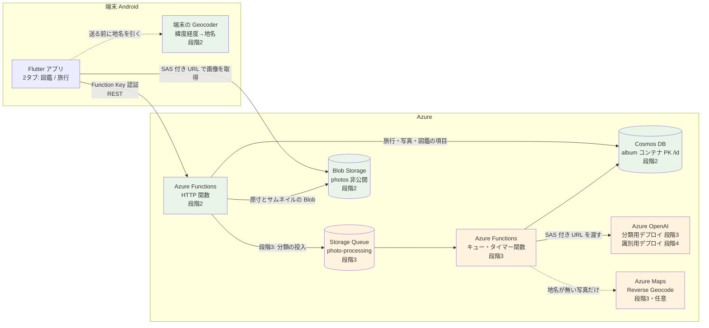

# 旅行アルバム 設計概要

## この文書の位置づけ

旅行アルバム（[要件定義書](./01_requirements.md)）の設計の全体像を書く。
段階ごとに何を作るか、構成、既存の流用と新設、主な設計判断とその理由、人間に決めてもらう点、リスクをまとめ、
詳細は各設計書へ案内する。

**未実装を含む目指す姿を書く文書である。** `docs/01`〜`07` のような「実装の写し」ではない。
実装した部分は、そのときに `docs/01`〜`07` へ取り込む（要件定義書の「この文書の位置づけ」と同じ扱い）。
設計の中身は設計案第3版（2026-10-12、Fable）に従い、第3版に無い細部はこの一式で決めている。

「推奨」はすべて Claude の意見で、採否は人間が決める。推測は「推測」、実機や実環境での確認が要るものは「要実測」と明記する。
行番号は 2026-10-12 時点の `main`（e9d9ac7）。

| 文書 | 内容 |
|---|---|
| [01_requirements.md](./01_requirements.md) | 要件（正） |
| 02_design_overview.md（この文書） | 全体像・設計判断・決めてもらう点・リスク |
| [03_screen_design.md](./03_screen_design.md) | 画面設計（Flutter） |
| [04_data_design.md](./04_data_design.md) | データ設計（Cosmos DB・Blob・クエリ） |
| [05_api_design.md](./05_api_design.md) | API 設計（エンドポイント・契約・検証・冪等性） |
| [06_processing_design.md](./06_processing_design.md) | 裏の処理（キュー・分類・識別・地名変換・費用・植物図鑑の統合） |
| [07_infrastructure_design.md](./07_infrastructure_design.md) | インフラ（Terraform・host.json・CI/CD） |
| [08_test_plan.md](./08_test_plan.md) | テスト計画 |
| [09_implementation_plan.md](./09_implementation_plan.md) | 実装計画（PR 分割・Issue） |

---

## 1. 目的と範囲

要件定義書 §1・§4 の段階のうち、この設計一式が扱う範囲。

| 段階 | この一式での扱い | 主な成果物 |
|---|---|---|
| 0. 片付け | 対象外（`docs/09_backlog.md` の「Flutter が CI の対象外」など） | — |
| 1. 実機で確かめる | 完了（結果は `docs/09_backlog.md` の「段階1の結果」）。設計の前提として使う | — |
| **2. 旅行アルバム（AI なし）** | **実装できる粒度で書く** | `album` コンテナ、`photos` コンテナ、旅行・写真の API、Flutter の2タブ・旅行・写真・送信キュー |
| 3. 大分類 | 骨格 | Storage Queue とワーカー、分類器、タグ横断、やり直し |
| 4. 詳しい識別と図鑑 | 骨格 | 定義表 `CATALOG_KINDS`、識別器、図鑑の API と画面、植物図鑑の統合と廃止 |
| 5. 旅行の自動まとめ | 段階2の設計で困らないことの確認だけ（§8） | — |
| 6. 自動アップロード | 同上 | — |

段階2で**作らない**もの（構造だけ用意する）: タグを付ける画面（要件 5.1・5.4「構造は段階2」）、
写真のコメント（要件 5.5.1、画面は段階4）、地名の裏での埋め直し（段階3・任意）。

## 2. 構成

既存の植物図鑑（`plants` コンテナ・公開の `images` コンテナ・`POST /api/images/upload`）は段階2・3では**このまま並存**し、
段階4で `album` に統合して廃止する（要件 5.8、[06 §7](./06_processing_design.md#7-今の植物図鑑の統合と廃止段階4)）。

## 3. 既存の流用と新設

| 既存の仕組み | 扱い | 根拠・参照 |
|---|---|---|
| レスポンスの封筒と契約（`api/src/utils/response.ts`。`details` は契約外） | そのまま流用。`ErrorCode`（`api/src/types/api.ts` 30〜41行）に `TRIP_NOT_FOUND`・`PHOTO_NOT_FOUND`、段階4で `ENTRY_NOT_FOUND` を足す | `ApiException.fromResponse()`（`mobile/lib/services/api_service.dart` 454行）が封筒を前提にしている |
| `createNotFoundError()`（`response.ts` 97〜103行、`PLANT_NOT_FOUND` 固定） | 第2引数で `code` を取れるように拡張（既定は今のまま） | 既存の呼び出しを変えない |
| `UpstreamError` と 502 / 503 の分類（`utils/errors.ts`、`createUpstreamErrorResponse()`） | 流用。`PhotoStorageService` と Storage Queue は `'storage'`、分類器・識別器は `'ai'`。段階3で Azure Maps を入れるなら `UpstreamService` に `'geocoding'` を足す | 「どこで失敗したか」で分類する方針（CLAUDE.md「レスポンス規約」） |
| Cosmos DB 側の 503 判定（6箇所に複製。`docs/09_backlog.md`） | 新ハンドラは `hasCauseCode()` を使う述語 `isConnectivityError()` を1つ作って使う。既存6箇所の置き換えは別作業 | 7箇所目を作らない |
| Function Key 認証、`app.ts` の import 登録 | 流用。**新しい関数ファイルは `app.ts` に import を足す** | CLAUDE.md「関数の登録経路」 |
| `container.item(id, id)` の形（`api/src/services/cosmosService.ts` 42行） | そのまま流用。`album` も PK `/id` | [04 §1](./04_data_design.md#1-cosmos-db) |
| `StorageService` の URL 検証（4条件）と削除の二層防御 | **設計で不要にする。** 写真 API は URL を受け取らず Blob 名を保存し、URL はサーバが応答のたびに組み立てる | [05 §6](./05_api_design.md#6-sas-付き-url) |
| `StorageService` の SAS 生成（`storageService.ts` 244〜286行） | `utils/blobSas.ts` に切り出して流用。`generateTempSasUrl()` はそれを呼ぶ薄い包みにする | AI 用の一時 URL と写真の表示 URL は同じ仕組み |
| `upload.ts` の一時→AI→永続 | 段階2では使わない。段階3・4で「AI に非公開 Blob を SAS で読ませる」部分だけ流用。段階4で廃止 | [06 §7](./06_processing_design.md#7-今の植物図鑑の統合と廃止段階4) |
| `OpenAIVisionService`（`services/openAIVisionService.ts`） | 段階3で、デプロイ名・スキーマ・プロンプトを引数で受ける形に小さく一般化。`identifyPlant()` と `PLANT_IDENTIFICATION_SCHEMA`（15〜84行）は段階4で定義表から生成するスキーマに置き換え、廃止と同時に消す | strict モードの罠（同ファイル 5〜14行）を踏み直さない |
| `contextInfo` の検証（`identify.ts` 40〜48行、`upload.ts` 76〜85行）と埋め込み（`openAIVisionService.ts` 137〜141行）、`CONTEXT_INFO_VALIDATION`（`constants/validation.ts` 95〜102行） | やり直しの `hint` にそのまま流用（同じ定数・同じ `message`） | 要件 5.5.1 |
| バリデーション定数（`positiveIntFromEnv()`、`UUID_REGEX`） | 流用。`TRIP_VALIDATION` / `PHOTO_VALIDATION` / `MOVE_VALIDATION` / `TAG_VALIDATION` を同じ形で追加 | [05 §4](./05_api_design.md#4-入力検証の定数) |
| テスト用の Cosmos・Blob の差し替え部品（`api/tests/fakes/`） | 流用・拡張（`@type`・`@tripId`・`@tag`・`@entryId` の絞り込み、同じ id の `create` で 409、`item().patch()`） | [08 §2](./08_test_plan.md#2-偽物の拡張) |
| Flutter の `ApiService` + `MockClient`、`detectImageMimeType()`、`cached_network_image`、`SettingsService`、`setState` | 流用。`ApiService` は根（`AppRoot`）で1つ作って各画面に渡す | CLAUDE.md「実装の慣習」の Flutter の構成方針 |
| Terraform の書き方、CI/CD | 流用 | [07](./07_infrastructure_design.md) |

新しく作るもの（段階2）: Cosmos の `album` コンテナと `AlbumService`、Blob の `photos` コンテナと `PhotoStorageService`、
旅行・写真の HTTP 関数（`trips.ts`・`tripDetail.ts`・`photos.ts`・`photoDetail.ts`・`photoMove.ts`）、`types/album.ts`、
`constants/tags.ts`、Flutter の `AppRoot`・`HomeShell`・旅行一覧・旅行詳細・旅行に属さない写真・写真ビューア・
`PhotoGrid`（複数選択）・`UploadQueue`・EXIF / SHA-256 / サムネイル / 地名の読み取り。
段階3: Storage Queue とワーカー、`PhotoClassifierService`、タグ横断画面。段階4: `catalog/kinds.ts`、`PhotoIdentifierService`、図鑑の API と画面、移行スクリプト。

## 4. 主な設計判断とその理由

要件番号は要件定義書のもの。詳しい比較表は各設計書にある。

### 4.1 `album` を1コンテナ追加し、PK は `/id`、写真の id は中身の SHA-256（要件 5.1.1・5.2）

| 判断 | 理由 |
|---|---|
| 旅行・写真・図鑑の項目を `type` で区別して1つの `album` コンテナに置く | コンテナを増やすと無料枠（推測 1000 RU/s。§5）を段階4の移行中に超えうる。`plants` 400 + `album` 400 = 800 なら枠内 |
| PK は `/id` | 写真が旅行をまたいで移動する（要件 5.1.1・5.2 ③）。PK を `/tripId` にすると移動がパーティション横断になり原子性が無い。`/id` なら移動は同じパーティション内の Patch 1回。既存の `container.item(id, id)` の形がそのまま使える |
| 写真の id = 画像バイト列の SHA-256（16進 64 文字） | 「クライアントが振る id による冪等性」と「同じ中身は1枚」（要件 5.2）が1つの仕組みに畳まれる。サーバは受け取ったバイト列のハッシュを計算し直して照合するので id を偽れない。PK `/id` では一意キーが張れないが、id 自体が中身から決まるので `create` の 409 で DB が保証する |
| 旅行に属さない写真は `tripId: null`（予約済みの「受信箱」旅行は作らない） | 受信箱を旅行にすると、旅行一覧・削除・集計のすべてで特別扱いが要る。`IS_NULL(c.tripId)` で絞れる |

弱点と対処は §6（ハッシュの決定性、パーティション横断の一覧、`tripId` の書き忘れ）。

### 4.2 タグは `string[]`、AI のカテゴリは `category:<kind>` の予約名（要件 5.1・5.4）

旅行・写真の両方に `tags: string[]` を段階2から持たせる（構造だけ。画面は後）。
平らな文字列の配列にするのは、新しいタグが文字列1つで足り、`ARRAY_CONTAINS(c.tags, @tag)` で絞り込め、
クライアントも `List<String>` で済むから。「誰が付けたか」は名前の規約（`category:` 接頭辞）で表し、
確信度やモデル名は `classification` に別に持つ。詳細は [04 §2](./04_data_design.md#2-タグの規約)。

### 4.3 図鑑の項目は `album` の `type: "entry"`、id は（種類, 名前）から決定的に作る（要件 5.5）

`kind` は図鑑の種類（`plant`＝植物・`food`＝食べ物・`landscape`＝風景。定義表 `CATALOG_KINDS` の1行が1種類）。
項目の id は `"<kind>-" + sha256(name.trim())` で、「同じ種類・同じ名前は1件」を `create` の 409 で DB に保証させる（写真と同じ仕組み）。
頭に `kind` を付けるのは、同じ名前が別の種類で現れうるため（例: 畑のメロンは植物、皿のメロンは食べ物）。名前をハッシュにするのは、
Cosmos の id に使えない文字（`/`・`?` など）を避け、長さをそろえるため。

別コンテナ `catalog`（PK は種類、名前に一意キー）という案もあったが、コンテナが増えると無料枠（1000 RU/s と思われる）を
植物図鑑の移行中に超えうるので、`album` に置く。

id に種類と名前が入るので、**項目の種類や名前はその場で書き換えられない**。変えるときは「新しい項目を作る（同じ種類・名前の項目が
既にあればそこへまとめる）→ 写真の `entryId` を付け替える → 写真が0枚になった古い項目を消す」になる。種類が変わるのは主に写真の
解析のやり直し（要件 5.5.1）のときで、そのときは写真ごとに付け替わるので自然にこの形になる。手順は [04 §3.3](./04_data_design.md#33-項目の種類や名前を変えるとき)。種類と項目は `api/src/catalog/kinds.ts` の定義表 `CATALOG_KINDS` 1か所に持ち、
分類 AI の選択肢・識別 AI のスキーマ・`GET /api/catalog/kinds`・Flutter の表示が追従する
（要件 5.5「項目も種類も後から増やせる」）。詳細は [04 §3](./04_data_design.md#3-図鑑の項目と定義表段階4)。

### 4.4 名前は AI が確定し、第2候補以降は残さない（要件 5.5）

識別のスキーマから `candidates` を外し、`name`・`confidence`（0〜100）・`comment` の1件にする。
命名規則は種類ごとに定義表の `namingRule` に持つ。[06 §3](./06_processing_design.md#3-識別段階4)。

### 4.5 コメントの修正と AI のやり直しは `PATCH` と `process`（要件 5.5.1）

`PATCH /api/photos/{photoId}` でコメントとタグを直し、`POST /api/photos/{photoId}/process { step, hint }` でやり直す。
`hint` は `contextInfo` の検証と埋め込みをそのまま流用する。やり直しの結果はコメントを上書きする（利用者が明示的に頼んだ操作で、
手がかりは `hint` として残るから）。[05 §5.6](./05_api_design.md#56-patch-apiphotosphotoid)・[05 §5.7](./05_api_design.md#57-post-apiphotosphotoidprocess段階3)。

### 4.6 画像は最初から非公開、URL はサーバが組み立てる（要件 §6 公開範囲）

`photos` コンテナは `private`。一覧・詳細の応答に Blob 単位の読み取り SAS 付き URL（60分）を埋め、
クライアントから URL を受け取らない。保存するのは Blob 名だけなので、既存の `imagePath` の4条件の検証と削除の二層防御は要らない。
[05 §6](./05_api_design.md#6-sas-付き-url)。

### 4.7 送り方は1リクエスト1枚、クライアントが同時2本まで（要件 5.2）

1リクエストに複数枚を詰めると、途中で落ちたときにどこまで届いたか分からず、413 の上限にも当たる。
1枚ずつなら各リクエストが冪等で、失敗した1枚だけ送り直せる。[03 §4.7](./03_screen_design.md#47-写真の追加と送信の進み具合)。

### 4.8 地名は段階2で端末の Geocoder、段階3で Azure Maps は任意（要件 5.3、§8 未決の論点）

端末の Geocoder は 0 円で API キーも要らない。足りなければ（要実測）段階3で Azure Maps を「地名が無い写真だけ裏で埋める」補助として足す。
[06 §4](./06_processing_design.md#4-地名への変換)。

### 4.9 この一式で第3版から独自に決めた細部

第3版に無く、既存の実装と仕様書の流儀に合わせて決めたもの。採否は人間が決める。

| 項目 | 決めたこと | 理由 | 参照 |
|---|---|---|---|
| 撮影日時順の並べ方 | Cosmos の `ORDER BY` ではなく、取得後にサーバの中で並べる（`takenAt` 昇順、null は末尾、同値は `uploadedAt` 昇順） | Cosmos の `ORDER BY` は null を先頭に置き、項目が無いドキュメントを結果から**外す**（推測。要確認）。「null は末尾」を SQL で書くと2クエリになる。1旅行数百枚ならメモリで並べて困らない | [04 §5.3](./04_data_design.md#53-旅行の写真一覧) |
| 旅行一覧の集計 | 写真の射影を1クエリで取り、枚数・期間・表紙をサーバの中で集計する（`GROUP BY` は代案） | 表紙（最初の写真のサムネイル）は `GROUP BY` では取れず、別クエリが要る。1クエリに畳める | [04 §5.1](./04_data_design.md#51-旅行一覧) |
| `takenAtSource` | リクエストでは受け取らず、サーバが `takenAt` の有無から `exif` / `none` を入れる | 段階2の出どころは EXIF だけ。項目はドキュメントに残し、段階6で出どころが増えたら受け取る | [05 §5.1](./05_api_design.md#51-post-apiphotos) |
| 写真 id の表記 | 小文字の16進のみ | Blob 名と id の文字列比較を単純にする。Dart の `crypto` も小文字を返す | [05 §4](./05_api_design.md#4-入力検証の定数) |
| 単一の写真の応答 | `{ photo, urlExpiresAt }`（第3版は `{ photo }`） | 一覧と同じく、クライアントが URL の期限を知る必要がある | [05 §5.3](./05_api_design.md#53-get-apiphotosphotoid) |
| 応答から外す項目 | `blobName`・`thumbnailBlobName` と Cosmos のシステム項目（`_rid` など） | クライアントは URL だけを使う。Blob 名は内部の都合 | [05 §3](./05_api_design.md#3-データモデル) |
| 旅行の更新 | `PUT` は `name`（必須）と `description`（任意）の全体置き換え | 作成と同じ検証を使い回す。段階2で直せるのはこの2つだけ | [05 §5.11](./05_api_design.md#511-put-apitripstripid) |
| 旅行の削除の順序 | 写真（ドキュメント→Blob）を先に消し、最後に旅行を消す | 途中で落ちても「写真が減った旅行」が残るだけで、再実行で続きができる。逆順だと存在しない旅行を指す写真が残る | [05 §5.12](./05_api_design.md#512-delete-apitripstripid) |
| 旅行に属さない写真の絞り込み | 旅行ありは `c.tripId = @tripId`、未所属は `IS_NULL(c.tripId)` の2本の SQL に分ける | `c.tripId = null` は Cosmos SQL では偽になるので、未所属は `IS_NULL` で書く。2本に分けた方がそれぞれの意味が素直に読める | [04 §5.3](./04_data_design.md#53-旅行の写真一覧) |
| キューへの投入 | 出力バインディングではなく `@azure/storage-queue` の `QueueClient` を直接使う | 投入の失敗を握って応答を変えない、という制御をコードで書ける（出力バインディングは関数の戻り値で送るので、失敗時の扱いを制御しにくい）。`dependencies` に置く（`devDependencies` だと本番で読み込めない。CLAUDE.md「CI/CD」） | [06 §1](./06_processing_design.md#1-キューとワーカー段階3) |
| 画面の文言・エラーの `message`・上限値 | [03](./03_screen_design.md)・[05](./05_api_design.md) に列挙 | 既存の文言（`植物IDの形式が無効です` など）と同じ型で作った | — |

## 5. 人間に決めてもらう点（推奨付き）

第3版 §9 の14点に、§4.9 の細部を足したもの。**決めたら、この表の該当行に結論を書き、推奨の文を消す**
（`docs/09_backlog.md` の運用と同じ）。

| # | 論点 | 推奨 |
|---|---|---|
| 1 | `album` 1コンテナ・PK `/id`・写真の id = SHA-256 | する。無料枠はポータルで確認する |
| 2 | 重複防止の範囲を全体にする | する。写真が旅行を移るので旅行ごとは意味が無い |
| 3 | 旅行に属さない写真は `tripId: null`（受信箱の旅行は作らない） | する |
| 4 | `tripId` 付きで再送した既存の写真は旅行を変えない | する。送信は「入れる」ではなく「送る」。入れたければ move |
| 5 | タグは `string[]` + `category:` 接頭辞 | する |
| 6 | 図鑑の項目は `album` の `type: "entry"`、id は（種類, 名前）から | する |
| 7 | 名前の正規化に NFKC を入れるか（当面 `trim()` のみ） | 当面入れない。要件 §8「当面は名前の完全一致」 |
| 8 | 項目の説明・属性は信頼度が最も高い識別で更新する | する。代案は「最初のものを固定」 |
| 9 | やり直しは利用者のコメントを上書きし、やり直し画面に事前入力する | する |
| 10 | 地名は段階2で端末の Geocoder、段階3で Azure Maps は任意 | する。Geocoder が使えなければ Azure Maps を段階3に繰り上げる |
| 11 | 旅行一覧の並びは `createdAt` 降順 | 推奨どおり（`lastTakenAt` 降順にしたければ変えてよい） |
| 12 | move の1回の上限 200 件（環境変数） | する |
| 13 | 第3版から変更なし: Blob 名を平坦に、`takenAt` は TZ 無し、サムネイルはクライアント、SAS 60 分、1リクエスト1枚・同時2本、EXIF はクライアント、状態管理、2タブ、ライフサイクル同梱、旅行削除は写真も、Storage Queue、GPS の EXIF は削らない、`images` の公開を段階4まで許容、Flex 移行は後 | 推奨どおり |
| 14 | 段階4の `Plant` の契約変更 | 不要（`plants` を廃止して移行するため） |
| 15 | §4.9 の細部（並べ方・集計・`takenAtSource`・id の表記・応答の形・削除の順序・SQL の形・キューの投入） | 推奨どおり |
| 16 | 画面の文言・`message`・上限値（[03](./03_screen_design.md)・[05](./05_api_design.md)） | 推奨どおり。変えるなら実装前に |
| 17 | 分類に使うモデル（安価なデプロイ）と、1日あたりの AI 呼び出しの上限値 | 段階3の着手時に価格表を見て決める。[06 §6](./06_processing_design.md#6-費用の見積もり方と上限) |
| 18 | **図鑑の項目を文書として持つか（検討中。段階4の前に決める）** | 下の2案。メインセッションは B を推す。人間が検討中 |

**18 の2案**（2026-10-12 の議論。段階2の設計には影響しない）:

| | A. 項目の文書を持つ（この一式の設計） | B. 項目の文書を持たず、写真から毎回まとめる |
|---|---|---|
| 持ち方 | `type: "entry"` の文書に名前・説明・属性を保存し、写真は `entryId` で指す | 識別の結果（種類・名前・属性・信頼度）は写真の中にだけ持つ。図鑑は写真を「種類と名前」でまとめて表示する |
| 写真をやり直して別の項目になったとき | 項目を探す・作る、写真を付け替える、0枚になった項目を消す（[04 §3.3](./04_data_design.md#33-項目の種類や名前を変えるとき)） | 写真の識別結果を書き換えるだけ |
| 項目の説明・属性 | 項目に保存する。どの写真の結果を使うかの決まりが要る | 表示のときに、その名前の写真のうち信頼度が最も高いものから取る |
| 図鑑を開くとき | 項目を読むだけ | 写真をまとめる計算をする（個人の規模なら問題ないと思われる） |
| 苦手なこと | 種類や名前の変更が作り直しになる | 項目そのものにコメントやお気に入りを付けたくなったら、そのときに項目の文書を足す |

## 6. リスク

| リスク | 影響 | 対処 |
|---|---|---|
| ハッシュの非決定性（`image_picker` の縮小が同じ写真に毎回同じバイト列を返すか。**要実測**） | 同じ写真が2枚入る（データは壊れない） | 段階2の最初の実機確認で「同じ写真を2回選んで `photoId` が一致するか」を見る。一致しなければ縮小なし（段階1の B で EXIF は残る）に切り替える |
| 無料枠の上限（推測 1000 RU/s をポータルで確認） | `album` を足すと課金される | PR 1（インフラ）の前にポータルで確認する |
| move 300 件で 400 RU/s を超えて Cosmos の 429 | SDK の再試行で吸収されるが、関数の 5 分に収まるか**要実測** | 上限 200 件、クライアントは 200 件ずつ分けて送る |
| 端末の Geocoder の可用性と精度（**要実測**） | 地名が出ない | `placeName: null` で送り、緯度・経度を表示する。段階3で Azure Maps |
| `IS_NULL(c.tripId)` は `tripId` を書き忘れると静かに外れる | 未所属の一覧から消える | `AlbumService.createPhoto()` で必ず `null` を入れ、テストで固定する |
| `/api/photos/move` と `/api/photos/{photoId}` のルートの優先順（推測。デプロイ後に手で確認） | move が 400 になる | メソッドが違う（POST と GET/DELETE/PATCH）うえ、リテラルは変数より優先されるはず。ダメなら `/api/photo-moves` に変える |
| SAS 生成の切り出しが既存の `upload` に触る | 既存の 502 / 503 の分類が崩れる | `/code-review high` と `test-reviewer`。`storageService.test.ts` が通ることを完了条件にする |
| Cosmos の `ORDER BY` と null / 欠損の扱い、パラメータへの `IS_NULL`（推測） | 一覧から写真が消える | サーバの中で並べる（§4.9）。SQL はデプロイ後に手で確認する |
| 従量課金の 429、SAS の時計のずれ、ライフサイクルの接頭辞の付け忘れ、Cosmos のクエリ（絞り込み・並び順・射影）は単体テストで検証できない、送信キューがメモリだけ、Terraform state が作業マシンにしか無い | 既存と同じ | それぞれ [05 §6](./05_api_design.md#6-sas-付き-url)・[07](./07_infrastructure_design.md)・[08 §5](./08_test_plan.md#5-単体テストで確かめられず手で確かめる項目) |

## 7. 既存の不具合との関係（`docs/09_backlog.md`）

| 既存の不具合 | 旅行アルバムでの扱い |
|---|---|
| `upload` で AI の呼び出しが例外で失敗すると一時 Blob が残る | 引き継がない（段階2は一時保存を使わない）。既存側は PR 1 の `temp-images` のライフサイクルで軽減し、段階4で `upload.ts` ごと消える |
| 識別結果で保存しなかった画像が永続コンテナに残る | 引き継がない。送った写真はすべてアルバムに残す（要件 5.2） |
| `save` の重複チェックが read-then-write で同時リクエストに効かない | 引き継がない。id を中身から決めることで、一意キー無しでも `create` の 409 で DB が保証する |
| UUID の生成方法が2つある | 新コードは `uuid` パッケージ。サーバで振るのは旅行の id だけ |
| 接続障害の判定が6箇所に複製 | 新ハンドラは `isConnectivityError()` を使う。既存6箇所の置き換えは別作業 |
| `ETIMEDOUT` の分類のずれ | `isConnectivityError()` の集合に `ETIMEDOUT` を含めるかは、既存の判断（バックログ）に合わせる。新ハンドラだけ違う集合にしない |
| Cosmos のシステム項目が応答に含まれる可能性 | 新しい API は応答に出す項目を明示的に詰め替える（[05 §3](./05_api_design.md#3-データモデル)） |
| `host.json` の `http` がトップレベルにある | 段階3で `extensions.queues` を足すときに `extensions.http` へ直す（[07 §4](./07_infrastructure_design.md#4-hostjson-の変更)） |
| azurerm v5 で `images` が非公開になる懸念 | 段階4で `images` を消せば消える。それまでに v5 へ上げるなら `allow_nested_items_to_be_public = true` を明示 |
| `updatePlant` の 404 / 409 の順序 | 段階4で植物専用の関数が消える。直すなら段階4より前に価値があるかで判断 |
| Application Insights へのマスキングが無い | 新ハンドラのログは `photoId`・`tripId`・件数だけにし、`placeName`・`comment`・`hint`・ファイル名は出さない |
| Flutter が CI の対象外 | `mobile/` の PR はマージ前に `flutter analyze` / `flutter test` を通す（CLAUDE.md「PR の粒度」）。段階0で CI に入れるのが先 |

## 8. 段階5・6への備え

- **段階5（旅行の自動まとめ）**: `takenAt` と `location` を持つ写真を横断して読める（`GET /api/photos?tripId=none`、将来は期間の絞り込みを足す）。
  提案の適用は `POST /api/photos/move` をそのまま使う。旅行の自動作成は `POST /api/trips` → move の2手
- **段階6（自動アップロード）**: `photo_manager` から読んだ元ファイルのハッシュは決定的（縮小を挟まない）。
  クライアントが「送った `photoId` の集合」を端末に持てば、送る前に重複を省ける。サーバ側は同じ `POST /api/photos`（`tripId` 無し）で冪等。
  送信キューの永続化（要件 5.7）はこの段階
- **共有・ログイン（未定）**: 画像が最初から非公開で、URL を保存していないので、SAS の発行者が変わるだけで済む

## 実装の起点になるファイル

| ファイル | 役割 |
|---|---|
| `api/src/services/openAIVisionService.ts` | スキーマ・`contextSection`・命名規則の一般化の起点（段階3・4） |
| `api/src/services/storageService.ts` | SAS 生成の切り出し元（PR 2） |
| `api/tests/fakes/cosmos.ts` | 拡張の対象（PR 2） |
| `api/src/constants/validation.ts` | `CONTEXT_INFO_VALIDATION` の流用元、新しい検証定数の追加先 |
| `infrastructure/main.tf` | コンテナ・キュー・デプロイの追加先 |
| `mobile/lib/screens/plant_list_screen.dart` | `ApiService` を根から受け取る形に変える起点（PR 5） |
