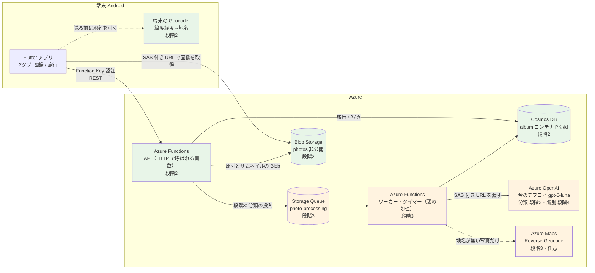

# 旅行アルバム 設計概要

## この文書の位置づけ

旅行アルバム（[要件定義書](./01_requirements.md)）の設計の全体像を書く。
段階ごとに何を作るか、構成、既存の流用と新設、主な設計判断とその理由、人間に決めてもらう点、リスクをまとめ、
詳細は各設計書へ案内する。

**未実装を含む目指す姿を書く文書である。** `docs/01`〜`07` のような「実装の写し」ではない。
実装した部分は `docs/01`〜`07` へ取り込む（開発中はこの一式を正として都度直し、取り込みは機能が固まってから後でまとめて行う。2026-10-12 に人間が決定）。
設計の中身は設計案第3版（2026-10-12、Fable）に従い、第3版に無い細部はこの一式で決めている。
2026-10-12 の人間のレビューで、撮影日時順の並べ方（`sortAt` とページング）・集計（`GROUP BY`）・旅行の削除（写真をどうするか選ぶ）・識別の失敗の上限・
AI の書き込みの方針（担当の欄だけの Patch、カウンタ無し）・カテゴリの専用の欄を改めた（§4.9・§5）。
同日の2回目のレビューで、分類のモデル（当面は今のデプロイ）・整合性の細部（未所属は `IS_NULL(c.tripId)` だけ、旅行の削除の最後の見直しは無し）・
旅行の削除のダイアログ・`sortAt` の揃え方・図鑑のまとめ方が決まり、図鑑の API の形と写真一覧の `total` の扱いは後の段階で決めることにした（§5 #17・#19・#20・#23・#25〜#28）。

「推奨」はすべて Claude の意見で、採否は人間が決める。推測は「推測」、実機や実環境での確認が要るものは「要実測」と明記する。
行番号は 2026-10-12 時点の `main`（e9d9ac7）。

| 文書 | 内容 |
|---|---|
| [01_requirements.md](./01_requirements.md) | 要件（正） |
| 02_design_overview.md（この文書） | 全体像・設計判断・決めてもらう点・リスク |
| [03_screen_design.md](./03_screen_design.md) | 画面設計（Flutter） |
| [04_data_design.md](./04_data_design.md) | データ設計（Cosmos DB・Blob・クエリ） |
| [05_api_design.md](./05_api_design.md) | API 設計（エンドポイント・契約・検証・冪等性） |
| [06_processing_design.md](./06_processing_design.md) | 裏の処理（キュー・分類・識別・地名変換・費用・植物図鑑の統合） |
| [07_infrastructure_design.md](./07_infrastructure_design.md) | インフラ（Terraform・host.json・CI/CD） |
| [08_test_plan.md](./08_test_plan.md) | テスト計画 |
| [09_implementation_plan.md](./09_implementation_plan.md) | 実装計画（PR 分割・Issue） |

---

## 1. 目的と範囲

要件定義書 §1・§4 の段階のうち、この設計一式が扱う範囲。

| 段階 | この一式での扱い | 主な成果物 |
|---|---|---|
| 0. 片付け | 対象外（`docs/09_backlog.md` の「Flutter が CI の対象外」など） | — |
| 1. 実機で確かめる | 完了（結果は `docs/09_backlog.md` の「段階1の結果」）。設計の前提として使う | — |
| **2. 旅行アルバム（AI なし）** | **実装できる粒度で書く** | Cosmos DB の `album` コンテナ（旅行・写真の情報）、Blob Storage の `photos` コンテナ（画像ファイル）、旅行・写真の API、Flutter の2タブ・旅行・写真・送信キュー |
| 3. 大分類 | 骨格 | Storage Queue とワーカー、分類器、カテゴリ横断、やり直し、掃除のタイマー |
| 4. 詳しい識別と図鑑 | 骨格 | 定義表 `CATALOG_KINDS`、識別器、図鑑の API と画面（写真からまとめる）、植物図鑑の統合と廃止 |
| 5. 旅行の自動まとめ | 段階2の設計で困らないことの確認だけ（§8） | — |
| 6. 自動アップロード | 同上 | — |

段階2で**作らない**もの（構造だけ用意する）: タグを付ける画面（要件 5.1・5.4「構造は段階2」）、
写真のコメント（要件 5.5.1、画面は段階4）、地名の裏での埋め直し（段階3・任意）。

## 2. 構成

Azure Functions で動くものは3種類あり、どれも同じ Function App（Azure 上の1つのアプリ。今の植物図鑑の API と同じもの）の中で動く。

| 呼び方 | 何か | 段階 |
|---|---|---|
| API | アプリから HTTP で呼ばれる関数（HTTP トリガー）。今の `api/src/functions/` の関数と同じ種類 | 2 |
| ワーカー | キューにたまった依頼（分類・識別）を1件ずつ処理する関数（キュー トリガー） | 3 |
| タイマー | 決まった間隔で動く関数（タイマー トリガー）。止まった処理の拾い直しと掃除 | 3 |

既存の植物図鑑（`plants` コンテナ・公開の `images` コンテナ・`POST /api/images/upload`）は段階2・3では**このまま並存**し、
段階4で `album` に統合して廃止する（要件 5.8、[06 §7](./06_processing_design.md#7-今の植物図鑑の統合と廃止段階4)）。

## 3. 既存の流用と新設

| 既存の仕組み | 扱い | 根拠・参照 |
|---|---|---|
| レスポンスの封筒と契約（`api/src/utils/response.ts`。`details` は契約外） | そのまま流用。`ErrorCode`（`api/src/types/api.ts` 30〜41行）に `TRIP_NOT_FOUND`・`PHOTO_NOT_FOUND` を足す（図鑑の項目は文書ではないので `ENTRY_NOT_FOUND` は置かない） | `ApiException.fromResponse()`（`mobile/lib/services/api_service.dart` 454行）が封筒を前提にしている |
| `createNotFoundError()`（`utils/response.ts`。もとは `PLANT_NOT_FOUND` 固定） | 第2引数で `code` を取る形に拡張した。**`code` は必須で既定値を置かない**。既存の呼び出し（`plantDetail.ts`）は `PLANT_NOT_FOUND` を明示して渡す（実装済み。PR 2） | 既定値を置くと、旅行や写真の 404 で渡し忘れたときに植物のコードが返り、クライアントの分岐を誤らせる |
| `UpstreamError` と 502 / 503 の分類（`utils/errors.ts`、`createUpstreamErrorResponse()`） | 流用。`PhotoStorageService` と Storage Queue は `'storage'`、分類器・識別器は `'ai'`。段階3で Azure Maps を入れるなら `UpstreamService` に `'geocoding'` を足す | 「どこで失敗したか」で分類する方針（CLAUDE.md「レスポンス規約」） |
| Cosmos DB 側の 503 判定（6箇所に複製。`docs/09_backlog.md`） | 新ハンドラは `hasCauseCode()` を使う述語 `isConnectivityError()` を1つ作って使う。既存6箇所の置き換えは別作業 | 7箇所目を作らない |
| Function Key 認証、`app.ts` の import 登録 | 流用。**新しい関数ファイルは `app.ts` に import を足す** | CLAUDE.md「関数の登録経路」 |
| `container.item(id, id)` の形（`api/src/services/cosmosService.ts` 42行） | そのまま流用。`album` も PK `/id` | [04 §1](./04_data_design.md#1-cosmos-db) |
| `StorageService` の URL 検証（4条件）と削除の二層防御 | **設計で不要にする。** 写真 API は URL を受け取らず Blob 名を保存し、URL はサーバが応答のたびに組み立てる | [05 §6](./05_api_design.md#6-sas-付き-url) |
| `StorageService` の SAS 生成（`storageService.ts` 244〜286行） | `utils/blobSas.ts` に切り出して流用。`generateTempSasUrl()` はそれを呼ぶ薄い包みにする | AI 用の一時 URL と写真の表示 URL は同じ仕組み |
| `upload.ts` の一時→AI→永続 | 段階2では使わない。段階3・4で「AI に非公開 Blob を SAS で読ませる」部分だけ流用。段階4で廃止 | [06 §7](./06_processing_design.md#7-今の植物図鑑の統合と廃止段階4) |
| `OpenAIVisionService`（`services/openAIVisionService.ts`） | 段階3で小さく一般化（実装済み）。送り先のデプロイはコンストラクタの引数で決め、`analyze()` はスキーマ・プロンプト・画像だけを受ける（[06 §2.1](./06_processing_design.md#21-モデルとサービス)）。`identifyPlant()` と `PLANT_IDENTIFICATION_SCHEMA`（15〜84行）は段階4で定義表から生成するスキーマに置き換え、廃止と同時に消す | strict モードの罠（同ファイル 5〜14行）を踏み直さない |
| `contextInfo` の検証（`identify.ts` 40〜48行、`upload.ts` 76〜85行）と埋め込み（`openAIVisionService.ts` の `plantIdentificationPrompt()` の `contextSection`）、`CONTEXT_INFO_VALIDATION`（`constants/validation.ts` 95〜102行） | やり直しの `hint` にそのまま流用（同じ定数・同じ `message`） | 要件 5.5.1 |
| バリデーション定数（`positiveIntFromEnv()`、`UUID_REGEX`） | 流用。`TRIP_VALIDATION` / `PHOTO_VALIDATION` / `MOVE_VALIDATION` / `TAG_VALIDATION` を同じ形で追加 | [05 §4](./05_api_design.md#4-入力検証の定数) |
| テスト用の Cosmos・Blob の差し替え部品（`api/tests/fakes/`） | 流用・拡張（`@type`・`@tripId`・`@category`・`@name`（植物の名前）の絞り込み。図鑑の `@kind`・`@entryName` では絞らない、`maxItemCount` と継続トークンのページ、同じ id の `create` で 409、`item().patch()` と `condition` 付き patch の 412）。集計（`GROUP BY`・`COUNT`・`TOP 1`）は解釈できないので、集計のクエリは差し替えられる層に分ける | [08 §2](./08_test_plan.md#2-テスト用の差し替え部品の拡張) |
| Flutter の `ApiService` + `MockClient`、`detectImageMimeType()`、`cached_network_image`、`SettingsService`、`setState` | 流用。`ApiService` は根（`AppRoot`）で1つ作って各画面に渡す | CLAUDE.md「実装の慣習」の Flutter の構成方針 |
| Terraform の書き方、CI/CD | 流用 | [07](./07_infrastructure_design.md) |

「コンテナ」は Cosmos DB と Blob Storage の両方で使う言葉で、別物である。Cosmos DB のコンテナは文書（旅行・写真の情報）の入れ物、
Blob Storage のコンテナはファイル（画像）の入れ物。段階2で足すのは Cosmos DB の `album` と Blob Storage の `photos` の1つずつで、
段階4で植物図鑑を統合したあとは、この2つだけが残る（Cosmos の `plants`、Blob の `images`・`temp-images` は消す）。

新しく作るもの（段階2）: Cosmos の `album` コンテナと `AlbumService`、Blob の `photos` コンテナと `PhotoStorageService`、
旅行・写真の API（Azure Functions の関数。`trips.ts`・`tripDetail.ts`・`photos.ts`・`photoDetail.ts`・`photoMove.ts`）、`types/album.ts`、
`constants/album.ts`、Flutter の `AppRoot`・`HomeShell`・旅行一覧・旅行詳細・旅行に属さない写真・写真ビューア・
`PhotoGrid`（複数選択・ページの続きの読み込み）・`UploadQueue`・EXIF / SHA-256 / サムネイル / 地名の読み取り。
段階3: Storage Queue とワーカー、再投入と掃除のタイマー、`catalog/kinds.ts`（段階3では分類の選択肢にだけ使う）、`PhotoClassifierService`、カテゴリ横断画面。段階4: `PhotoIdentifierService`、図鑑の API と画面、移行スクリプト。

## 4. 主な設計判断とその理由

要件番号は要件定義書のもの。詳しい比較表は各設計書にある。

### 4.1 `album` を1コンテナ追加し、PK は `/id`、写真の id は中身の SHA-256（要件 5.1.1・5.2）

| 判断 | 理由 |
|---|---|
| 旅行・写真を `type` で区別して1つの Cosmos DB の `album` コンテナに置く（図鑑の項目は文書として持たない。§4.3） | コンテナを増やすと無料枠（推測 1000 RU/s。§5）を段階4の移行中に超えうる。`plants` 400 + `album` 400 = 800 なら枠内 |
| PK は `/id` | 写真が旅行をまたいで移動する（要件 5.1.1・5.2 ③）。PK を `/tripId` にすると移動がパーティション横断になり原子性が無い。`/id` なら移動は同じパーティション内の Patch 1回。既存の `container.item(id, id)` の形がそのまま使える |
| 写真の id = 画像バイト列の SHA-256（16進 64 文字） | 「クライアントが振る id による冪等性」と「同じ中身は1枚」（要件 5.2）が1つの仕組みに畳まれる。サーバは受け取ったバイト列のハッシュを計算し直して照合するので id を偽れない。PK `/id` では一意キーが張れないが、id 自体が中身から決まるので `create` の 409 で DB が保証する |
| 旅行に属さない写真は `tripId: null` で表す（特別な旅行を作って入れておく形にしない） | 特別な旅行を作ると、旅行一覧・削除・集計のすべてで特別扱いが要る。`IS_NULL(c.tripId)` で絞れる |
| 並べ替え用の日時 `sortAt` を全写真に持たせ、一覧は `ORDER BY c.sortAt` と継続トークンでページで読む | 「サーバの中で並べる」は旅行の写真を全部読むことになり、規模が大きくなると困る（2026-10-12 のレビュー）。撮影日時が無い写真はアップロード日時（日本時間に直す）を使い、`null` の並びの問題が無くなる。[04 §1.3](./04_data_design.md#13-写真type-photo)・[04 §5.3](./04_data_design.md#53-旅行の写真一覧) |
| 旅行一覧の枚数・期間は `GROUP BY` で数え、表紙は旅行ごとに `TOP 1` で1枚だけ読む。図鑑も同じ形 | 同上。画面から呼ばれる API に「写真を全部読む」クエリを置かない。[04 §5.1](./04_data_design.md#51-旅行一覧)・[04 §3.1](./04_data_design.md#31-項目は写真からまとめる) |

弱点と対処は §6（ハッシュの決定性、パーティション横断の一覧、`tripId` の書き忘れ）。

### 4.2 カテゴリは専用の欄 `category`、タグ `string[]` は利用者のものだけ（要件 5.1・5.4）

**2026-10-12 に人間が決定。** AI が付ける大分類は写真の専用の欄 `category`（`plant` / `food` / `landscape` / `other`、分類前は `null`）に持ち、
`tags: string[]`（旅行・写真の両方に段階2から持たせる。構造だけで画面は後）は利用者が付けるもの（お気に入りなど）だけにする。
以前の案（`tags` に `category:<kind>` の予約名を混ぜる）は採らない。書く主体が欄で分かれるので、ワーカーと利用者が同じ配列を編集し合う処理が要らず、
横断は `c.category = @category` で引ける。確信度やモデル名は `classification` に別に持つ。詳細は [04 §2](./04_data_design.md#2-カテゴリとタグ)。

### 4.3 図鑑の項目は文書として持たず、写真の識別結果からまとめる（要件 5.5）

**2026-10-12 に人間が決定**（§5 #18 の案 B。案 A との比較はそこに記録として残す）。

`kind` は図鑑の種類（`plant`＝植物・`food`＝食べ物・`landscape`＝風景。定義表 `CATALOG_KINDS` の1行が1種類）。
識別の結果（`kind`・`name`・`confidence`・`description`・`characteristics`・`attributes`）は**写真の文書の `identification` の中にだけ**持ち、
図鑑の画面は写真を `identification.kind` と `identification.name` でまとめて作る。見出しの説明・属性・表紙は、その名前の写真のうち信頼度が最も高いものから取り、
枚数も写真を数えて出す。「同じ種類・同じ名前は1件」（要件 5.5）は、まとめる鍵が（種類, 名前）であることで成り立つ。
鍵に種類を含めるのは、同じ名前が別の種類で現れうるため（例: 畑のメロンは植物、皿のメロンは食べ物）。

| 利点 | 理由 |
|---|---|
| やり直しで種類や名前が変わっても、写真の `identification` を書き換えるだけ | 項目の作成・併合・付け替え・0枚になった項目の削除が無い。2つの文書を食い違わないよう保つ処理（§4.10）が1つ減る |
| 図鑑の項目の id・`ENTRY_NOT_FOUND`・項目の削除 API が要らない | 項目は `kind` と `name` で指定する。API の形（名前の渡し方、0枚のときの応答、ページの方式）は [05 §5.14](./05_api_design.md#514-図鑑段階4)（§5 #20。2026-10-18 に決定） |
| 植物図鑑の統合は `plants` の記録を写真に移すだけ | [06 §7](./06_processing_design.md#7-今の植物図鑑の統合と廃止段階4) |

**写真を全部読んでまとめる形はとらない**（2026-10-12 のレビューで、規模が大きくなると困ると判断）。
名前ごとの枚数は `GROUP BY` で数え、見出し（説明・属性・表紙）は項目ごとに `TOP 1` で1枚だけ読み、項目一覧は `offset` / `limit` で、項目の写真は継続トークンでページに分ける。
1ページを開く RU は写真の総数に依らない（1ページ 50 項目で 200〜400 RU。推測。[04 §3.1](./04_data_design.md#31-項目は写真からまとめる) の「規模の注意」）。
代償は、1ページを開くのに `limit` + 2 本のクエリを投げることと、2項目の `ORDER BY` に複合インデックスが要ること（[07 §3](./07_infrastructure_design.md#3-段階4)）。
それでも重くなったら「写真から作り直せるまとめの控え（キャッシュ）」を文書として足す。正は写真のままなので、**そのときもデータの移し替えは要らない**。

種類と項目は `api/src/catalog/kinds.ts` の定義表 `CATALOG_KINDS` 1か所に持ち、
分類 AI の選択肢・識別 AI のスキーマ・`GET /api/catalog/kinds`・Flutter の表示が追従する
（要件 5.5「項目も種類も後から増やせる」）。詳細は [04 §3](./04_data_design.md#3-図鑑の項目と定義表段階4)、やり直しで変わるときは [04 §3.3](./04_data_design.md#33-やり直しで種類や名前が変わったとき)。

### 4.4 名前は AI が確定し、第2候補以降は残さない（要件 5.5）

識別のスキーマから `candidates` を外し、`name`・`confidence`（0〜100）・`comment` の1件にする。
命名規則は種類ごとに定義表の `namingRule` に持つ。[06 §3](./06_processing_design.md#3-識別段階4)。

### 4.5 コメントの修正と AI のやり直しは `PATCH` と `process`（要件 5.5.1）

`PATCH /api/photos/{photoId}` でコメントとタグを直し、`POST /api/photos/{photoId}/process { step, hint }` でやり直す。
`hint` は `contextInfo` の検証と埋め込みをそのまま流用する。やり直しはコメントを上書きする（利用者が明示的に頼んだ操作で、
手がかりは `hint` として残るから）。上書きは受付の時点で行い（コメントを消す）、結果で置き換える。
送信直後の自動の解析は、利用者がその間に書いたコメントを消さない（ワーカーは「`commentSource` が `"user"` でなければ」の条件付き patch でコメントを書く。§4.10）。
「解析中」で利用者の更新を止めるロックは置かない（2026-10-12 に人間が決定。AI は担当の欄だけを部分更新する）。
[05 §5.6](./05_api_design.md#56-patch-apiphotosphotoid)・[05 §5.7](./05_api_design.md#57-post-apiphotosphotoidprocess段階3)・[06 §3.2](./06_processing_design.md#32-書き込み)。

### 4.6 画像は最初から非公開、URL はサーバが組み立てる（要件 §6 公開範囲）

Blob Storage の `photos` コンテナは `private`。一覧・詳細の応答に Blob 単位の読み取り SAS 付き URL（60分）を埋め、
クライアントから URL を受け取らない。保存するのは Blob 名だけなので、既存の `imagePath` の4条件の検証と削除の二層防御は要らない。
[05 §6](./05_api_design.md#6-sas-付き-url)。

### 4.7 送り方は1リクエスト1枚、クライアントが同時2本まで（要件 5.2）

1リクエストに複数枚を詰めると、途中で落ちたときにどこまで届いたか分からず、413 の上限にも当たる。
1枚ずつなら各リクエストが冪等で、失敗した1枚だけ送り直せる。[03 §4.7](./03_screen_design.md#47-写真の追加と送信の進み具合)。

### 4.8 地名は段階2で端末の Geocoder、段階3で Azure Maps は任意（要件 5.3、§8 未決の論点）

端末の Geocoder は 0 円で API キーも要らない。足りなければ（要実測）段階3で Azure Maps を「地名が無い写真だけ裏で埋める」補助として足す。
[06 §4](./06_processing_design.md#4-地名への変換)。

### 4.9 この一式で第3版から独自に決めた細部

第3版に無く、既存の実装と仕様書の流儀に合わせて決めたもの。採否は人間が決める。

| 項目 | 決めたこと | 理由 | 参照 |
|---|---|---|---|
| 撮影日時順の並べ方 | 全写真に並べ替え用の `sortAt`（`takenAt` があればそれ、無ければ `uploadedAt` を日本時間（UTC+9）に直した TZ 無しの文字列）を持たせ、`ORDER BY c.sortAt ASC` と継続トークンでページで読む（1ページ 100 枚、上限 200） | 以前の「取得後にサーバの中で並べる」は旅行の写真を全部読むため、規模が大きくなると困る（2026-10-12 のレビューで変更）。`sortAt` は必ずある文字列なので、`ORDER BY` の null の扱いを気にしなくてよい。撮影日時の無い写真はアップロード日時の位置に入る。`takenAt`（撮影地の時刻）と `uploadedAt`（UTC）は日本時間に揃える（利用者は日本在住） | [04 §1.3](./04_data_design.md#13-写真type-photo)・[04 §5.3](./04_data_design.md#53-旅行の写真一覧) |
| 旅行一覧の集計 | 枚数は `GROUP BY c.tripId` の `COUNT`、期間は `IS_STRING(c.takenAt)` で絞った `MIN` / `MAX`、表紙は旅行ごとに `TOP 1 … ORDER BY c.sortAt`。未所属の枚数も同じ `GROUP BY` から出し、`GET /api/trips` の `unassignedPhotoCount` で返す | 以前の「全写真の射影をサーバで集計」をやめた（同上）。`GROUP BY` の結果は旅行の数だけで小さい。表紙の `TOP 1` は旅行ごと（数十本）だが1本 数 RU | [04 §5.1](./04_data_design.md#51-旅行一覧) |
| 写真一覧の `total` | 返さない。枚数は旅行の `photoCount` と `unassignedPhotoCount` で取る。継続トークンはクエリパラメータで受け渡す。**決定**（§5 #27。2026-10-12） | ページごとに数えるのは無駄 | [05 §5.2](./05_api_design.md#52-get-apiphotos) |
| 図鑑のまとめ方（案 B の中で） | 枚数は `GROUP BY c.identification.name`、見出しは項目ごとに `TOP 1 … ORDER BY confidence DESC, at DESC`（複合インデックス）、項目一覧は `offset` / `limit`、項目の写真は継続トークン | 写真を全部読まない。1ページの RU が写真の総数に依らない | [04 §3.1](./04_data_design.md#31-項目は写真からまとめる)・[04 §5.6](./04_data_design.md#56-図鑑のまとめ段階4) |
| `takenAtSource` | リクエストでは受け取らず、サーバが `takenAt` の有無から `exif` / `none` を入れる | 段階2の出どころは EXIF だけ。項目はドキュメントに残し、段階6で出どころが増えたら受け取る | [05 §5.1](./05_api_design.md#51-post-apiphotos) |
| 写真 id の表記 | 小文字の16進のみ | Blob 名と id の文字列比較を単純にする。Dart の `crypto` も小文字を返す | [05 §4](./05_api_design.md#4-入力検証の定数) |
| 単一の写真の応答 | `{ photo, urlExpiresAt }`（第3版は `{ photo }`） | 一覧と同じく、クライアントが URL の期限を知る必要がある | [05 §5.3](./05_api_design.md#53-get-apiphotosphotoid) |
| 応答から外す項目 | `blobName`・`thumbnailBlobName` と Cosmos のシステム項目（`_rid` など） | クライアントは URL だけを使う。Blob 名は内部の都合 | [05 §3](./05_api_design.md#3-データモデル) |
| 旅行の更新 | `PUT` は `name`（必須）と `description`（任意）の全体置き換え | 作成と同じ検証を使い回す。段階2で直せるのはこの2つだけ | [05 §5.11](./05_api_design.md#511-put-apitripstripid) |
| 旅行の削除 | 中の写真も消すかを利用者がダイアログで選ぶ（既定は「写真は残す」）。API は `deletePhotos=true|false` を必須のクエリで受ける。消さない場合は写真を `tripId: null`（未所属）にする | 2026-10-12 のレビューで「写真も一緒に消える」から変更。必須にするのは、省略時の既定で写真が消える（または残る）事故を防ぐため | [05 §5.12](./05_api_design.md#512-delete-apitripstripiddeletephotostruefalse)・[03 §4.4](./03_screen_design.md#44-旅行詳細画面) |
| 旅行の削除の順序 | 写真（消す、または未所属に patch）を先に処理し、最後に旅行を消す。消した後の見直しは**しない**。削除と送信・move が重なって残った写真は消えず、段階3の掃除のタイマーが未所属に戻す（段階2の間は見えないまま。許容） | 途中で落ちても「写真が減った旅行」が残るだけで、再実行で続きができる。逆順だと存在しない旅行を指す写真が数百枚残り、再実行の手段（旅行は 404）が無い。重なるケースはめったに起きないので、そのためのリッチな対応はしない（2026-10-12 に人間が決定） | [04 §7.1](./04_data_design.md#71-操作ごとの表)・[04 §7.3](./04_data_design.md#73-旅行の削除と重なった送信move) |
| 識別の失敗の上限 | 自動の再試行は 3 回（`PHOTO_PROCESSING_MAX_ATTEMPTS`）で止めて `failed` にし、再投入のタイマーも `failed` は拾わない。利用者が `process` を頼んだときだけ `attempts` を 0 に戻してもう一度試す。やり直しの回数に上限は置かない | 画像によっては永遠に失敗し続ける。上限が無いと AI を呼び続ける。やり直しの費用は AI のデプロイの容量と予算アラートで抑える（#24） | [06 §1.3](./06_processing_design.md#13-状態と失敗)・[04 §7.1](./04_data_design.md#71-操作ごとの表) |
| 設定値の置き場 | 環境変数・コードの定数・Flutter の定数を [07 §6](./07_infrastructure_design.md#6-設定値の一覧) の1か所にまとめ、他の文書はそこへリンクする | 名前・既定値・意味・使う所が文書ごとに散っていた | [07 §6](./07_infrastructure_design.md#6-設定値の一覧) |
| 旅行に属さない写真の絞り込み | 旅行ありも未所属も `c.tripId = @tripId` の1本の SQL で、未所属は `@tripId = null`。存在しない旅行を指す写真は未所属に含めない | Cosmos SQL の等価比較は null 同士なら真で、項目の無いドキュメントには一致しない（PR 4a-2 で `IS_NULL` から改めた）。消えた旅行を指す写真は旅行の削除と送信・移動が重なったときにしか残らず、段階3の掃除のタイマーが未所属に戻すので、そのためにクエリを広げない（#19） | [04 §5.3](./04_data_design.md#53-旅行の写真一覧) |
| キューへの投入 | 出力バインディングではなく `@azure/storage-queue` の `QueueClient` を直接使う | 投入の失敗を握って応答を変えない、という制御をコードで書ける（出力バインディングは関数の戻り値で送るので、失敗時の扱いを制御しにくい）。`dependencies` に置く（`devDependencies` だと本番で読み込めない。CLAUDE.md「CI/CD」） | [06 §1](./06_processing_design.md#1-キューとワーカー段階3) |
| キューのメッセージ | `{ photoId }` だけ。やる処理（`processing.step`）と手がかり（`hint`）は写真の文書に持ち、ワーカーは写真を読み直す | 再投入・重複配信で、メッセージと写真の中身が食い違わない。タイマーが写真だけから再投入できる | [06 §1.1](./06_processing_design.md#11-構成) |
| 画面の文言・エラーの `message`・上限値 | [03](./03_screen_design.md)・[05](./05_api_design.md) に列挙 | 既存の文言（`植物IDの形式が無効です` など）と同じ型で作った | — |

### 4.10 整合性: 途中で失敗しても食い違いが残らない形にする

Cosmos DB は別パーティションの文書をまとめて原子的に書けない（PK が `/id` なので文書ごとに別パーティション）。
2つ以上の文書や、文書と Blob にまたがる操作は、途中で止まると食い違った状態が残りうる。
すべての書き込み操作について「途中で失敗したら何が残るか・利用者から何が見えるか・どう直るか」を
[04 §7](./04_data_design.md#7-整合性途中で失敗したら何が残るか) に表で書いた。方針は3つ。

| 方針 | 適用 |
|---|---|
| 書く順を「残っても害が小さい方が先」にする | Blob → 文書（文書が無ければ一覧に出ない）。写真 → 旅行（旅行が残れば再実行できる）。やり直しは写真に `step`・`hint` を書いてからキューに投入 |
| 再送で直る形（冪等）にする | 写真の id と Blob 名が中身から決まる。move・処理状態は patch。旅行の削除は再実行で続きができる |
| それでも残るものは掃除で直す | 孤児 Blob と、消えた旅行を指す写真は掃除のタイマー（段階3）が消す・戻す。めったに起きないケースのために、未所属の定義を広げたり削除の手順を足したりしない |

点検で見つかって塞いだ穴（2026-10-12）:

| 穴 | 塞ぎ方 |
|---|---|
| 旅行の削除と送信・move が重なると、消えた旅行を指す写真が残り、どの一覧にも出ない | 掃除のタイマー（段階3）が未所属に戻す。それまでは見えないが写真は消えておらず、まれなので許容する（[04 §7.3](./04_data_design.md#73-旅行の削除と重なった送信move)）。以前の案（未所属の定義を広げる、削除の最後に掃き戻す）は 2026-10-12 に人間が却下 |
| 写真の削除で Blob の削除に失敗すると孤児 Blob が永久に残る | 掃除のタイマーが「文書が無く1日より古い Blob」を消す（[04 §7.2](./04_data_design.md#72-掃除のタイマー段階3)） |
| 分類の後、識別の投入に失敗すると `done` のまま識別されない | 分類の後は `pending`・`step: "identify"` にしてから投入し、タイマーが `step` を見て再投入する。メッセージは `{ photoId }` だけにする |
| やり直しの受付で、キューへの投入に失敗すると 502 を返すのに `pending` のまま後で走る | 投入の失敗で応答を変えない（202）。タイマーが拾う |
| 分類のやり直しで種類が変わったのに、識別が失敗すると古い種類・名前の下に残り続ける | 分類の結果を書くときに `identification` を `null` に戻す |
| 送信直後の自動の解析（写真を送った直後に AI が勝手に行う分類・識別）が、利用者がその間に書いたコメントを消す | ワーカーはコメントを「`commentSource` が `"user"` でなければ」の条件付き patch で書き、利用者のコメントがあれば書かない。やり直しは受付の時点でコメントを消す（利用者が明示的に頼んだ操作） |
| ワーカーが読んでから書くまでの間に利用者が写真を変える（AI が解析している数秒〜数十秒の間に、利用者がコメント・タグ・旅行を変える）と、古い内容で上書きする | **AI は担当の欄（`category`・`classification`・`identification`・`processing`）だけを部分更新（Patch）し、利用者の欄（`comment`・`tags`・`tripId`）には触らない。** 両方が書く `comment` だけ条件付き patch。「解析中」で利用者の更新を止めるロックは置かない（止めると解析の間は何も変えられず、処理が落ちると解析中のまま残る）。`_etag` の条件と「412 なら読み直し」は不要になったので置かない（2026-10-12 に人間が決定。[04 §7.4](./04_data_design.md#74-ワーカーの書き込みの決まり)） |
| 同じメッセージが2回届き、2つのインスタンスが同じ写真を解析する | 担当するときの patch を `state = "pending"` の条件付きにする。412 なら担当済み |
| 同じ画像で AI が毎回失敗し、再試行が永遠に続く | 自動の再試行は 3 回で `failed`。タイマーは `failed` を拾わない。利用者がやり直したときだけ試す（§4.9） |

以前あった「AI の1日の呼び出し回数のカウンタ（読んで足して書くと並列で数え漏れるので `incr` で数える）」は、**カウンタ自体を置かない**ことにしたので無くなった（#17）。

残すと決めた食い違い（害が小さい）: 段階3までの孤児 Blob、応答が届かず押し直したときの旅行の二重作成、写真の削除と送信が重なったときの Blob の無い文書（1人で使う限り実質起きない）、
旅行の削除と送信・move が重なって残った写真（段階3の掃除が入るまで見えない）。
理由は [04 §7.5](./04_data_design.md#75-残すと決めた食い違い)。

## 5. 人間に決めてもらう点（推奨付き）

第3版 §9 の14点に、§4.9 の細部を足したもの。**決めたら、この表の該当行に結論を書き、推奨の文を消す**
（`docs/09_backlog.md` の運用と同じ）。2026-10-12 の人間のレビューで 1〜16・18 と、追加の 21・22・24 が決まり、同日の2回目のレビューで 17・19・23・25・26・28 が決まった。27 も同日に推奨どおり決まった。
20 は 2026-10-18 に決めた。今、決まっていない点は無い。

言葉の補足（この表と §4 で使う言い回し）:

| 言い回し | 意味 |
|---|---|
| サムネイルはクライアント | 一覧用の小さな画像を、サーバではなくスマホのアプリで作って送る |
| EXIF はクライアント | 写真に記録された撮影日時・位置情報を、スマホのアプリで読み取って送る（サーバは受け取るだけ） |
| 端末の Geocoder | スマホに入っている無料の「緯度経度 → 地名」の変換機能（Android の Google Play 開発者サービス） |
| Azure Maps | Microsoft の有料の地図サービス。サーバから呼んで地名に変換する |
| 重複防止の範囲を全体に | 「同じ写真は1枚」をアルバム全体で保証する（同じ写真を別の旅行に入れることもできない） |
| 自動の解析は利用者のコメントを消さない | 写真を送った直後に AI が勝手に行う分類・識別が、その間に利用者が書いたコメントを上書きしない |
| ワーカーが読んでから書くまでに利用者が写真を変える | AI が解析している数秒〜数十秒の間に、利用者がコメント・タグ・旅行を変えること |
| AI は担当の欄だけを部分更新（Patch） | 写真の文書のうち AI の結果を入れる欄だけを書き換え、利用者が書く欄には触らない |

| # | 論点 | 結論 / 推奨 |
|---|---|---|
| 1 | `album` 1コンテナ・PK `/id`・写真の id = SHA-256 | **決定: する。** 無料枠はポータルで確認する |
| 2 | 重複防止の範囲を全体にする（アルバム全体で同じ写真は1枚） | **決定: する** |
| 3 | 旅行に属さない写真は `tripId: null` で表す（「受信箱」のような特別な旅行は作らない） | **決定: する** |
| 4 | `tripId` 付きで再送した既存の写真は旅行を変えない | **決定: 変えない。** 送信は「入れる」ではなく「送る」。入れたければ move |
| 5 | カテゴリは専用の欄 `category`、タグ `string[]` は利用者のものだけ | **決定（2026-10-12）。** 以前の「`tags` に `category:` 接頭辞」は採らない（§4.2、[04 §2](./04_data_design.md#2-カテゴリとタグ)） |
| 6 | 図鑑の項目は `album` の `type: "entry"`、id は（種類, 名前）から | **18 で B に変えた（2026-10-12）。項目の文書は持たない** |
| 7 | 名前の正規化に NFKC を入れるか | **決定: 当面 `trim()` だけ。** 要件 §8「当面は名前の完全一致」 |
| 8 | 項目の説明・属性は信頼度が最も高い識別から取る | **決定: する。** 表示のたびにその名前の写真から取る（同点なら識別の日時が新しい方） |
| 9 | やり直しは利用者のコメントを上書きし、やり直し画面に事前入力する。自動の解析は利用者のコメントを消さない | **決定: する。** 上書きは受付の時点（コメントを消す）。自動の解析は条件付き patch でコメントを書く（§4.10） |
| 10 | 地名は段階2で端末の Geocoder、段階3で Azure Maps は任意 | **決定: する。** Geocoder が使えなければ Azure Maps を段階3に繰り上げる。**Azure Maps は iOS に対応するときに改めて検討する** |
| 11 | 旅行一覧の並びは `createdAt` 降順 | **決定: `createdAt` 降順** |
| 12 | move の1回の上限 200 件（環境変数） | **決定: する** |
| 13 | 第3版から変更なし: Blob 名を平坦に、`takenAt` は TZ 無し、サムネイルはクライアント、SAS 60 分、1リクエスト1枚・同時2本、EXIF はクライアント、状態管理、2タブ、ライフサイクル同梱、Storage Queue、GPS の EXIF は削らない、`images` の公開を段階4まで許容、Flex 移行は後 | **決定: この一式のとおり。** ただし「旅行削除は写真も」は 21 で「利用者に聞く」に変わった |
| 14 | 段階4の `Plant` の契約変更 | **決定: 不要**（`plants` を廃止して移行するため） |
| 15 | §4.9 の細部（`takenAtSource`・id の表記・応答の形・SQL の形・キューの投入） | **決定: この一式のとおり。** 並べ方・集計・削除の順序は 21・22 で改めた |
| 16 | 画面の文言・`message`・上限値 | **決定: この一式のとおり**（[03](./03_screen_design.md)・[05](./05_api_design.md)。設定値は [07 §6](./07_infrastructure_design.md#6-設定値の一覧) に一覧）。変えるなら実装前に |
| 17 | 分類に使うモデルと、デプロイの容量（TPM）の値 | **決定（2026-10-12）: 当面は分類にも今のデプロイをそのまま使い、容量も今のまま（150）。2026-10-17 に今のデプロイを `gpt-5.6-luna` から `gpt-6-luna`（Terraform の `azurerm_cognitive_deployment.gpt6_luna`）に替え、分類も識別もこれにそろえた（識別の精度は普段使いで見て決める）。** 分類用のデプロイ名は環境変数 `AZURE_OPENAI_CLASSIFY_DEPLOYMENT_NAME` で持ち、未設定なら `AZURE_OPENAI_DEPLOYMENT_NAME` を使う。分類と識別を別のモデルにするときは、Terraform でデプロイを1つ足して環境変数を書き換えるだけ。費用はデプロイの容量・予算アラート・再試行の上限で抑える（24）。安価なモデルへの切り替え（要件 5.4）は、GPT-6 系で一番安い `gpt-6-luna` にしたことで済んだ。[06 §2.1](./06_processing_design.md#21-モデルとサービス)・[07 §2](./07_infrastructure_design.md#2-段階3) |
| 18 | 図鑑の項目を文書として持つか | **決定: B**（2026-10-12、人間）。この一式は B で書いてある（§4.3、[04 §3](./04_data_design.md#3-図鑑の項目と定義表段階4)） |
| 19 | 整合性の点検で足した細部（§4.10）: 掃除のタイマー（段階3。孤児 Blob を消すついでに、存在しない旅行を指す写真を `tripId: null` に戻す）、`processing.step`、分類で `identification` を消す、`process` の受付でコメントを消す、投入の失敗で応答を変えない、担当は `state = "pending"` の条件付き patch、失敗の上限 3 回で `failed`（タイマーは拾わない） | **決定（2026-10-12）。** ただし「めったに起きないケースのためにリッチな対応をしない」（25）に合わせ、**未所属の定義に「存在しない旅行を指す写真」を含めること（`NOT ARRAY_CONTAINS(@tripIds, c.tripId)`）と、旅行の削除の最後の掃き戻しは削った。** 未所属は `IS_NULL(c.tripId)` だけ。旅行の削除と送信・move が重なって残った写真は、まれで、写真は消えず、掃除が入れば未所属に戻る（段階2の間は見えなくなる）ので許容する（[04 §7.3](./04_data_design.md#73-旅行の削除と重なった送信move)） |
| 20 | B に伴う API の形: 項目は `GET /api/catalog/entry?kind=&name=`（名前はクエリ文字列に URL エンコード）、該当する写真が無ければ 200 で `entry: null`、項目の削除 API は置かない。項目一覧は `offset` / `limit`、項目の写真は `continuationToken` でページ | **決定（2026-10-18、人間）: 案のとおり。** [05 §5.14](./05_api_design.md#514-図鑑段階4) |
| 21 | 旅行の削除で中の写真も消すかを利用者に聞く（画面のダイアログで選ぶ。既定は「写真は残す」）。API は `deletePhotos=true\|false` を必須で受け、消さない場合は未所属にする | **決定（2026-10-12）。** ダイアログの既定・クエリの必須・`detachedPhotoCount` は 25 で決定。削除と送信・move が重なった写真の扱いは 19 |
| 22 | 撮影日時順は `sortAt`（撮影日時、無ければアップロード日時）を全写真に持たせ、`ORDER BY` と継続トークンでページで読む。旅行一覧の枚数・期間は `GROUP BY`、表紙は `TOP 1`。図鑑も全部読まない形 | **決定（2026-10-12）。** `uploadedAt` の揃え方（日本時間に直す）は Claude の判断（26） |
| 23 | 識別の失敗の上限: 自動の再試行は 3 回で `failed`、タイマーは `failed` を拾わない、利用者のやり直しだけがもう一度試す。やり直しの回数には上限を置かない | **決定（2026-10-12）** |
| 24 | AI の書き込みは担当の欄だけの Patch（ロック無し。`_etag` 条件は外す）。AI の1日の呼び出し回数のカウンタは置かず、デプロイの容量（TPM）・予算アラート・再試行の上限で費用を抑える | **決定（2026-10-12、人間）。** [04 §7.4](./04_data_design.md#74-ワーカーの書き込みの決まり)・[06 §6](./06_processing_design.md#6-費用の抑え方) |
| 25 | 旅行の削除の細部: ダイアログの既定を「写真は残す」にする。`deletePhotos` を省略可にせず必須にする。応答に `detachedPhotoCount` を足す | **決定（2026-10-12）。** 削除と登録・移動が重なることはユースケースとしてほぼ無いので、そのためのリッチな対応はしない（19 も同じ方針） |
| 26 | `sortAt` の揃え方: `takenAt` が無い写真は `uploadedAt`（UTC）を日本時間（UTC+9。コードの定数）に直した TZ 無しの文字列にする | **決定（2026-10-12）。** 撮影地のタイムゾーンを確実に取れず、旅行の多くは国内なので日本時間に揃える |
| 27 | `GET /api/photos` から `total` を外し、未所属の枚数を `GET /api/trips` の `unassignedPhotoCount` で返す。継続トークンはクエリパラメータで受け渡す | **推奨どおり決定（2026-10-12）。** 写真一覧は `total` を返さず、継続トークンはクエリパラメータ `continuationToken` で受け渡す（大きさは 2KB に抑える）。未所属の枚数は `GET /api/trips` の `unassignedPhotoCount`（PR 3・4a-2 で実装済み。[05 §5.2](./05_api_design.md#52-get-apiphotos)・[05 §5.9](./05_api_design.md#59-get-apitrips)） |
| 28 | 図鑑の項目一覧は `GROUP BY`（枚数）+ 項目ごとの `TOP 1`（見出し）で、`offset` / `limit` でページ。複合インデックス（`/identification/confidence`, `/identification/at` の降順）を段階4のインフラで足す | **決定（2026-10-12）** |
| 29 | 要件定義書 5.1「旅行を削除できる。中の写真も一緒に消える」を 21 に合わせて直す | 済み。01 の 5.1 を「消す前に、中の写真も一緒に消すかを利用者に聞く。消さない場合は未所属で残る」に直した |
| 30 | 段階3で分類まで済んだ写真（識別の対象の種類で `identification` が無いもの）の識別 | **決定（2026-10-18、人間）: 一度だけ走らせる手動のスクリプトで識別の待ちにする**（積むのは再投入のタイマー。06 §1）。人間が実行する。タイマーが `done` の写真を自分から拾うことはしない（段階3の `state: "none"` と同じ理由。意図せず全件に課金しないため）。4-1b で実装済み（`api/src/scripts/enqueueUnidentified.ts`）。[06 §1](./06_processing_design.md#1-キューとワーカー段階3) |
| 31 | 新しい図鑑画面（4-3）を、図鑑タブを差し替える（4-5）までどこから開くか | **決定（2026-10-18、人間）: 一時的に3つ目のタブ「図鑑（新）」を置く。** 4-5 で今の図鑑タブと入れ替えて消す。今の植物図鑑には触らない。[03 §6.1](./03_screen_design.md#61-図鑑タブ種類タブ--項目一覧) |
| 32 | アプリの解析の状態の表示を `step` で分けること（「識別中...」「識別に失敗しました」）と、やり直しで `step` を選べること（03 §5.1・§5.4）を、どの PR で入れるか（4-1a の監査で、計画のどの PR にも入っていないと分かった） | **決定（2026-10-18、人間）: 4-3（図鑑画面）に入れる。** 識別の結果がアプリに出るのは 4-3 からなので、識別まわりの画面をまとめて揃える。それまでは識別中も「分類中...」、識別の失敗も「分類に失敗しました」と出る（動作は壊れない）。[09 §4](./09_implementation_plan.md#4-段階4の-pr-の骨格) |

**18 の2案**（2026-10-12 の議論。記録として残す。決定は B）:

| | A. 項目の文書を持つ（第3版の設計） | B. 項目の文書を持たず、写真から毎回まとめる（**決定**） |
|---|---|---|
| 持ち方 | `type: "entry"` の文書に名前・説明・属性を保存し、写真は `entryId` で指す | 識別の結果（種類・名前・属性・信頼度）は写真の中にだけ持つ。図鑑は写真を「種類と名前」でまとめて表示する |
| 写真をやり直して別の項目になったとき | 項目を探す・作る、写真を付け替える、0枚になった項目を消す | 写真の識別結果を書き換えるだけ（[04 §3.3](./04_data_design.md#33-やり直しで種類や名前が変わったとき)） |
| 項目の説明・属性 | 項目に保存する。どの写真の結果を使うかの決まりが要る | 表示のときに、その名前の写真のうち信頼度が最も高いものから取る |
| 図鑑を開くとき | 項目を読むだけ | 写真をまとめる計算をする。読む量は写真の枚数に比例（個人の規模の見積もりは [04 §3.1](./04_data_design.md#31-項目は写真からまとめる)。重くなったら控えを足す） |
| 苦手なこと | 種類や名前の変更が作り直しになる。項目と写真の2つの文書を食い違わないよう保つ処理が要る | 項目そのものにコメントやお気に入りを付けたくなったら、そのときに項目の文書を足す |

## 6. リスク

| リスク | 影響 | 対処 |
|---|---|---|
| ハッシュの非決定性（`image_picker` の縮小が同じ写真に毎回同じバイト列を返すか。**要実測**） | 同じ写真が2枚入る（データは壊れない） | 段階2の最初の実機確認で「同じ写真を2回選んで `photoId` が一致するか」を見る。一致しなければ縮小なし（段階1の B で EXIF は残る）に切り替える |
| 無料枠の上限（推測 1000 RU/s をポータルで確認） | `album` を足すと課金される | PR 1（インフラ）の前にポータルで確認する |
| move 300 件で 400 RU/s を超えて Cosmos の 429 | SDK の再試行で吸収されるが、関数の 5 分に収まるか**要実測** | 上限 200 件、クライアントは 200 件ずつ分けて送る |
| 端末の Geocoder の可用性と精度（**要実測**）。Google Play 開発者サービスが入っている Android で動く（SC-03K は可）。**オフラインでは変換できない** | 地名が出ない | オフラインや失敗のときは `placeName: null` で送り（送信は止めない）、画面は緯度・経度を表示する。足りなければ段階3で Azure Maps（iOS に対応するときに改めて検討） |
| `c.tripId = @tripId`（null）は `tripId` を書き忘れると静かに外れる | 未所属の一覧から消える | `AlbumService.createPhoto()` で必ず `null` を入れ、テストで固定する |
| `/api/photos/move` と `/api/photos/{photoId}` のルートの優先順（推測。デプロイ後に手で確認） | move が 400 になる | メソッドが違う（POST と GET/DELETE/PATCH）うえ、リテラルは変数より優先されるはず。ダメなら `/api/photo-moves` に変える |
| SAS 生成の切り出しが既存の `upload` に触る | 既存の 502 / 503 の分類が崩れる | `/code-review high` と `test-reviewer`。`upload.test.ts` が通ることを完了条件にする（一時 URL の SAS は #50 で upload の入口のテストへ寄せた） |
| Cosmos の `ORDER BY c.sortAt` と継続トークンの振る舞い（ページの途中で写真が増減したときの重複・欠落。推測） | 一覧に写真が二重に出る・抜ける | `sortAt` は必ずある文字列なので null の問題は無い。デプロイ後に 300 枚でページをめくって手で確認する（[08 §5.2](./08_test_plan.md#52-デプロイ後api段階2)） |
| `GROUP BY c.tripId` で `null` の鍵がグループになるか、`MIN` / `MAX` が `IS_STRING` で絞れば期待どおりか、`GROUP BY` と `ORDER BY` を同じクエリに書けないこと（推測） | 未所属の枚数が出ない・期間がずれる | デプロイ後に手で確認する。`null` がグループにならなければ未所属の枚数だけ `COUNT` を1本足す（[04 §5.1](./04_data_design.md#51-旅行一覧)） |
| 図鑑の1ページで `TOP 1` を項目の数（最大 50）だけ投げる。2項目の `ORDER BY` は複合インデックスが要る（B の代償。推測の見積もりは [04 §3.1](./04_data_design.md#31-項目は写真からまとめる)） | ページを開くのが遅い、インデックスが無いと 400 | 段階4の最初に実測して記録する。インフラ（複合インデックス）を API より先に apply する。遅ければ「写真から作り直せる控え」を足す（データの移し替えは要らない） |
| Cosmos の Patch の `condition`（`FROM c WHERE …`）の書き方と、`null` の比較（推測） | 利用者のコメントが AI に消される、担当の二重化 | 段階3のデプロイ後に、コメントを書いてからやり直しを頼む手順で確かめる（[08 §5.3](./08_test_plan.md#53-段階34で足すもの)） |
| 途中で失敗した操作の残骸（孤児 Blob・消えた旅行を指す写真） | 容量の費用。写真が一覧から消える（段階3の掃除が入るまで） | 書く順・冪等・掃除のタイマー（§4.10、[04 §7](./04_data_design.md#7-整合性途中で失敗したら何が残るか)） |
| 従量課金の 429、SAS の時計のずれ、ライフサイクルの接頭辞の付け忘れ、Cosmos のクエリ（絞り込み・並び順・射影）は単体テストで検証できない、送信キューがメモリだけ、Terraform state が作業マシンにしか無い | 既存と同じ | それぞれ [05 §6](./05_api_design.md#6-sas-付き-url)・[07](./07_infrastructure_design.md)・[08 §5](./08_test_plan.md#5-単体テストで確かめられず手で確かめる項目) |

## 7. 既存の不具合との関係（`docs/09_backlog.md`）

| 既存の不具合 | 旅行アルバムでの扱い |
|---|---|
| `upload` で AI の呼び出しが例外で失敗すると一時 Blob が残る | 引き継がない（段階2は一時保存を使わない）。既存側は PR 1 の `temp-images` のライフサイクルで軽減し、段階4で `upload.ts` ごと消える |
| 識別結果で保存しなかった画像が永続コンテナに残る | 引き継がない。送った写真はすべてアルバムに残す（要件 5.2） |
| `save` の重複チェックが read-then-write で同時リクエストに効かない | 引き継がない。id を中身から決めることで、一意キー無しでも `create` の 409 で DB が保証する |
| UUID の生成方法が2つある | 新コードは `uuid` パッケージ。サーバで振るのは旅行の id だけ |
| 接続障害の判定が6箇所に複製 | 新ハンドラは `isConnectivityError()` を使う。既存6箇所の置き換えは別作業 |
| `ETIMEDOUT` の分類のずれ | `isConnectivityError()` の集合に `ETIMEDOUT` を含めるかは、既存の判断（バックログ）に合わせる。新ハンドラだけ違う集合にしない |
| Cosmos のシステム項目が応答に含まれる可能性 | 新しい API は応答に出す項目を明示的に詰め替える（[05 §3](./05_api_design.md#3-データモデル)） |
| `host.json` の `http` がトップレベルにある | 段階3で `extensions.queues` を足すときに `extensions.http` へ直す（[07 §4](./07_infrastructure_design.md#4-hostjson-の変更)） （PR 3-1 で直した） |
| azurerm v5 で `images` が非公開になる懸念 | 段階4で `images` を消せば消える。それまでに v5 へ上げるなら `allow_nested_items_to_be_public = true` を明示 |
| `updatePlant` の 404 / 409 の順序 | 段階4で植物専用の関数が消える。直すなら段階4より前に価値があるかで判断 |
| Application Insights へのマスキングが無い | 新ハンドラのログは `photoId`・`tripId`・件数だけにし、`placeName`・`comment`・`hint`・ファイル名は出さない |
| Flutter が CI の対象外 | `mobile/` の PR はマージ前に `flutter analyze` / `flutter test` を通す（CLAUDE.md「PR の粒度」）。段階0で CI に入れるのが先 |

## 8. 段階5・6への備え

- **段階5（旅行の自動まとめ）**: `takenAt` と `location` を持つ写真を横断して読める（`GET /api/photos?tripId=none`、将来は期間の絞り込みを足す）。
  提案の適用は `POST /api/photos/move` をそのまま使う。旅行の自動作成は `POST /api/trips` → move の2手
- **段階6（自動アップロード）**: `photo_manager` から読んだ元ファイルのハッシュは決定的（縮小を挟まない）。
  クライアントが「送った `photoId` の集合」を端末に持てば、送る前に重複を省ける。サーバ側は同じ `POST /api/photos`（`tripId` 無し）で冪等。
  送信キューの永続化（要件 5.7）はこの段階
- **共有・ログイン（未定）**: 画像が最初から非公開で、URL を保存していないので、SAS の発行者が変わるだけで済む

## 実装の起点になるファイル

| ファイル | 役割 |
|---|---|
| `api/src/services/openAIVisionService.ts` | スキーマ・`contextSection`・命名規則の一般化の起点（段階3・4） |
| `api/src/services/storageService.ts` | SAS 生成の切り出し元（PR 2） |
| `api/tests/fakes/cosmos.ts` | 拡張の対象（PR 2） |
| `api/src/constants/validation.ts` | `CONTEXT_INFO_VALIDATION` の流用元、新しい検証定数の追加先 |
| `infrastructure/main.tf` | コンテナ・キュー・デプロイの追加先 |
| `mobile/lib/screens/plant_list_screen.dart` | `ApiService` を根から受け取る形に変える起点（PR 5） |
