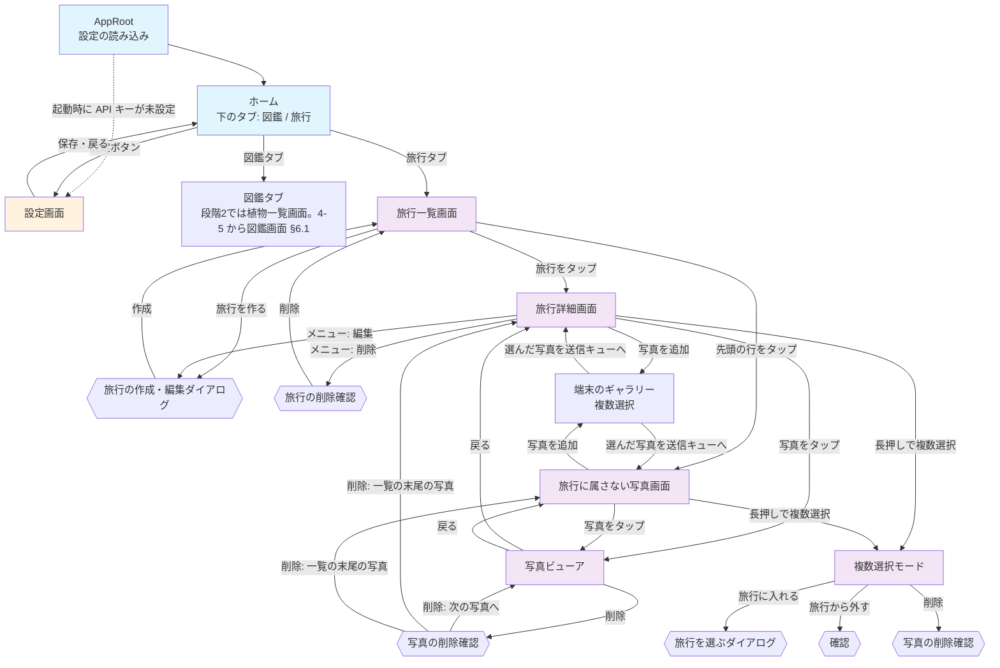

# 旅行アルバム 画面設計

## この文書の位置づけ

旅行アルバムの Flutter アプリ（`mobile/lib/`）の画面を、利用者から見える振る舞い（画面の要素・文言・遷移・ダイアログ・エラーの出方）で書く。
書き方は [docs/03_screen_design.md](../03_screen_design.md)（実装の写し）に合わせる。**この文書は未実装を含む目指す姿**で、
実装した画面は `docs/03_screen_design.md` へ取り込む（開発中はこの一式を正として都度直し、取り込みは機能が固まってから後でまとめて行う。2026-10-12 に人間が決定）。

段階2の画面は実装できる粒度で、段階3・4の画面は骨格で書く。各画面の見出しに段階を付ける。
API の形は [05_api_design.md](./05_api_design.md)、送信や保存のデータの形は [04_data_design.md](./04_data_design.md) を参照する。
文言はこの文書で決めたもので、第3版（設計案）には無い。変えるなら実装前に決める。

---

## 1. 画面一覧

| 画面 | 段階 | 画面上部の表示 | ソース（`mobile/lib/`、予定） |
|---|---|---|---|
| ホーム（下のタブ: 図鑑 / 旅行） | 2 | タブごと | `screens/home_shell.dart` |
| 図鑑タブ | 2・3: 植物一覧画面。4: 図鑑（種類タブ） | 図鑑 | `screens/catalog_screen.dart`（下の「図鑑画面」と同じ画面。段階3までは植物一覧画面 `screens/plant_list_screen.dart` だった。4-3a から 4-5 までは図鑑画面を一時的な3つ目のタブ「図鑑（新）」に置き、4-5 で図鑑タブを差し替えて植物一覧画面と3つ目のタブを消した。§6.1・§6.4） |
| 旅行一覧画面 | 2 | 旅行 | `screens/trip_list_screen.dart` |
| 旅行の作成・編集ダイアログ | 2 | 旅行を作る / 旅行を編集 | `widgets/trip_edit_dialog.dart` |
| 旅行詳細画面 | 2 | 旅行名 | `screens/trip_detail_screen.dart` |
| 旅行に属さない写真画面 | 2 | 旅行に属さない写真 | `screens/unassigned_photos_screen.dart` |
| 写真ビューア | 2 | （無し。全画面） | `screens/photo_viewer_screen.dart` |
| 旅行を選ぶダイアログ | 2 | 旅行を選ぶ | `widgets/trip_picker_dialog.dart` |
| 送信の進み具合バナー | 2 | — | `widgets/upload_banner.dart`（「写真を追加」ボタンは `widgets/add_photos_button.dart`、送信の列は `services/upload_queue.dart`、EXIF の読み取りは `utils/photo_metadata.dart`） |
| 写真グリッド（複数選択つき） | 2 | — | `widgets/photo_grid.dart`（旅行詳細・未所属・段階3のカテゴリ横断・段階4の項目詳細で共用。複数選択の見出しと操作バーは `widgets/photo_selection_scaffold.dart`） |
| カテゴリの一覧画面 | 3 | カテゴリ | `screens/category_photos_screen.dart`（`CategoryListScreen`） |
| カテゴリ横断画面（カテゴリの写真の画面） | 3 | カテゴリの表示名 | `screens/category_photos_screen.dart`（`CategoryPhotosScreen`） |
| やり直しダイアログ | 3（カテゴリ）・4（識別） | 解析をやり直す | `widgets/retry_processing_dialog.dart` |
| コメントの編集ダイアログ | 4 | コメントを編集 | `widgets/comment_edit_dialog.dart` |
| 図鑑画面（種類タブ → 項目一覧） | 4 | 図鑑 | `screens/catalog_screen.dart` |
| 図鑑の項目詳細画面 | 4 | 項目名 | `screens/catalog_entry_screen.dart`（信頼度のバッジは `widgets/confidence_badge.dart`。図鑑の一覧の行と共用） |
| 設定画面 | 既存 | 設定 | `screens/settings_screen.dart`（接続テストの宛先は 4-5 で写真の一覧に変えた。§6.4） |

削除・移動の確認は独立した画面ではなく、各画面の上に出るダイアログである。

### 状態の持ち方（段階2）

CLAUDE.md「実装の慣習」の Flutter の構成方針（`setState`、コンストラクタ注入、`Navigator.push`）を守る。
画面をまたいで共有するのは次の2つだけで、どちらも `AppRoot`（`lib/app_root.dart`）が1つ作って各画面のコンストラクタに渡す。

| 共有するもの | 型 | 理由 |
|---|---|---|
| `ApiService` | 既存 | 2タブが同じ設定で通信するので、根で1つ作る（以前は `PlantListScreen` が自分で作っていた） |
| `UploadQueue` | `ChangeNotifier` | 送信は画面を移っても続く（要件 5.2）。画面の `State` に置くと画面を閉じたときに消える |

`UploadQueue` の購読は `ListenableBuilder` で行い、状態管理パッケージは入れない。
「画面をまたいで共有するクライアント状態」（お気に入りなど）はまだ無いので、CLAUDE.md の「見直す条件」には当たらない。

設定（API キー・エンドポイント）の読み込みと「API設定が完了していません」の扱いは `AppRoot` に移す。
植物一覧画面が持っていた起動時の挙動（API キー未設定なら設定画面を自動で開く、設定画面から戻ると設定を読み直す）は、
`AppRoot` が2タブの外側で同じように行う。各タブの画面は `ApiService` を受け取って一覧を出すだけになる（植物一覧画面は 4-5 で図鑑画面に差し替えた。§6.4）。
エンドポイントにも既定値は無い（本番の URL をアプリに組み込まない）。API キーかエンドポイントのどちらかが無ければ、タブを出さずに設定を促す表示にし、起動時は設定画面を自動で開く。

## 2. 画面遷移図（段階2）



- 旅行詳細画面と旅行に属さない写真画面は同じ部品（`PhotoGrid`）を使い、違いは「どの写真を出すか」「旅行から外す」の有無だけ
- 写真ビューアは、開いた一覧の写真を左右のスワイプで順に見られる（一覧の並び順のまま）
- 複数選択モードは画面ではなく、旅行詳細・未所属の画面上の状態。戻る操作で解除される

## 3. 全画面共通

[docs/03_screen_design.md](../03_screen_design.md) の「全画面共通」をそのまま引き継ぐ。
加えて旅行アルバムの画面に共通するもの。

- 処理の結果はスナックバーで知らせる。API の失敗の文言は `ApiException.userMessage`（ステータスで決まる固定文言か、サーバの `error.message`）。
  `ApiException` 以外の失敗では画面ごとの固定文言（各画面の表に書く）
- 一覧の読み込みは「読み込み中...」「0件」「取得に失敗」の3状態を持ち、失敗時は「エラーが発生しました」・文言・「再試行」ボタン。
  下に引っ張ると読み込み直す
- **写真の一覧はページで読む。** `GET /api/photos`（と段階4の `GET /api/catalog/entry`）は1回に 100 枚（サーバの既定）を返し、`continuationToken` が `null` でなければ続きがある。
  グリッドの下端に近づいたら次のページを読み、末尾に「読み込み中...」を出す。次のページの取得に失敗したら末尾に「続きを読み込めませんでした」と「再試行」。
  下に引っ張ると先頭から読み直す（トークンは捨てる）。規模が大きくなっても1回に読む量は変わらない（[04 §5.3](./04_data_design.md#53-旅行の写真一覧)）。
  続きを読んでいる間に読み直した場合、遅れて届いた古い続きは捨て、続きは読み直した1ページ目のトークンから読む。
  ページが空でもトークンがあれば続きを読む（サーバは空のページを読み直しても空なら、トークン付きで返すことがある）。
  引っ張って読み直すのは写真の一覧だけで（図鑑の項目詳細は、見出しが写真のページと同じ応答に入っているので見出しも読み直す。§6.2）、旅行詳細の見出し（枚数・期間）と旅行に属さない写真の画面の枚数は取り直さない（画面を開き直すと取り直す。複数選択の操作の後と、写真ビューアから戻った後と、その画面宛ての写真の送信が一区切りついた後も取り直す。§4.4・§4.5・§4.6・§4.7）
- **撮影日時はタイムゾーン無しの文字列**（`2026-10-05T12:30:15`）で、端末のタイムゾーンに変換せず「2026年10月5日 12:30」と表示する。
  グリッドの各サムネイルの読み上げのラベルも撮影日時（撮影日時が無ければ「撮影日時なし」）
  （撮影した土地での時刻として扱う。要件 5.2）。`DateTime.parse()` の結果に `toLocal()` を掛けない（Z が無いのでローカル扱いになるが、
  表示のためだけに使い、変換はしない）。撮影日時が無い写真は「撮影日時なし」
- サーバが付ける日時（`createdAt`・`uploadedAt` など。UTC の ISO）は、既存の植物詳細と同じく端末のタイムゾーンに直して表示する
- 旅行の期間は「2026/10/05 〜 2026/10/08」。同じ日なら「2026/10/05」。撮影日時のある写真が無ければ「撮影日時なし」
- 画像は `cached_network_image` で表示する。キャッシュのキーは URL ではなく `photo-<id>`（原寸）/ `thumb-<id>`（サムネイル）。
  **SAS 付き URL は応答のたびに変わるので、URL をキーにするとキャッシュが効かない。** 写真用に上限を上げた `CacheManager` を使う
  （`utils/photo_cache_manager.dart`。既定の 200 件では数百枚の旅行で入れ替わり続ける）。旅行一覧の表紙は応答に写真の id が無いので、
  SAS（クエリ）を除いた Blob の URL から `cover-<ホスト><パス>` をキーにする
- SAS の期限（`urlExpiresAt`）が過ぎた URL は 403 になる。画像を読み込めないサムネイルには「画像を読み込めません」と出し、自動では取り直さない
  （画像そのものが壊れていると取り直しが止まらなくなるため）。下に引っ張れば一覧ごと新しい URL で取り直せる
- サムネイルの読み込み中は灰色の枠だけを出す（3列のグリッドで1枚ずつ文字を出すと読みにくいため）
- 写真の一覧を下に引っ張って読み直す間は今のグリッドを出したままにし、失敗したらエラーの文言をスナックバーで知らせる（グリッドは残す）
- 旅行詳細では、写真の一覧が 404 `TRIP_NOT_FOUND` を返したら（先頭・続き・読み直しのどれでも）、上の失敗の表示ではなく画面全体を「この旅行は削除されています」にする（§4.4）
- **自動の再試行はしない**（既存と同じ）。例外は送信キューで、通信の一時的な失敗（ステータス 0 / 429 / 503）に限って 3 回まで送り直す（§4.7）

## 4. 各画面の詳細設計（段階2）

### 4.1 ホーム（下のタブ）

```
┌─────────────────────────────────────────┐
│ （選んだタブの画面）                    │
│                                         │
│                                         │
├─────────────────────────────────────────┤
│      [図鑑]              [旅行]         │ ← 下のタブ
└─────────────────────────────────────────┘
```

- 下のタブは「図鑑」「旅行」の2つ。起動時は「図鑑」で、起動するとすぐ図鑑（§6.1）が種類の一覧（`GET /api/catalog/kinds`）と最初の種類の項目を読む。
  「図鑑」は 4-5 から新しい図鑑の画面（それまでは植物一覧画面。4-3a から 4-5 までは新しい図鑑を3つ目のタブ「図鑑（新）」に置いていた。§6.4）
- タブを切り替えても各タブの画面の状態（スクロール位置、読み込んだ一覧）は保たれる（`IndexedStack`。旅行のタブから図鑑に戻っても図鑑は読み直さない。[02 §5](./02_design_overview.md#5-人間に決めてもらう点推奨付き) #36）
- 設定ボタンはどのタブの画面上部にもあり、同じ設定画面を開く
- 設定画面から戻ったとき、エンドポイントと API キーが変わっていなければ、開いていたタブと各タブの状態をそのまま保つ。変わっていればすべてのタブを作り直し、新しい設定で読み直す（開くタブも起動時と同じ「図鑑」に戻り、図鑑は新しい設定で種類の一覧から読み直す）
- API キーかエンドポイントのどちらかが未保存のときは、下のタブを出さずに「API設定が完了していません」「設定画面で API キーとエンドポイントを入力してください」と「設定を開く」ボタンだけを出す（文言はどちらが無い場合も同じ。起動時は設定画面を自動で開く）
  （設定の読み込みに失敗したときも同じくタブを出さず、「API設定の読み込みに失敗しました」と「再試行」）。設定画面から戻ると設定を読み直す（既存と同じ挙動。`docs/03_screen_design.md` §1 起動時の挙動）

### 4.2 旅行一覧画面

```
┌─────────────────────────────────────────┐
│ 旅行                             [設定] │ ← ヘッダー
├─────────────────────────────────────────┤
│ ┃ 送信中 5/12                           │ ← 送信の進み具合バナー（送信中・失敗ありのときだけ。§4.7）
├─────────────────────────────────────────┤
│ ┌─────────────────────────────────────┐ │
│ │ [写真] 旅行に属さない写真        >  │ │ ← 先頭に固定の行
│ │        8枚                          │ │
│ └─────────────────────────────────────┘ │
│ ┌─────────────────────────────────────┐ │
│ │ [表紙] 北海道 2026秋             >  │ │ ← 旅行（createdAt 降順）
│ │        12枚 · 2026/10/05 〜 10/08   │ │
│ └─────────────────────────────────────┘ │
│ ┌─────────────────────────────────────┐ │
│ │ [表紙] 京都                      >  │ │
│ │        0枚 · 撮影日時なし           │ │
│ └─────────────────────────────────────┘ │
│              (以下同様...)              │
│                              [旅行を作る] │ ← 右下に浮かぶボタン
└─────────────────────────────────────────┘
```

**画面要素：**
- ヘッダー: タイトル「旅行」と設定ボタン（段階3で設定ボタンの左に「カテゴリ」のアイコンを足した。§5.2）
- 送信の進み具合バナー（§4.7）
- 先頭の行「旅行に属さない写真」: 枚数（`GET /api/trips` の `unassignedPhotoCount`）。タップで旅行に属さない写真画面へ。
  この行は旅行ではないので、編集・削除のメニューは無い
- 旅行の一覧: `GET /api/trips` が返す順（作成日時の降順。要件 5.1「新しい旅行が上」）。各行は表紙（最初の写真のサムネイル。無いか読めなければアイコン）、
  旅行名（1行。はみ出す分は省略）、枚数と撮影の期間（`photoCount`・`firstTakenAt`・`lastTakenAt`）。タップで旅行詳細画面へ
- 「旅行を作る」ボタン（右下に浮かぶ）: 旅行の作成ダイアログ（§4.3）

**一覧以外の表示：**

| 状態 | 表示 |
|---|---|
| 読み込み中 | 「旅行一覧を読み込み中...」 |
| 旅行が0件 | 先頭の行は出す。その下に「まだ旅行がありません」「「旅行を作る」から最初の旅行を作りましょう」 |
| 一覧の取得に失敗 | 「エラーが発生しました」、エラーの文言（`ApiException` 以外の失敗では「旅行一覧の読み込みに失敗しました」）、「再試行」ボタン |
| 一覧が出ている状態での読み直しに失敗 | 一覧を出したまま、エラーの文言をスナックバーに出す（下に引っ張れば読み直せる）。読み直しの間も今の一覧を出したままにする |

旅行一覧と未所属の枚数は `GET /api/trips` の1回で取る（枚数と期間はサーバが `GROUP BY` で数え、写真を全部読まない。[04 §5.1](./04_data_design.md#51-旅行一覧)）。

**一覧を読み込み直すタイミング：** 旅行詳細・未所属の画面・カテゴリの一覧（§5.2。カテゴリの写真の画面で写真を消すと枚数が変わる）から戻ったとき、旅行を作ったとき、送信キューの送信が一区切りついたとき（準備中・送信中の写真が無くなったとき。枚数が変わるため。§4.7。ただし、その区切りで新しく入った写真が無い、つまり全部失敗したか全部が別の場所に送信済みだったときは、枚数が変わらないので読み直さない）、下に引っ張ったとき。

### 4.3 旅行の作成・編集ダイアログ

```
┌─────────────────────────────────────┐
│ 旅行を作る                          │ ← 編集時は「旅行を編集」
│                                     │
│ 旅行名                              │
│ ┌─────────────────────────────────┐ │
│ │例：北海道 2026秋                │ │ ← 1行・最大100文字
│ └─────────────────────────────────┘ │
│ メモ（任意）                        │
│ ┌─────────────────────────────────┐ │
│ │                                 │ │ ← 3行・最大1000文字
│ └─────────────────────────────────┘ │
│                                     │
│              [キャンセル] [作成]    │ ← 編集時は「保存」
└─────────────────────────────────────┘
```

- 旅行名: 1行、ヒント「例：北海道 2026秋」、100文字まで入力できる。メモ: 3行、1000文字まで
- 「作成」/「保存」: 前後の空白を除いて検証する。空なら入力欄の下に「旅行名を入力してください」と出して送らない。
  通れば `POST /api/trips`（作成）または `PUT /api/trips/{tripId}`（編集）を呼ぶ。処理中はボタンが「作成中...」/「保存中...」になり押せない
  - 成功: ダイアログを閉じ、「旅行を作成しました」/「旅行を更新しました」。作成後は旅行一覧を読み込み直す。編集後は旅行詳細のタイトルを更新する
  - 失敗: ダイアログに留まり、エラーの文言（`ApiException` 以外では「旅行の保存に失敗しました」）をスナックバーに出す。入力は残る
- 「キャンセル」（ダイアログの外をタップした場合も同じ）: 何もしない

旅行の期間や枚数は入力しない（写真から導く。[04 §1.2](./04_data_design.md#12-旅行type-trip)）。タグも段階2では付けない。

### 4.4 旅行詳細画面

```
┌─────────────────────────────────────────┐
│ [<] 北海道 2026秋                   [⋮] │ ← ヘッダー（戻る・旅行名・メニュー: 編集 / 削除）
│     12枚 · 2026/10/05 〜 10/08          │ ← 枚数と期間
├─────────────────────────────────────────┤
│ ┃ 送信中 5/12                           │ ← 送信の進み具合バナー（この旅行宛ての送信があるとき）
├─────────────────────────────────────────┤
│ ┌──────┐ ┌──────┐ ┌──────┐             │
│ │      │ │      │ │      │             │ ← サムネイルのグリッド（3列。撮影日時順。下端で次のページ）
│ └──────┘ └──────┘ └──────┘             │
│ ┌──────┐ ┌──────┐ ┌──────┐             │
│ │      │ │      │ │  ⟳   │             │ ← 送信中の写真は端末の画像を半透明で表示
│ └──────┘ └──────┘ └──────┘             │
│ ┌──────┐ ┌──────┐                      │
│ │      │ │  !   │                      │ ← 送れなかった写真は「!」
│ └──────┘ └──────┘                      │
│                                         │
│                            [写真を追加] │ ← 右下に浮かぶボタン
└─────────────────────────────────────────┘
```

開くたびに `GET /api/trips/{tripId}`（枚数・期間）と `GET /api/photos?tripId={tripId}`（最初のページ）を取り直す。

**画面要素：**
- ヘッダー: 戻るボタン、旅行名、右上のメニュー（「編集」→ §4.3、「削除」→ 下記）。その下に枚数と期間
- 写真のグリッド（`PhotoGrid`）: 3列の正方形のサムネイル。`GET /api/photos` が返す順（撮影日時の昇順。撮影日時が無い写真はアップロード日時の位置。[04 §5.3](./04_data_design.md#53-旅行の写真一覧)）。
  下端に近づいたら次のページを読む（§3）。日付ごとの見出しは置かない。サムネイルが無い写真（`thumbnailUrl` が null）は原寸をサムネイルの大きさで出す。
  タップで写真ビューア（§4.6）、長押しで複数選択モード（§4.8）
- 送信キューにこの旅行宛ての項目があれば、サーバの写真の後ろに端末の画像を半透明で並べる（送信待ち・送信中・送り直し待ちは回転するアイコン、失敗は「!」）。
  一覧を読み直して既にサーバの写真として並んでいるもの（送れた写真）は、端末の画像では並べない（二重にしない）。
  一度サーバの写真として並んだ送れた写真は、その後にビューアで消したり旅行から外したりしても、端末の画像として並べ直さない。
  送れた項目は一区切りまで印を付けずに並べたままにし、一区切りで一覧を取り直してサーバの写真として並び直す（一区切りまでの間に消えてまた現れることが無いように）。
  サーバの写真の続きのページが残っている間は並べず、最後のページまで読んでから並べる（続きが届くたびに端末の画像が後ろへずれないように）。
  写真が0枚の旅行でも、並べる端末の画像があれば「まだ写真がありません」ではなく端末の画像を出す。
  準備中の写真（キューに入る前）は並べない（進み具合バナーの「写真を準備中」で分かる）。
  端末の画像はタップしても長押ししても何もしない（ビューアで開けない・選べない。§4.6・§4.8）。
  旅行に属さない写真の画面（§4.5）では、旅行を指定せずに送った項目を並べる（実装済み。PR 7e）
- 「写真を追加」ボタン: 端末のギャラリーを開く（複数選択）。選んだ写真はこの旅行宛てに送る（送り方 ①。§4.7）。
  旅行を読み込めるまでと、複数選択モードの間は出さない
- 段階3で、枚数と期間・送信の進み具合バナーの下にカテゴリの絞り込みのチップを足した（§5.3）

**一覧以外の表示：**

| 状態 | 表示 |
|---|---|
| 読み込み中 | 旅行の読み込み中は回転する印だけ。旅行を読めた後、写真の一覧を読んでいる間は「写真を読み込み中...」 |
| 0件 | 「まだ写真がありません」「「写真を追加」からギャラリーの写真を送りましょう」。サーバの写真が0枚でも、並べる端末の画像（上記）があれば出さずにグリッドで並べる。カテゴリで絞っているときの0件は §5.3 |
| 旅行の取得に失敗 | 画面全体に「エラーが発生しました」、エラーの文言（`ApiException` 以外では「旅行の読み込みに失敗しました」）、「再試行」。編集・削除のメニューは出さない |
| 写真の一覧の取得に失敗 | 旅行名・枚数・期間は出したまま、写真の部分に「エラーが発生しました」、エラーの文言（`ApiException` 以外では「写真の読み込みに失敗しました」）、「再試行」 |
| 旅行が無い（404 `TRIP_NOT_FOUND`） | 「この旅行は削除されています」と表示し、戻るボタンで旅行一覧へ（一覧は読み込み直す）。旅行名と編集・削除のメニューは出さない。写真の選択中に分かったときは選択も解き、戻る1回で旅行一覧へ戻れるようにする。写真ビューアや確認ダイアログを開いている間に分かったときは、それを閉じてから出す（ビューアが読ませた続きのページで分かったときも同じ）。分かった後に、先に出していた旅行の取得の成功が遅れて届いても、旅行名とメニュー・「写真を追加」は出し直さない。旅行の取得（開いたとき・取り直し）だけでなく、写真の一覧（`GET /api/photos?tripId=`）の先頭のページ・続きのページ・下に引っ張った読み直しのどれで分かっても同じで、写真の一覧の失敗の表示（「エラーが発生しました」・「続きを読み込めませんでした」・スナックバー）は出さない。判定は `code` で行い、`code` の違う 404 は「写真の一覧の取得に失敗」などの失敗と同じ扱い。この旅行宛ての送信の進み具合バナーは出したままにする（送れなかった写真を「閉じる」で片付けられるように。PR 7e） |

**削除：** 中の写真をどうするかを利用者が選ぶ（2026-10-12 に人間が決定）。API は `deletePhotos` を必須にしているので、写真が0枚で選択肢を出さないときも `deletePhotos=false` を載せる。

```
┌─────────────────────────────────────┐
│ 旅行を削除                          │
│                                     │
│ 「北海道 2026秋」を削除します。     │
│ 中の写真12枚はどうしますか？        │
│                                     │
│ (•) 写真は残す                      │ ← 既定
│     「旅行に属さない写真」に移ります │
│ ( ) 写真も削除する                  │
│     この操作は元に戻せません        │
│                                     │
│                 [キャンセル] [削除] │
└─────────────────────────────────────┘
```

- 枚数は `GET /api/trips/{tripId}` の `photoCount`（要件 5.1「消す前に枚数を示して確認する」）。0枚なら選択肢を出さず「「京都」を削除しますか？」「キャンセル」「削除」
- 成功の知らせの枚数は応答で決める。0枚の旅行なら括弧書きを付けず「旅行を削除しました」
- 既定は「写真は残す」（誤操作で写真が消えないように）。「写真も削除する」を選ぶと「削除」ボタンが赤くなる
- 「削除」: `DELETE /api/trips/{tripId}?deletePhotos=false|true`（選んだ方。[05 §5.12](./05_api_design.md#512-delete-apitripstripiddeletephotostruefalse)）。処理中はダイアログのボタンが押せず「削除中...」
  - 成功: 「旅行を削除しました（写真12枚は「旅行に属さない写真」に移しました）」または「旅行を削除しました（写真12枚を削除）」を表示して旅行一覧へ戻る（一覧は読み込み直す）。
    枚数は応答の `detachedPhotoCount` / `deletedPhotoCount`
  - 失敗: 確認ダイアログを開いたまま（そのまま再試行もキャンセルもできる）、エラーの文言（`ApiException` 以外では「旅行の削除に失敗しました」）をスナックバーに出す。旅行詳細も閉じない。404 なら成功と同じ扱い（既に無い）
- この旅行宛ての送信が進行中（準備中・送信待ち・送信中・送り直し待ちの写真がある）なら、削除のダイアログの前に「送信中の写真があります。送信を止めて削除しますか？」（「キャンセル」「削除」）を出す。
  この旅行宛ての写真が失敗しているだけ（自動では送り直されない）なら確かめず、そのまま削除のダイアログを出す。
  「キャンセル」なら何もしない。「削除」なら上の削除のダイアログへ進み、そこで削除を確定したときに、送信キューのこの旅行宛ての項目（準備中・送信待ち・送り直し待ち・失敗）を取り消してから削除する
  （削除のダイアログで「キャンセル」したら送信は続ける。取り消しは、確定した時点の写真（準備中・送信待ち・送信中・送り直し待ち・失敗）だけに効く。削除が失敗しても取り消した写真は戻らず（選び直せば送れる）、その後にこの旅行へ追加した写真は送る。準備中の写真は残りの準備をやめ、「写真を準備中」も出さない）。取り消した写真は送らず（準備中の写真は準備が済んでも送らず、送り直し待ちの写真は待ちが過ぎても送り直さない）、失敗にも数えず、完了の知らせにも数えない。
  この旅行宛てに一区切りの前に送れていた写真も、完了の知らせに数えない。
  送信中の要求は止められないので、その結果は知らせない（送れても失敗しても数えない）。結果を待つ間も、その写真はグリッドに並べず、進み具合バナーにも送信中にも数えない（削除が失敗して旅行詳細に留まっても残らない。実装済み。PR 7e）。
  それでも削除と重なって届いた写真は消えないが、段階3の掃除のタイマーが未所属に戻すまでどの一覧にも出ない（まれなので許容。[04 §7.3](./04_data_design.md#73-旅行の削除と重なった送信move)）

見出し（枚数・期間）の取り直しが重なったときは、最後に出した取得の結果だけを使う（先に出した取得が遅れて届いても、成功でも失敗でも、新しい表示を覆さない。旅行が無い 404 は、どの取得で分かっても「この旅行は削除されています」にする）。

**一覧を読み込み直すタイミング：** 写真ビューアから戻ったとき（削除したかどうかによらない。複数選択の操作の後と同じく、先頭のページから読み直し、見出しの枚数・期間も取り直す。ビューアを開いている間に別の端末で増えた写真も出る）、複数選択の操作が完了したとき（見出しの枚数・期間も取り直す。§4.8）、送信が一区切りついて、この旅行宛ての写真が1枚以上送れていたとき（複数選択の操作の後と同じく、先頭のページから読み直し、見出しの枚数・期間も取り直す。§4.7）、下に引っ張ったとき。

### 4.5 旅行に属さない写真画面

旅行詳細画面と同じ部品で、次の点だけ違う。

- ヘッダーは「旅行に属さない写真」で、メニュー（編集・削除）は無い。枚数だけを出す（期間は出さない。枚数は `GET /api/trips` の `unassignedPhotoCount`）
- `GET /api/photos?tripId=none` をページで取る
- 「写真を追加」は旅行を指定せずに送る（送り方 ②。`tripId` のパートを省く）。進み具合バナーは、旅行を指定せずに送った写真だけを数える（§4.7）
- グリッドの後ろに端末の画像で並べるのは、旅行を指定せずに送った写真だけ（旅行宛ての写真は並べない。並べ方は §4.4 と同じ）
- 0件の表示は「旅行に属さない写真はありません」「「写真を追加」で送った写真は、あとから旅行に入れられます」（並べる端末の画像があれば出さない。§4.4 と同じ）
- 複数選択の操作に「旅行から外す」は無い（「旅行に入れる」と「削除」だけ）。「旅行に入れる」のダイアログはすべての旅行を出す
- 複数選択の操作の後は、写真の一覧と一緒に枚数も `GET /api/trips` で取り直す（開いたときの枚数は旅行一覧から受け取る）。
  枚数の取り直しに失敗したら、枚数は前の値のまま出す（写真の一覧は読み直す。操作の知らせは出ているので、失敗の知らせは足さない）。
  送信が一区切りついて、旅行を指定せずに送った写真が1枚以上送れていたときと、写真ビューアから戻ったとき（削除したかどうかによらない）も、同じく写真の一覧と枚数を取り直す（§4.7）

### 4.6 写真ビューア

**実装済み**（PR 7d。`screens/photo_viewer_screen.dart`。送信中・送信失敗の写真の扱いは PR 7e）。

```
┌─────────────────────────────────────────┐
│ [<]                    [やり直す][削除] │ ← 半透明のバー（タップで表示・非表示）。「やり直す」は段階3（§5.1）
│                                         │
│                                         │
│              原寸の画像                 │ ← 左右のスワイプで前後の写真。ピンチで拡大
│                                         │
│                                         │
├─────────────────────────────────────────┤
│ 2026年10月5日 12:30                     │ ← 撮影日時（無ければ「撮影日時なし」）
│ 北海道旭川市                            │ ← 地名。無ければ緯度・経度「43.7700, 142.3600」、
│                                         │    位置情報が無ければ「位置情報なし」
│ 段階3: [風景]  段階4: サクラ >          │ ← 段階3以降（§5・§6）
└─────────────────────────────────────────┘
```

- グリッドのサムネイルをタップすると、その写真から開く（複数選択モードの間はタップで選択が切り替わり、ビューアは開かない。§4.8）
- 開いた一覧（旅行詳細・未所属）の写真を、一覧と同じ順で左右にスワイプして見られる（`PageView`）。左へ払うと次の写真、右へ払うと前の写真。原寸は `imageUrl`、表示までの間はサムネイルを出す（`thumbnailUrl` が null なら何も出さない）。原寸を読めない（SAS の期限切れの 403 など）ときは「画像を読み込めません」を出す（戻れば一覧が新しい URL で読み直される）。
  一覧がまだ読んでいないページの写真は、読み込んだ末尾の写真まで来たときに一覧が次のページを読む（ビューアは一覧の読み込み済みの配列を共有する。グリッドを下端まで送っていなくても、ビューアから読ませる）。
  最後のページまで読んでいれば、末尾でそれ以上進まない
- 画面をタップすると上のバーと下の情報の表示・非表示が切り替わる
- ピンチで拡大できる。拡大している間は左右のスワイプで前後に移らず、画像を動かす
- 下の情報は2行（段階3でカテゴリと分類の状態の行を、段階4で図鑑の項目へのリンク・コメント・「コメントを編集」の行を足す。§5.1・§6.3）。
  - 撮影日時（§3 の表記「2026年10月5日 12:30」。無ければ「撮影日時なし」）
  - 場所: 地名（`location.placeName`）があれば地名。地名が無く緯度・経度があれば「緯度, 経度」を小数4桁に丸めて出す（足りない桁は0で埋める。例 `43.77` / `142.36` は「43.7700, 142.3600」）。
    位置情報が無ければ（`location` が null）「位置情報なし」
- 削除: 上のバーの「削除」で確認ダイアログ「写真を削除」「この写真を削除しますか？\nこの操作は元に戻せません。」「キャンセル」「削除」。
  「削除」で `DELETE /api/photos/{photoId}`。処理中はダイアログのボタンが押せず「削除中...」になり、外のタップ・戻る操作でも閉じない。
  成功なら確認ダイアログを閉じて「写真を削除しました」を出し、一覧の読み込み済みの写真からも除いて、次の写真へ移る（次の写真が無い、つまり一覧の末尾の写真なら一覧へ戻る。知らせは一覧に戻っても出たまま）。
  「一覧の末尾」は読み込み済みの末尾ではなく、続きのページが無いときの末尾。読み込み済みの写真を使い切っても続きがあれば、一覧に続きを読ませて、届いたら次の写真へ移る。
  削除で後ろの写真が今の位置に詰まり、それが読み込み済みの末尾になったときも、一覧に続きを読ませる（スワイプで末尾に来たときと同じ）。
  失敗なら確認ダイアログを開いたまま（そのまま再試行もキャンセルもできる）ビューアに留まり、エラーの文言（`ApiException.userMessage`。`ApiException` 以外では「写真の削除に失敗しました」）をスナックバーに出す。写真は一覧に残る。
  404 `PHOTO_NOT_FOUND`（別の端末で先に消されたなど）なら成功と同じ扱い（判定は `code` で行い、封筒の無い 404 は失敗と同じ扱い。§4.8 の複数選択の削除と同じ）
- 戻ると、開いた画面（旅行詳細・未所属）が写真の一覧と見出しの枚数を読み直す（削除したかどうかによらない。§4.4・§4.5）
- 開いている間に旅行が無い（404 `TRIP_NOT_FOUND`）と分かったら、ビューアを閉じて旅行詳細の「この旅行は削除されています」を出す（§4.4）
- 送信中・送信失敗の写真（端末にしか無いもの）はビューアで開けない（タップしても何も起きない）

### 4.7 写真の追加と送信の進み具合

**実装済み**（PR 7a・7b・7c。`widgets/add_photos_button.dart`・`services/upload_queue.dart`・`utils/photo_metadata.dart`・`widgets/upload_banner.dart`）。
PR 7a: 写真を選ぶ、準備のハッシュと EXIF、同時 2 本の送信、201 の扱い、進み具合バナーの「送信中」と失敗の行・「送り直す」「閉じる」、完了の知らせまで。
PR 7b: 準備が済んだ順に送ることと準備中の表示、自動の送り直し、404、200（別の場所）と完了の知らせの補足、失敗の理由の文言。
PR 7c: 準備のサムネイルと地名、送信の `thumbnail`・`placeName` のパート。

**写真を選ぶ：** 「写真を追加」で `image_picker` の `pickMultiImage()` を開く（既存と同じ画質85・最大1920px。
縮小しても同じ写真から同じハッシュになることは、2026-10-14 に SC-03K で確かめた（`docs/09_backlog.md`「段階2の結果」）。[02 §6](./02_design_overview.md#6-リスク)）。
選ぶ画面を開いてから写真を受け取るまでの間は、「写真を追加」のボタンを「写真を読み込み中...」（回転する印つき、灰色）に替えて押せなくする。その間に選択モードに入って抜けても、受け取るまでは「写真を読み込み中...」のまま（受け取った後の準備の間は「写真を追加」に戻り、押せる）。
写真を選ぶ部品は、選んだ写真を1枚ずつ縮小してから返すので、300枚では受け取るまで10分ほどかかる（2026-10-17、SC-03K。その間に何も出ないと、止まったように見える）。
選ばずに閉じたら何もしない（ボタンは元に戻す）。読み込みに失敗したら「画像の読み込みに失敗しました」。
選んだうちの一部だけが読めなかったときも同じ知らせを出し、読めた写真は送る（読めた写真まで送らずに捨てない）。

**準備：** 選んだ各ファイルについて、選んだ順に1枚ずつ次を行う。ハッシュと EXIF は別の isolate（`compute`）で、サムネイルと地名はその後にメインの isolate で行う
（どちらも端末の機能（プラグイン）を使い、プラグインは別の isolate から呼べないため）。その間はバナーに「写真を準備中... 3/12」
（準備を終えた枚数/選んだ枚数。サムネイルと地名まで済んだ写真を準備を終えたと数える。読めなかった写真も準備を終えた枚数に数える。準備中の選択が複数あれば、その画面が数える宛先の分を合計する）。

| 処理 | 中身 | パッケージ |
|---|---|---|
| ハッシュ | ファイルのバイト列の SHA-256（16進・小文字）→ `photoId` | `crypto` |
| EXIF | `DateTimeOriginal` → `takenAt`（`YYYY-MM-DDTHH:mm:ss`。無ければ null）、GPS → 緯度・経度（度・分・秒を10進の度に直す。南緯・西経は負。片方しか読めなければ両方 null。無ければ null）。EXIF を読めなくても送信は止めない | `exif` |
| サムネイル | 長辺 320px・画質 70 の JPEG（横長は 320×240 のように、縦長は 240×320 のように）。プラグインは幅・高さとも指定の長さを下回らない範囲で縮めるので、画像の縦横（ヘッダから読む）から短辺を「長辺 320 に合わせた長さ」に換算し、幅・高さの両方にその値を指定する（両方に 320 を指定すると短辺が 320 になる。縦横で別の値を指定すると、プラグインが EXIF の向きで縦横を入れ替えたときに長辺が 320 を超える）。作れなければ（画像を読めない・圧縮に失敗する）サムネイル無しで送る（送信は止めない） | `flutter_image_compress` |
| 地名 | 緯度・経度があれば、小数3桁に丸めた座標をキーに端末内のキャッシュを引き、無ければ端末の Geocoder で引いて都道府県＋市区町村にする（片方だけならその分だけ、どちらも空なら null）。失敗・空の結果・5 秒の時間切れは null（送信は止めない）。キャッシュに残すのは引けた地名だけ | `geocoding`（[06 §4.2](./06_processing_design.md#42-段階2端末)） |

準備が済んだ順に `UploadQueue` に入れ、全部の準備を待たずに送り始める。項目は `{ file, photoId, tripId?, takenAt, latitude, longitude, placeName, thumbnail }`。

**送信：** `UploadQueue` が同時 2 本まで `POST /api/photos` を呼ぶ（[05 §5.1](./05_api_design.md#51-post-apiphotos)。送るパートは [05 §8](./05_api_design.md#8-クライアントmobilelibservicesapi_servicedartに足すメソッド)。
撮影日時・緯度・経度・サムネイル・地名が無ければそのパートを省き、旅行に属さない写真の画面から送るときは `tripId` を省く。地名は緯度・経度を送るときだけ送る）。
画面を移っても続く（`AppRoot` が持つ）。アプリを終了すると送信待ちは失われる（永続化は段階6）。
設定（API キー・エンドポイント）を変えたときも、送信待ち・失敗の写真は捨てる（前の設定の宛先には送らない。送信中の要求の結果も知らせない）。選び直せば送れる。

| 応答 | 扱い |
|---|---|
| 201 | 完了。準備中の写真も送信中の項目も無くなった（一区切りついた）ときに、送れた写真の宛先の画面（旅行詳細・未所属）と旅行一覧が一覧を読み込み直す（1枚ごとには読み直さない。数百枚の送信で取得とグリッドの作り直しが同じ数だけ起き、スクロール位置も先頭に戻るため） |
| 200（既存） | 完了。応答の `tripId` が送った宛先と違えば、その写真を「送信済み（別の場所）」として数える（宛先の一覧は変わらないので、その宛先の画面は読み直さない） |
| 0（通信失敗。応答が 60 秒返らない時間切れを含む）/ 429 / 503 | 2秒 → 4秒 → 8秒の間隔（失敗を受けてから数える）で最大 3 回送り直す。それでも失敗なら「失敗」。送り直しを待つ間も送信中として数える（バナーは「送信中」のまま、同時 2 本の枠もふさいだまま、一区切りにもならない）。429 は封筒の無い応答（Functions ランタイムの「Too Busy」）も含む。時間切れが無いと、通信が固まったときに送信中のまま枠がふさがり、送り直しも区切りも来ない |
| 404 `TRIP_NOT_FOUND` | 宛先の旅行が消えている。残りの同じ宛先の項目（まだ送っていないものと、一時的な失敗の後で送り直しを待っているもの）も送らずに「失敗」にし、「旅行が見つかりません」。その後に準備が済んだ同じ宛先の写真も、送らずに失敗にする（送っても同じ結果になる。数百枚を選んだときに無駄な要求を送らない）。消えた宛先は、その宛先を数えている画面で「送り直す」を押すまで覚えている（一区切りや「閉じる」の後に同じ旅行へ選び直した写真も送らずに失敗にする。「送り直す」を押すと忘れて送る） |
| その他（400・413・415・500・502） | 「失敗」。文言は `ApiException.userMessage` |

**進み具合バナー：** 旅行一覧・旅行詳細・未所属の画面上部に、準備中の写真かキューの項目があるときだけ出す。

```
┃ 写真を準備中... 3/12                          ← 準備中の写真があるとき（送信中・失敗の行より優先する）
┃ 送信中 5/12                                   ← 送信中（完了数/全体）
┃ 2枚を送信できませんでした（旅行が見つかりません）  [送り直す] [閉じる] ← 失敗があり、送信中の項目が無いとき
```

- 準備中の写真があれば、送信中の項目や失敗した項目があっても準備中の行だけを出す（準備が済んでから送信中・失敗の行に替わる）
- 失敗の行には、理由を括弧で添える。理由はその画面のバナーが数えている失敗した項目のうち、最後に失敗したものの文言（404 `TRIP_NOT_FOUND` は「旅行が見つかりません」、それ以外は `ApiException.userMessage`。`ApiException` 以外は「写真の送信に失敗しました」）

- 「送り直す」: 失敗した項目を再びキューに入れる（準備はやり直さない。0 / 429 / 503 の自動の送り直しも改めて 3 回まで行う）。その画面のバナーが数えている項目だけが対象
- 「閉じる」: 失敗した項目をキューから消す（端末の写真は消えない。選び直せば送れる）。その画面のバナーが数えている項目だけが対象
- 準備中の写真も送信中の項目も無くなったら、送れた分を「12枚を送信しました」とスナックバーで出す（送れた分が 0 枚なら出さない）。
  準備中の写真が残っている間は、先に送れた分があっても知らせない（選んだ写真の途中で知らせて、残りの分でもう一度知らせることはしない）。
  枚数は宛先を問わずその区切りで送れた全部で、どの画面にいても出す（送信を始めた画面を閉じていても出る。`AppRoot` が出す）。
  失敗が無ければバナーを消す。失敗があればバナーは失敗の行（「2枚を送信できませんでした」）に替わり、「送り直す」か「閉じる」まで残る。「送信済み（別の場所）」があれば
  「12枚を送信しました（1枚は送信済みでした。別の旅行か、旅行に属さない写真にあります）」（12枚には送信済みの1枚も含む）
- 旅行詳細では、その旅行宛ての項目だけを数える。旅行に属さない写真の画面では、旅行を指定せずに送った項目だけを数える。旅行一覧では全体を数える
  （数える項目が無い画面にはバナーを出さない。例: 京都宛ての送信中に北海道の詳細を開いても出ない）。準備中の写真も同じく宛先で数える
  （京都宛ての写真の準備中に北海道の詳細を開いても「写真を準備中」は出ず、旅行一覧には出る）
- 旅行詳細で旅行が無い（404 `TRIP_NOT_FOUND`）と分かって「この旅行は削除されています」にした後も、その旅行宛ての項目のバナーは出したままにする（失敗の行の「閉じる」で片付けられる。§4.4）
- 旅行詳細で旅行を削除したときは、その旅行宛ての送信を取り消す（取り消した写真は送らず、失敗にも完了の知らせにも数えない。§4.4 の「削除」）

### 4.8 複数選択と、旅行への出し入れ・削除

グリッドの長押しで複数選択モードに入る。長押しした写真が選ばれた状態で入る（「1枚を選択中」）。

```
┌─────────────────────────────────────────┐
│ [×] 3枚を選択中   [表示中をすべて選択]  │ ← ヘッダーが置き換わる
├─────────────────────────────────────────┤
│ ┌──────┐ ┌──────┐ ┌──────┐             │
│ │  ✓   │ │      │ │  ✓   │             │ ← 選んだ写真にチェック
│ └──────┘ └──────┘ └──────┘             │
│              (以下同様...)              │
├─────────────────────────────────────────┤
│ [旅行に入れる] [旅行から外す] [削除]    │ ← 下の操作バー（未所属の画面では「旅行から外す」が無い。カテゴリの写真の画面は「削除」だけ。§5.2）
└─────────────────────────────────────────┘
```

- 見出しは「N枚を選択中」と「×」「表示中をすべて選択」に替わる（幅 360dp の端末で「300枚を選択中」が入りきらないときは、切らずに文字を縮めて出す）（旅行名と編集・削除のメニューは出ない）。選んだ写真には読み上げでも「選択中」の状態が付く（選択モード中は選んでいない写真も「選択されていない」と読み上げる。選択モードの外では、サムネイルに選択の状態を付けない。読み上げが全部のサムネイルを「未選択」と読まないように）
- タップで選択を切り替える。「表示中をすべて選択」で読み込んだ写真を全部選ぶ（一覧はページで読むので、まだ読み込んでいない続きは入らない。続きも選ぶには下まで送ってから押す。文言はこの範囲が分かるように「表示中を」とした（2026-10-17 に人間が決定。全部を読み込んでから選ぶ形は、100枚を超える選択がまれなので割に合わない）。送信中・失敗の写真は選べない）。「×」か端末の戻る操作で解除
  （端末の戻る操作でも画面は閉じない。解除すると選んだ写真も外れ、見出しが元に戻り、下の操作バーが消える）
- 選んだ枚数が 0 になっても選択モードのまま（「×」か戻る操作で抜ける）
- 操作は選んだ写真が 1 枚以上のときだけ押せる
- 操作の後の「一覧を読み込み直す」は、先頭のページから読み直す（「写真を読み込み中...」が出て、スクロール位置も先頭に戻る。下に引っ張ったときのように今の一覧を残したままにはしない）
- 各ダイアログは、送っている間（移動・削除の要求の応答を待つ間）は「キャンセル」と実行のボタンを押せず、外のタップ・戻る操作でも閉じない。
  旅行を選ぶダイアログでは、旅行の行と「新しい旅行を作る」も押せない（送った先と選んでいる旅行が食い違わないように。作成ダイアログを重ねると、送り終えて閉じるときに取り違える）。
  実行のボタンは「入れています...」「外しています...」「削除中...」に替わる（旅行の作成・削除のダイアログと同じ。二重に送らないように）

**旅行に入れる（送り方 ③、要件 5.1.1・5.2）：** 旅行を選ぶダイアログを出す。

```
┌─────────────────────────────────────┐
│ 旅行を選ぶ                          │
│                                     │
│ ( ) 北海道 2026秋   12枚            │ ← GET /api/trips の順。今いる旅行は出さない
│ ( ) 京都             0枚            │
│                                     │
│ [+ 新しい旅行を作る]                │ ← §4.3 のダイアログを開き、作った旅行を選んだ状態にする
│                                     │
│              [キャンセル] [入れる]  │
└─────────────────────────────────────┘
```

旅行の一覧はダイアログを開くたびに `GET /api/trips` で取り直す。読み込み中は「入れる」を押せない。
読み込みに失敗したら、ダイアログの中にエラーの文言（`ApiException` 以外では「旅行一覧の読み込みに失敗しました」）と「再試行」を出す。
旅行を選ぶまで「入れる」は押せない。
「新しい旅行を作る」で作った旅行は一覧の先頭に加わり、先に別の旅行を選んでいても作った旅行の選択に替わる（そのまま「入れる」で作った旅行に入る）。

「入れる」で `POST /api/photos/move { photoIds, tripId }`。200 件を超えるときは 200 件ずつ分けて順に送る（ちょうど 200 件なら 1 回）。

- 成功: ダイアログを閉じ、「3枚を「北海道 2026秋」に入れました」。枚数は応答の `moved` の件数（分けて送ったときは合計）。
  応答の `notFound` が空でなければ「（1枚は見つかりませんでした）」を足す（例「1枚を「京都」に入れました（1枚は見つかりませんでした）」）。
  選択を解除して（選択モードを抜ける）一覧を読み込み直す。旅行詳細では見出しの枚数・期間も `GET /api/trips/{tripId}` で取り直す（未所属の画面は §4.5）。
  取り直しに失敗したら見出しは前の値のまま出す（写真の一覧は読み直す。操作の知らせは出ているので、失敗の知らせは足さない。旅行が既に無い 404 なら「この旅行は削除されています」）
- 失敗: 留まってエラーの文言（`ApiException` 以外では「写真の移動に失敗しました」）。選択は残る（ダイアログで選んだ旅行も選んだまま）。分けて送った途中で失敗したら、送れた分は入っている（押し直すと残りが送られる。同じ写真を再び送っても同じ結果になる）。
  押し直して成功したら、出ている失敗の知らせを閉じてすぐに成功の知らせを出す

**旅行から外す：** 確認ダイアログ「旅行から外す」「3枚を旅行から外しますか？\n写真は「旅行に属さない写真」に移ります。」「キャンセル」「外す」。
「外す」で `POST /api/photos/move { photoIds, tripId: null }`（`tripId` のキーは省かずに `null` を送る。省くとサーバは 400）。成功なら「3枚を旅行から外しました」（枚数は `moved` の件数）。`notFound`・200 件ずつ分けて送ること・成功後の読み直し・失敗の扱いは「入れる」と同じ（失敗したら確認ダイアログに留まる）。

**削除：** 確認ダイアログ「写真を削除」「3枚の写真を削除しますか？\nこの操作は元に戻せません。」「キャンセル」「削除」。
「削除」で `DELETE /api/photos/{photoId}` を 1 枚ずつ順に呼ぶ（同時 2 本まで）。404 `PHOTO_NOT_FOUND`（別の端末で消されたなど）は成功と数える（封筒の無い 404 は失敗と数える）。
1 枚が失敗しても残りは続ける。全部終わったら確認ダイアログを閉じ、「3枚を削除しました」、失敗があれば「2枚を削除しました（1枚は削除できませんでした）」
（全部が失敗しても「0枚を削除しました（3枚は削除できませんでした）」で閉じる。削除では確認ダイアログに留まらない）。
選択を解除して一覧を読み込み直す（消せなかった写真は一覧に残る）。見出しの枚数の取り直しは「入れる」と同じ。

## 5. 段階3の画面（骨格）

### 5.1 写真ビューアへの追加

**実装済み**（3-4a。`screens/photo_viewer_screen.dart`、表示名は `utils/photo_category.dart`。状態の表示を `step` で分けるのは 4-3c）。

- 下の情報に**カテゴリ**（写真の `category` 欄。`植物` / `食べ物` / `風景`。`null`（分類前）と `other`（どれにも当てはまらない）なら出さない）。
  表示名はアプリが持つ（`plant` 植物・`food` 食べ物・`landscape` 風景。知らないキーはキーのまま出す）。図鑑のタブ（§6.1）だけは `GET /api/catalog/kinds` から作るが、
  カテゴリの表示名はアプリの表のまま（API を読めないときも出せる。種類を足すときに見直す。2026-10-18 に決定。[02 §5](./02_design_overview.md#5-人間に決めてもらう点推奨付き) #33）。
  `other` を出さないのは、図鑑に載らない写真の寄せ集めで、出しても見分けの役に立たないため（分類中・失敗は状態の表示で分かる。分類が違えば上のバーの「やり直す」から頼める）。
  カテゴリは状態によらず `category` があれば出す（やり直しの間も、前回の結果のカテゴリを状態と並べて出す）
- 分類の状態（`processing.state`）: `pending` / `classifying` / `identifying` は「分類中...」、`failed` は「分類に失敗しました」と「やり直す」ボタン。`done` と `none`（段階2の写真）は状態を出さない。
  段階4（4-3c）から `processing.step` を見て、`step` が `identify` なら「識別中...」「識別に失敗しました」にする（`identify` の待ち（`pending`）も「識別中...」）。`step` が無い（段階2・3の写真）か `classify` なら今までどおり。
  サムネイルの印と読み上げ（§5.5）は `step` によらず「分類中」「分類に失敗しました」のまま。
  `failed` は自動では再試行されない（[06 §1.3](./06_processing_design.md#13-状態と失敗)）ので、「やり直す」を押さない限りこの表示のまま。
  カテゴリと状態は下の情報の行なので、上のバーと一緒に表示・非表示が切り替わる（§4.6）
- 「やり直す」ボタン: 失敗したときは下の情報の状態の横に出す（段階4では分類と合わない写真の案内の横にも出す。§6.3）。どの状態でも（`none` の段階2の写真も）、上のバーの「削除」の左の「やり直す」から頼める（済んだ写真の分類が違っていたとき）。どちらもやり直しダイアログ（§5.4）を開く
- やり直しを受け付けたら（202）、ダイアログを閉じて「やり直しを受け付けました」をスナックバーに出し、応答の写真で表示を更新し（「分類中...」になる。やり直す範囲で「名前だけ」を選んだときは「識別中...」。§5.4）、開いていた一覧の写真も同じものに置き換える（一覧に戻ったときに古い状態を出さない。サムネイルに分類中の印が付く。§5.5）
- 解析中でも、写真の削除・旅行への出し入れ・（段階4の）コメントの編集はできる（「解析中」で操作を止めるロックは無い。[04 §7.4](./04_data_design.md#74-ワーカーの書き込みの決まり)）

### 5.2 カテゴリ横断画面

**実装済み**（3-4b。`screens/category_photos_screen.dart`、ボタンは `screens/trip_list_screen.dart`）。

旅行一覧の上のバーの「カテゴリ」からカテゴリの一覧の画面を開き、カテゴリをタップすると `GET /api/photos?category={category}` を
`PhotoGrid` でページで出す（旅行をまたぐ。旅行に属さない写真も含む。要件 5.4「すべての旅行の食べ物の写真」）。複数選択の操作は「削除」だけ。

- 「カテゴリ」ボタンは旅行一覧の上のバーの、設定ボタンの左のアイコン（読み上げは「カテゴリ」）
- カテゴリの一覧の画面（見出し「カテゴリ」）に、植物・食べ物・風景の順に並べる。アプリが持つ3つで（表示名は §5.1 と同じ）、API は呼ばない。
  「その他」は並べない（§5.1 と同じ理由。2026-10-18 に決定。[02 §5](./02_design_overview.md#5-人間に決めてもらう点推奨付き) #33）
- カテゴリの写真の画面の見出しはカテゴリの表示名。`tripId` を付けずに `category` だけで取る（[05 §5.2](./05_api_design.md#52-get-apiphotos)）。並び・続きのページ・下に引っ張る読み直し・取得の失敗の表示は旅行詳細と同じ（§3・§4.4）
- 写真が0枚なら「{表示名}の写真はありません」「分類が済んだ写真が、ここに並びます」
- 「写真を追加」は置かない（どの旅行に送るかが決まらないため）。送信中・送れなかった端末の画像のマスも並べない（まだ分類されていないため）
- 写真をタップすると写真ビューア（§4.6・§5.1）。ビューアから戻ると先頭のページから読み直す（削除したかどうかによらない。旅行詳細と同じ）
- 複数選択（§4.8）の操作は「削除」だけ（「旅行に入れる」「旅行から外す」は無い）。削除の後は選択を解除して先頭のページから読み直す（この画面に枚数の見出しは無い）

利用者のタグ（`tags`）での横断は、タグを付ける画面と一緒に後の段階で入れる。

### 5.3 旅行詳細画面のカテゴリの絞り込み

**実装済み**（3-4b。`screens/trip_detail_screen.dart`）。

旅行詳細画面（§4.4）の枚数と期間・送信の進み具合バナーの下に、カテゴリのチップを横一列に並べる（要件 5.4。入りきらなければ横にスクロールする）。

```
│ [<] 北海道 2026秋                   [⋮] │
│     12枚 · 2026/10/05 〜 10/08          │
├─────────────────────────────────────────┤
│ ┃ 送信中 5/12                           │ ← 送信の進み具合バナー（この旅行宛ての送信があるとき。§4.4）
├─────────────────────────────────────────┤
│ (すべて) (植物) (食べ物) (風景)         │ ← 1つだけ選べる。既定は「すべて」
├─────────────────────────────────────────┤
│ ┌──────┐ ┌──────┐ ┌──────┐             │
```

- チップの表示名と並びは §5.1 のカテゴリ・§5.2 のカテゴリの一覧と同じ（植物・食べ物・風景。「その他」のチップは置かない。その写真は「すべて」で見える）。「すべて」が既定で、画面を開き直すと「すべて」に戻る
- 旅行を読み込めるまでと、旅行の取得に失敗したとき・「この旅行は削除されています」のときはチップを出さない（§4.4 の一覧以外の表示のまま）
- チップを選ぶと `GET /api/photos?tripId={tripId}&category={category}` を先頭から取り直す（継続トークンは同じ絞り込みにだけ有効。[05 §5.2](./05_api_design.md#52-get-apiphotos)）。「すべて」は `category` を付けない。
  選んでいるチップをもう一度押しても何もしない（取り直さない）
- 写真ビューアから戻ったとき・複数選択の操作の後・送信の一区切りの後の読み直し（§4.4）は、選んでいるカテゴリのまま先頭から読み直す
- 分類前の写真（`category` が `null`）と、送信中・送れなかった端末の画像は「すべて」のときだけ並べる
- ヘッダーの枚数と期間は絞り込みに関係なく旅行全体のまま。「写真を追加」は絞り込んでいても出す（送った写真は分類が済むまで、絞り込んだ一覧には出ない）
- 絞り込んだ結果が0件なら「この旅行に{表示名}の写真はありません」の1行だけ（「すべて」の0件の2行目の案内は出さない）
- 複数選択（§4.8）は絞り込んだまま使える。選択モードの間はチップを出さない（選択モードの見出しと操作バーだけにする。チップを変えると一覧が変わり、選んだ写真が見えなくなるため）

### 5.4 やり直しダイアログ

```
┌─────────────────────────────────────┐
│ 解析をやり直す                      │
│                                     │
│ やり直す範囲                        │ ← カテゴリが図鑑の種類の写真だけ（段階4）
│ [カテゴリから][名前だけ]            │
│                                     │
│ 手がかり（任意）                    │
│ ┌─────────────────────────────────┐ │
│ │例：これはサクラではなくウメ     │ │ ← 3行・最大500文字（contextInfo と同じ）
│ └─────────────────────────────────┘ │
│                               0/500 │
│ 今のコメントは AI の結果で置き換わります │
│ （失敗したときのエラーの文言）      │
│              [キャンセル] [やり直す]│
└─────────────────────────────────────┘
```

**実装済み**（3-4a で `step: "classify"`、4-3c でやり直す範囲（`step: "identify"`）。`widgets/retry_processing_dialog.dart`）。

- 「やり直す」: `POST /api/photos/{photoId}/process { step, hint }`（`step` は下のやり直す範囲で決まり、選ばせないときは `classify`。[05 §5.7](./05_api_design.md#57-post-apiphotosphotoidprocess段階3)）。処理中は入力欄・やり直す範囲・ボタンが押せず、端末の戻る操作でも閉じない。
  202 ならダイアログを閉じ、写真ビューアが「やり直しを受け付けました」を出す（§5.1）。
  失敗したらダイアログに留まり（そのまま再試行もキャンセルもできる）、入力欄の下にエラーの文言（`ApiException.userMessage`。それ以外は「解析のやり直しの受付に失敗しました」）を出す。写真は変わらない
- 手がかりが空白だけなら、手がかり無しとして頼む（前回の手がかりは消える。[05 §5.7](./05_api_design.md#57-post-apiphotosphotoidprocess段階3)）
- 「キャンセル」: 何も頼まずに閉じる
- 手がかりの事前入力: 利用者が直したコメント（`commentSource: "user"`）があればそれを、無ければ前回の `hint` を入れておく（どちらも無ければ空）
- 受け付けた時点で写真のコメントは消え（[05 §5.7](./05_api_design.md#57-post-apiphotosphotoidprocess段階3)）、結果のコメントで置き換わる。
  ダイアログにはその旨を一行で出す（「今のコメントは AI の結果で置き換わります」）
- 段階4では `step` を選べる（「カテゴリから」/「名前だけ」）。4-3c の細部（2026-10-19 に決めた）:
  写真のカテゴリが図鑑の種類（植物・食べ物・風景。アプリの表 `photoCategories`）なら、手がかりの上に「やり直す範囲」として「カテゴリから」「名前だけ」を出す（既定は「カテゴリから」）。
  「カテゴリから」は `step: "classify"`、「名前だけ」は `step: "identify"`（カテゴリはそのままで、名前などを識別し直す）。
  カテゴリが図鑑の種類でない（分類前・`other`）ときは選択を出さず「カテゴリから」で頼む（サーバは `identify` を 400 で断る。[05 §5.7](./05_api_design.md#57-post-apiphotosphotoidprocess段階3) の 8）

### 5.5 進み具合

**実装済み**（3-4a。`widgets/photo_grid.dart`）。

旅行詳細（と旅行に属さない写真・カテゴリの写真の画面・図鑑の項目詳細。どれも `PhotoGrid`）のサムネイルに、分類が済んでいない写真（`pending` / `classifying` / `identifying`）は右下に小さな砂時計の印を付ける。失敗した写真（`failed`）は右下に「!」。
読み上げ用のラベルは、撮影日時に「、分類中」「、分類に失敗しました」を足す。済んだ写真（`done`）と段階2の写真（`none`）には印を付けない。
一覧を下に引っ張ると最新の状態になる（自動の更新はしない）。

## 6. 段階4の画面（骨格）

### 6.1 図鑑タブ（種類タブ → 項目一覧）

**実装済み**（4-3a。`screens/catalog_screen.dart`、タブは `screens/home_shell.dart`。項目をタップして項目詳細を開くのは 4-3b、下のタブの「図鑑」への差し替えは 4-5 で実装済み）。

```
┌─────────────────────────────────────────┐
│ 図鑑                             [設定] │
│ [植物] [食べ物] [風景]                  │ ← 種類タブ（GET /api/catalog/kinds の順）
├─────────────────────────────────────────┤
│ ┌─────────────────────────────────────┐ │
│ │ [表紙] サクラ                 [92%] │ │ ← 項目（名前・信頼度・写真の枚数）
│ │        3枚                          │ │
│ └─────────────────────────────────────┘ │
└─────────────────────────────────────────┘
```

`GET /api/catalog/entries?kind={kind}&offset=&limit=`。項目は文書ではなく、識別済みの写真をサーバが名前でまとめたもの（[04 §3.1](./04_data_design.md#31-項目は写真からまとめる)）。
信頼度・説明・表紙はその名前の写真のうち信頼度が最も高いものから来る。植物一覧画面（カード）を置き換えた（4-5）。信頼度のバッジの色分けは既存の4段階を流用。
1回に 50 件（サーバの既定）で、下端に近づいたら `offset` を進めて次のページを読む（§3 の写真の一覧と同じ出方）。
次の `offset` は読んだ件数ではなく `limit` だけ進め、`offset >= total` になったら読み切り。サーバは数えてから見出しを読むまでに写真が無くなった項目をページから外すので、読んだ件数が `limit` より少なくても続きがあることがある（[05 §5.14](./05_api_design.md#514-図鑑段階4)）。読んだ件数で進めると、次のページで同じ項目が重なる
種類タブを切り替えるたびに先頭から読み込み直す（自動の更新はしない。下に引っ張れば取り直す）。

細部（4-3a。2026-10-18 に決めた）:

- 図鑑は起動時のタブなので、アプリを開くとすぐ種類の一覧（`GET /api/catalog/kinds`）を読む（4-5 で下のタブの「図鑑」に差し替えるまでは、3つ目のタブ「図鑑（新）」を初めて開いたときに読んでいた）。種類のタブは応答の `kinds` の順で、表示名は `label`。最初のタブ（植物）の項目を読む。
  種類の一覧を読み込む間は、見出し「図鑑」と設定ボタンの下に「図鑑を読み込み中...」（種類のタブはまだ出さない）。
  種類の一覧を読めなければ「エラーが発生しました」・エラーの文言（`ApiException.userMessage`。それ以外は「図鑑の読み込みに失敗しました」）・「再試行」（「再試行」で種類の一覧から読み直す。この表示は下に引っ張っても読み直さない）
- 項目の行: 左に表紙のサムネイル（読めないときは本のアイコン。種類によらず同じ。`coverThumbnailUrl` は `null` にならない。[05 §3.3.1](./05_api_design.md#331-catalogentry段階4)）、名前、2行目に「{photoCount}枚」、右に信頼度のバッジ（「92%」。四捨五入した整数。色は植物図鑑の4段階の `AppColors.getConfidenceColor`）。
  表紙の画像のキャッシュの鍵は、旅行一覧の表紙と同じく署名（URL のクエリ）を除いた Blob の場所から作る `cover-<ホスト><パス>`（§3）。署名は読み込むたびに変わるので、URL のままだと毎回取り直す
- 読み込み中は「図鑑を読み込み中...」、項目が0件なら「{表示名}の項目はまだありません」「識別が済んだ写真が、ここにまとまります」、
  取得に失敗したら「エラーが発生しました」・エラーの文言（`ApiException.userMessage`。それ以外は「図鑑の読み込みに失敗しました」）・「再試行」。
  0件と失敗の表示も、下に引っ張れば読み直す。
  続きを読む間は一覧の下端に「読み込み中...」、続きのページの失敗は、一覧の下端に「続きを読み込めませんでした」「再試行」（写真の一覧と同じ）
- 1ページの項目がすべて外れて（上の「数えてから見出しを読むまで」）空でも、`offset < total` なら続きを読む（写真の一覧の「ページが空でもトークンがあれば続きを読む」と同じ。§3）。
  `offset >= total` で読んだ項目が0件のときだけ0件の表示にする
- 一覧を出したまま下に引っ張った読み直しに失敗したら、一覧はそのままにして、エラーの文言をスナックバーに出す（写真の一覧と同じ）。
  読み直しは先頭（`offset=0`）から読み、続きを読んでいる間に読み直したら、遅れて届いた古い続きは捨てる
- 項目をタップすると項目詳細（§6.2）。項目詳細から戻ったとき、項目詳細で最後に読んだ見出しの、一覧の行に出すもの（表紙の写真〔署名を除いた場所〕・枚数・信頼度）が、タップした行と違えば、一覧を先頭から読み直す
  （項目詳細で写真を消した、やり直しで名前が変わったなど。02 §5 #35）。項目詳細でその項目の写真が無い（`entry: null`）と分かったときも読み直す。
  どちらも、下に引っ張ったときと同じく、読み直す間は今の一覧を出したままにし、失敗したらスナックバー。どれも同じなら読み直さない（スクロール位置を保つ。コメントを編集しただけなら行は変わらない）

4-3a から 4-5 までは、この画面を下のタブの3つ目「図鑑（新）」に置き、図鑑タブ（植物一覧画面）はそのまま残していた（2026-10-18 に決定。[02 §5](./02_design_overview.md#5-人間に決めてもらう点推奨付き) #31）。
4-5 で図鑑タブをこの画面に差し替え、3つ目のタブを消した（旧図鑑の植物は移さずに捨てると決めたので、[06 §7](./06_processing_design.md#7-今の植物図鑑の統合と廃止段階4) の手順 3 の確認は待たない。02 §5 #34）。

### 6.2 図鑑の項目詳細画面

**実装済み**（4-3b。`screens/catalog_entry_screen.dart`。写真は `widgets/photo_grid.dart` の `loadPage` に項目の詳細のページを渡して読む）。

```
┌─────────────────────────────────────────┐
│ [<] サクラ                              │
├─────────────────────────────────────────┤
│ [92%]  3枚                              │
│ 説明: …                                 │
│ 特徴: …                                 │
│ 学名: Prunus × yedoensis                │ ← kinds の fields を順に回して attributes[key] を出す
│ 科名: バラ科                            │    （無ければ「—」）
├─────────────────────────────────────────┤
│ ┌──────┐ ┌──────┐ ┌──────┐             │ ← この項目の写真（PhotoGrid。旅行をまたぐ）
│ └──────┘ └──────┘ └──────┘             │
└─────────────────────────────────────────┘
```

`GET /api/catalog/entry?kind={kind}&name={name}`（名前は URL エンコード。[05 §5.14](./05_api_design.md#514-図鑑段階4)）。写真は `continuationToken` でページで読む（§3）。写真をタップすると写真ビューアへ。
見出しの「枚数」は `entry.photoCount`（サーバが数えた総数）で、読み込んだページの枚数ではない。
見出し（名前・信頼度・説明・項目・枚数）は1ページ目の `entry` で出し、続きのページの応答の `entry` では書き換えない（読む間に見出しが入れ替わらないように。開き直すか下に引っ張れば取り直す）。
続きのページの応答が `entry: null`（読む間にその名前の写真が無くなった）なら、続きは無いものとして読み終える（出している写真と見出しはそのまま。開き直すと「この項目には写真がありません」）
項目を削除する操作は無い（項目は写真の集まりなので、写真を消すか、やり直しで名前を変えれば消える）。

細部（4-3b。2026-10-19 に決めた）:

- 図鑑の一覧（§6.1）の項目の行をタップすると開く。画面上部は項目の名前
- 見出し: 信頼度のバッジ（一覧の行と同じ「92%」）と「{photoCount}枚」、「説明」「特徴」、その種類の `fields` の順に「{label}」と値。
  説明・特徴・欄の値が無い（`null`・空・キーが無い）ときは「—」。`string[]` の値は「、」でつなぐ
- 写真は旅行をまたいで `sortAt` の順（§5.2 のカテゴリの写真の画面と同じグリッド）。送信中の写真は並べない（まだ識別されていない）。
  長押しの複数選択の操作は「削除」だけ（どの旅行へ移すかの操作は旅行の画面で行う。§5.2 と同じ）
- 写真ビューアから戻ったとき・複数選択で削除したときは、見出しと写真を1ページ目から読み直す（削除や、やり直しで名前が変わって枚数が変わるため）
- 下に引っ張ると、見出しと写真を1ページ目から読み直す。読み直した結果が `entry: null` なら、下の表の「`entry` が `null`」の表示にする
- 下に引っ張った読み直しの間は今の見出しとグリッドを出したままにし、失敗したらエラーの文言（`ApiException` 以外では「項目の読み込みに失敗しました」）をスナックバーに出す（§3 の写真の一覧と同じ）。
  写真ビューアから戻ったとき・削除の後の読み直しの間は、見出しを出したまま写真の部分を「項目を読み込み中...」にし、失敗したら写真の部分を下の表の「取得に失敗」の表示にする
- 続きのページを読む間・続きの失敗の出方は §3 の写真の一覧と同じ（下端に「読み込み中...」、「続きを読み込めませんでした」「再試行」）
- 見出しは画面の高さの4割まで。説明などが長くて収まらない分は、見出しの中でスクロールする（写真のグリッドの高さを残す）
- 1ページ目の読み直しが重なっても、見出しは写真と同じ応答から出す。どの応答を採るかは次のとおり:
  写真ビューアから戻ったとき・削除の後は、写真の部分を作り直して読み直すので、それより前に始めた読み直し（引っ張った読み直しなど）の応答は成功でも失敗でも捨てる。
  同じ表示のまま読み直しが重なったとき（取得の失敗の表示で、引っ張りながら「再試行」を押したなど）は、先に成功した応答を採り、その後に届いた応答は捨てる

| 状態 | 表示 |
|---|---|
| 読み込み中 | 「項目を読み込み中...」 |
| `entry` が `null`（写真が 0 枚。やり直しで名前が変わった直後など） | 「この項目には写真がありません」「写真が削除されたか、解析のやり直しで名前が変わりました」と「戻る」。戻ると（「戻る」でも端末の戻る操作でも）図鑑の一覧を読み込み直す |
| 取得に失敗 | 「エラーが発生しました」、エラーの文言（`ApiException` 以外では「項目の読み込みに失敗しました」）、「再試行」 |

### 6.3 写真ビューアへの追加

**実装済み**（4-3c。`screens/photo_viewer_screen.dart`、コメントの編集ダイアログは `widgets/comment_edit_dialog.dart`）。

- コメント（AI の一言。`comment`）と「コメントを編集」。編集は入力欄のダイアログ（500文字まで）→ `PATCH /api/photos/{photoId} { comment }`。
  `commentSource: "user"` のときは「（編集済み）」と出す
- 図鑑の項目へのリンク（`identification.matchesKind` が true なら `identification.name` →「サクラ >」。タップで項目詳細（§6.2）を `identification.kind`・`name` で開く）
- `identification.matchesKind: false` のときは「分類と合わない写真です。やり直しで手がかりを付けてください」と「やり直す」
- 解析中（`processing.state` が `pending` / `classifying` / `identifying`）でもコメントは編集できる。自動の解析は利用者のコメントを消さない（[06 §3.2](./06_processing_design.md#32-書き込み)）。
  やり直し（§5.4）だけが置き換える

細部（4-3c。2026-10-19 に決めた）:

- 下の情報（§4.6）の、カテゴリと状態の下に置く。上から、図鑑の項目へのリンク（または分類と合わない写真の案内）、コメント、「コメントを編集」
- コメントが無ければコメントの行は出さない（「コメントを編集」は出す）。利用者が直したコメント（`commentSource: "user"`）は末尾に「（編集済み）」
- 「コメントを編集」: ダイアログ（見出し「コメントを編集」、入力欄に今のコメントを入れておく。3行・最大500文字、「キャンセル」「保存」）。
  保存中は入力欄とボタンが押せず、閉じられない。空・空白だけで保存するとコメントを消す（サーバは `null` と同じに扱う。[05 §5.6](./05_api_design.md#56-patch-apiphotosphotoid)）。
  成功したらダイアログを閉じて「コメントを保存しました」をスナックバーに出し、応答の写真で表示と開いていた一覧の写真を置き換える。
  失敗したらダイアログに留まり、入力欄の下にエラーの文言（`ApiException.userMessage`。それ以外は「コメントの保存に失敗しました」）を出す
- 項目へのリンクは「{name} >」のボタン。タップすると種類の一覧（`GET /api/catalog/kinds`）を読んでから項目詳細を開く（見出しの欄に `fields` が要るため）。
  種類の一覧を読めなければ、エラーの文言（`ApiException.userMessage`。それ以外は「図鑑の読み込みに失敗しました」）をスナックバーに出して開かない。
  種類の一覧に無い種類（種類を減らした後の古い識別など）なら、開かずに「図鑑にこの種類がありません」をスナックバーに出す（サーバは項目の詳細の種類を同じ定義表で断る。[05 §5.14](./05_api_design.md#514-図鑑段階4)）。
  ビューアから開いた項目詳細から戻るとビューアに戻る（ビューアは何も読み直さない。項目詳細から戻ったときの図鑑の一覧の読み直し（§6.1・§6.2）は、図鑑の一覧から開いたときだけ）
- やり直しを待っている間（`pending` など）も、前回の識別（`identification`）があればリンクと案内を出す（前回の結果はやり直しの結果が出るまで残る。05 §5.7）
- 「分類と合わない写真です。やり直しで手がかりを付けてください」の横の「やり直す」は、やり直しダイアログ（§5.4）を開く
- 下の情報は画面の高さの半分まで。コメントなどが長くて収まらない分は下の情報の中でスクロールし、「コメントを編集」はスクロールの外（下の情報の下端）に置いていつも押せるようにする
- 項目へのリンクを押してから項目詳細が開くまで（種類の一覧を読む間）は、もう一度押しても何もしない（項目詳細を重ねて開かない）
- コメントを変えずに（前後の空白を除いて今のコメントと同じまま）「保存」を押したら、何も送らずにダイアログを閉じる（送ると AI のコメントが利用者のコメントになり、「（編集済み）」が付く）。図鑑に無い種類へのリンクとあわせて 02 §5 #39 で確定

### 6.4 植物図鑑の廃止に伴う画面の削除

**実装済み**（4-5。[06 §7](./06_processing_design.md#7-今の植物図鑑の統合と廃止段階4) の手順 4）。

- 植物一覧画面（`screens/plant_list_screen.dart`・`widgets/plant_card.dart`）、画像選択・コンテキスト入力画面（`screens/camera_screen.dart`）、識別結果確認画面（`screens/identification_screen.dart`）、植物詳細画面（`screens/plant_detail_screen.dart`）を削除した。
  植物の写真を撮って識別・保存する入口はアプリから無くなり、植物は旅行アルバムの写真の識別から図鑑（§6.1）にまとまる
- 下のタブの「図鑑」は図鑑画面（§6.1）になり、3つ目のタブ「図鑑（新）」は消した（§4.1）
- `models/plant.dart` と、`ApiService` の植物のメソッド（`uploadAndIdentifyImage`・`checkDuplicate`・`savePlant`・`getPlants`・`getPlant`・`updatePlant`・`deletePlant`）、`ApiException.isImageAlreadySaved` を削除した。アプリは植物図鑑の API（`/api/images/upload`・`/api/plants*`）を呼ばない（API は 4-6 で消す）
- **設定画面の「接続テスト」は、入力中のエンドポイントと API キー（保存前の値）で、旅行をまたぐ写真の一覧を1件だけ読んで（`GET /api/photos?category=plant&limit=1`）確かめる**（以前は `GET /api/plants`）。2xx なら届いたとみなす。
  Function Key に加えて、サーバがデータベース（とストレージ）に届くかまで確かめるため。キーが違えば 401、データベースに届かなければ 503 などで失敗になる。
  使わないもの: 図鑑の種類の一覧（定義表を返すだけで、データベースの設定が誤っていても成功する）、1件の読み取り（Cosmos の SDK がコンテナが無いときの 404 も「見つからない」にまとめる）、旅行の一覧（全部を集計して重い）。
  2xx なら結果に「接続成功」、スナックバーに「接続に成功しました」。それ以外（2xx 以外の応答と通信の失敗）は結果に「接続失敗」、スナックバーに「接続に失敗しました。設定を確認してください。」。
  失敗の文言は原因（キー・エンドポイント・サーバの障害）で分けない（どれが違うかを知らせると、キーやエンドポイントを推し量る手がかりになる。02 §5 #37）。
  キーかエンドポイントが空（空白だけを含む）なら「APIキーとエンドポイントを入力してください」で何もしない。宛先以外の振る舞いは [docs/03_screen_design.md](../03_screen_design.md) の設定画面と同じ

## 7. 画面遷移のパターン（段階2）

### 旅行を作って写真を送る（送り方 ①）

1. ホーム → 旅行タブ
2. 「旅行を作る」→ 旅行名を入れて「作成」
3. 一覧の旅行をタップ → 旅行詳細
4. 「写真を追加」→ ギャラリーで複数選択
5. 準備 → 送信（バナーに進み具合）。画面を移っても続く
6. 送信が一区切りつくと一覧が更新される

### 旅行を決めずに送り、あとで旅行に入れる（送り方 ②・③）

1. 旅行一覧の先頭「旅行に属さない写真」→ 「写真を追加」→ 送信
2. 送った写真を長押し → 複数選択 → 「旅行に入れる」→ 旅行を選ぶ（または「新しい旅行を作る」）→ 「入れる」
3. 旅行に属さない写真から消え、選んだ旅行に並ぶ

### 写真を見る・削除する

1. 旅行詳細 → 写真をタップ → 写真ビューア（スワイプで前後）
2. 「削除」→ 確認 → 次の写真へ（最後なら一覧へ）

### やり直し・キャンセル

- 各ダイアログの「キャンセル」（外をタップした場合も同じ）はその画面に留まる
- 複数選択モードは「×」か端末の戻る操作で解除する（選択は捨てる）
- 送信の失敗は「送り直す」で再開、「閉じる」で諦める。送った分は取り消せない（サーバの写真を消すには削除する）
