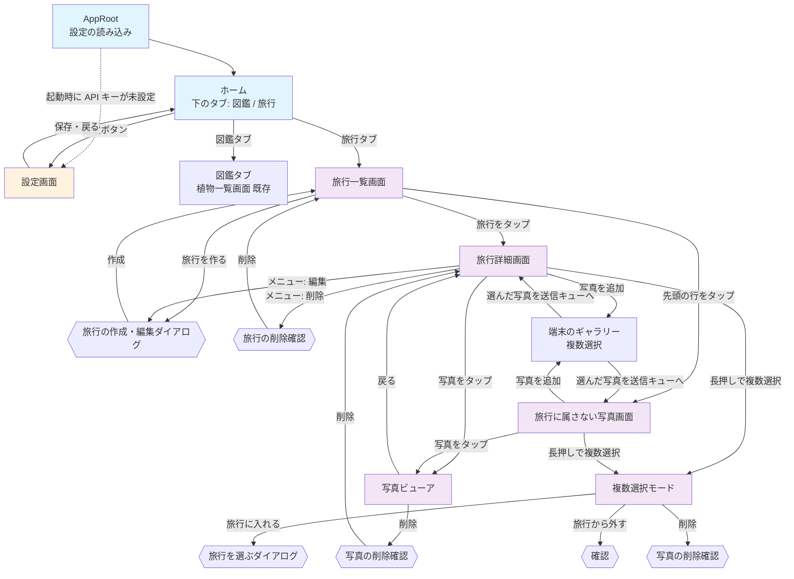

# 旅行アルバム 画面設計

## この文書の位置づけ

旅行アルバムの Flutter アプリ（`mobile/lib/`）の画面を、利用者から見える振る舞い（画面の要素・文言・遷移・ダイアログ・エラーの出方）で書く。
書き方は [docs/03_screen_design.md](../03_screen_design.md)（実装の写し）に合わせる。**この文書は未実装を含む目指す姿**で、
実装した画面はそのときに `docs/03_screen_design.md` へ取り込む。

段階2の画面は実装できる粒度で、段階3・4の画面は骨格で書く。各画面の見出しに段階を付ける。
API の形は [05_api_design.md](./05_api_design.md)、送信や保存のデータの形は [04_data_design.md](./04_data_design.md) を参照する。
文言はこの文書で決めたもので、第3版（設計案）には無い。変えるなら実装前に決める。

---

## 1. 画面一覧

| 画面 | 段階 | 画面上部の表示 | ソース（`mobile/lib/`、予定） |
|---|---|---|---|
| ホーム（下のタブ: 図鑑 / 旅行） | 2 | タブごと | `screens/home_shell.dart` |
| 図鑑タブ（植物一覧画面） | 2・3: 今のまま。4: 図鑑（種類タブ） | SnapPlant | `screens/plant_list_screen.dart`（段階4で `screens/catalog_screen.dart` に差し替え） |
| 旅行一覧画面 | 2 | 旅行 | `screens/trip_list_screen.dart` |
| 旅行の作成・編集ダイアログ | 2 | 旅行を作る / 旅行を編集 | `widgets/trip_form_dialog.dart` |
| 旅行詳細画面 | 2 | 旅行名 | `screens/trip_detail_screen.dart` |
| 旅行に属さない写真画面 | 2 | 旅行に属さない写真 | `screens/unassigned_photos_screen.dart` |
| 写真ビューア | 2 | （無し。全画面） | `screens/photo_viewer_screen.dart` |
| 旅行を選ぶダイアログ | 2 | 旅行を選ぶ | `widgets/trip_picker_dialog.dart` |
| 送信の進み具合バナー | 2 | — | `widgets/upload_progress_banner.dart` |
| 写真グリッド（複数選択つき） | 2 | — | `widgets/photo_grid.dart`（旅行詳細・未所属・段階3のタグ横断・段階4の項目詳細で共用） |
| タグ横断画面 | 3 | タグ名 | `screens/tag_photos_screen.dart` |
| やり直しダイアログ | 3（カテゴリ）・4（識別） | 解析をやり直す | `widgets/reprocess_dialog.dart` |
| 図鑑画面（種類タブ → 項目一覧） | 4 | 図鑑 | `screens/catalog_screen.dart` |
| 図鑑の項目詳細画面 | 4 | 項目名 | `screens/catalog_entry_screen.dart` |
| 設定画面 | 既存 | 設定 | `screens/settings_screen.dart` |

削除・移動の確認は独立した画面ではなく、各画面の上に出るダイアログである。

### 状態の持ち方（段階2）

CLAUDE.md「実装の慣習」の Flutter の構成方針（`setState`、コンストラクタ注入、`Navigator.push`）を守る。
画面をまたいで共有するのは次の2つだけで、どちらも `AppRoot`（`lib/app_root.dart`）が1つ作って各画面のコンストラクタに渡す。

| 共有するもの | 型 | 理由 |
|---|---|---|
| `ApiService` | 既存 | 今は `PlantListScreen` が自分で作っている（`plant_list_screen.dart` 86行）。2タブになると両方が同じ設定で通信するので、根で1つ作る |
| `UploadQueue` | `ChangeNotifier` | 送信は画面を移っても続く（要件 5.2）。画面の `State` に置くと画面を閉じたときに消える |

`UploadQueue` の購読は `ListenableBuilder` で行い、状態管理パッケージは入れない。
「画面をまたいで共有するクライアント状態」（お気に入りなど）はまだ無いので、CLAUDE.md の「見直す条件」には当たらない。

設定（API キー・エンドポイント）の読み込みと「API設定が完了していません」の扱いは `AppRoot` に移す。
今の植物一覧画面の起動時の挙動（API キー未設定なら設定画面を自動で開く、設定画面から戻ると設定を読み直す）は、
`AppRoot` が2タブの外側で同じように行う。植物一覧画面は `ApiService` を受け取って一覧を出すだけになる。

## 2. 画面遷移図（段階2）



- 旅行詳細画面と旅行に属さない写真画面は同じ部品（`PhotoGrid`）を使い、違いは「どの写真を出すか」「旅行から外す」の有無だけ
- 写真ビューアは、開いた一覧の写真を左右のスワイプで順に見られる（一覧の並び順のまま）
- 複数選択モードは画面ではなく、旅行詳細・未所属の画面上の状態。戻る操作で解除される

## 3. 全画面共通

[docs/03_screen_design.md](../03_screen_design.md) の「全画面共通」をそのまま引き継ぐ。
加えて旅行アルバムの画面に共通するもの。

- 処理の結果はスナックバーで知らせる。API の失敗の文言は `ApiException.userMessage`（ステータスで決まる固定文言か、サーバの `error.message`）。
  `ApiException` 以外の失敗では画面ごとの固定文言（各画面の表に書く）
- 一覧の読み込みは「読み込み中...」「0件」「取得に失敗」の3状態を持ち、失敗時は「エラーが発生しました」・文言・「再試行」ボタン。
  下に引っ張ると読み込み直す
- **撮影日時はタイムゾーン無しの文字列**（`2026-10-05T12:30:15`）で、端末のタイムゾーンに変換せず「2026年10月5日 12:30」と表示する
  （撮影した土地での時刻として扱う。要件 5.2）。`DateTime.parse()` の結果に `toLocal()` を掛けない（Z が無いのでローカル扱いになるが、
  表示のためだけに使い、変換はしない）。撮影日時が無い写真は「撮影日時なし」
- サーバが付ける日時（`createdAt`・`uploadedAt` など。UTC の ISO）は、既存の植物詳細と同じく端末のタイムゾーンに直して表示する
- 旅行の期間は「2026/10/05 〜 2026/10/08」。同じ日なら「2026/10/05」。撮影日時のある写真が無ければ「撮影日時なし」
- 画像は `cached_network_image` で表示する。キャッシュのキーは URL ではなく `photo-<id>`（原寸）/ `thumb-<id>`（サムネイル）。
  **SAS 付き URL は応答のたびに変わるので、URL をキーにするとキャッシュが効かない。** 写真用に上限を上げた `CacheManager` を使う
  （`utils/photo_cache_manager.dart`。既定の 200 件では数百枚の旅行で入れ替わり続ける）
- SAS の期限（`urlExpiresAt`）が過ぎた URL は 403 になる。画像の読み込みに失敗したら、一覧を取り直してから再表示する（利用者には「画像を読み込めません」と出す。
  下に引っ張れば取り直せる）
- 画像の読み込み中は「読み込み中...」、読み込めないときは「画像を読み込めません」
- **自動の再試行はしない**（既存と同じ）。例外は送信キューで、通信の一時的な失敗（ステータス 0 / 429 / 503）に限って 3 回まで送り直す（§4.7）

## 4. 各画面の詳細設計（段階2）

### 4.1 ホーム（下のタブ）

```
┌─────────────────────────────────────────┐
│ （選んだタブの画面）                    │
│                                         │
│                                         │
├─────────────────────────────────────────┤
│      [図鑑]              [旅行]         │ ← 下のタブ
└─────────────────────────────────────────┘
```

- 下のタブ「図鑑」「旅行」。起動時は「図鑑」（既存の初期画面を変えない）
- タブを切り替えても各タブの画面の状態（スクロール位置、読み込んだ一覧）は保たれる（`IndexedStack`）
- 設定ボタンは両方のタブの画面上部にあり、同じ設定画面を開く
- API キーが未設定のときは、どちらのタブでも「API設定が完了していません」「設定画面で API キーを入力してください」と「設定を開く」ボタン
  （既存の植物一覧画面の表示を2タブの共通部品にする）。設定画面から戻ると設定を読み直す（既存と同じ挙動。`docs/03_screen_design.md` §1 起動時の挙動）

### 4.2 旅行一覧画面

```
┌─────────────────────────────────────────┐
│ 旅行                             [設定] │ ← ヘッダー
├─────────────────────────────────────────┤
│ ┃ 送信中 5/12                           │ ← 送信の進み具合バナー（送信中・失敗ありのときだけ。§4.7）
├─────────────────────────────────────────┤
│ ┌─────────────────────────────────────┐ │
│ │ [写真] 旅行に属さない写真        >  │ │ ← 先頭に固定の行
│ │        8枚                          │ │
│ └─────────────────────────────────────┘ │
│ ┌─────────────────────────────────────┐ │
│ │ [表紙] 北海道 2026秋             >  │ │ ← 旅行（createdAt 降順）
│ │        12枚 · 2026/10/05 〜 10/08   │ │
│ └─────────────────────────────────────┘ │
│ ┌─────────────────────────────────────┐ │
│ │ [表紙] 京都                      >  │ │
│ │        0枚 · 撮影日時なし           │ │
│ └─────────────────────────────────────┘ │
│              (以下同様...)              │
│                              [旅行を作る] │ ← 右下に浮かぶボタン
└─────────────────────────────────────────┘
```

**画面要素：**
- ヘッダー: タイトル「旅行」と設定ボタン
- 送信の進み具合バナー（§4.7）
- 先頭の行「旅行に属さない写真」: 枚数（`GET /api/photos?tripId=none` の `total`）。タップで旅行に属さない写真画面へ。
  この行は旅行ではないので、編集・削除のメニューは無い
- 旅行の一覧: `GET /api/trips` が返す順（作成日時の降順。要件 5.1「新しい旅行が上」）。各行は表紙（最初の写真のサムネイル。無ければアイコン）、
  旅行名（1行。はみ出す分は省略）、枚数と撮影の期間（`photoCount`・`firstTakenAt`・`lastTakenAt`）。タップで旅行詳細画面へ
- 「旅行を作る」ボタン（右下に浮かぶ）: 旅行の作成ダイアログ（§4.3）

**一覧以外の表示：**

| 状態 | 表示 |
|---|---|
| 読み込み中 | 「旅行一覧を読み込み中...」 |
| 旅行が0件 | 先頭の行は出す。その下に「まだ旅行がありません」「「旅行を作る」から最初の旅行を作りましょう」 |
| 一覧の取得に失敗 | 「エラーが発生しました」、エラーの文言（`ApiException` 以外の失敗では「旅行一覧の読み込みに失敗しました」）、「再試行」ボタン |

旅行一覧と未所属の枚数は別々のリクエストで、片方だけ失敗したら、失敗した方だけエラーにする（未所属の枚数が取れなければ「—枚」）。

**一覧を読み込み直すタイミング：** 旅行詳細・未所属の画面から戻ったとき、旅行を作ったとき、送信キューの送信が1枚完了するたび（枚数が変わるため。
連続する完了はまとめて1回）、下に引っ張ったとき。

### 4.3 旅行の作成・編集ダイアログ

```
┌─────────────────────────────────────┐
│ 旅行を作る                          │ ← 編集時は「旅行を編集」
│                                     │
│ 旅行名                              │
│ ┌─────────────────────────────────┐ │
│ │例：北海道 2026秋                │ │ ← 1行・最大100文字
│ └─────────────────────────────────┘ │
│ メモ（任意）                        │
│ ┌─────────────────────────────────┐ │
│ │                                 │ │ ← 3行・最大1000文字
│ └─────────────────────────────────┘ │
│                                     │
│              [キャンセル] [作成]    │ ← 編集時は「保存」
└─────────────────────────────────────┘
```

- 旅行名: 1行、ヒント「例：北海道 2026秋」、100文字まで入力できる。メモ: 3行、1000文字まで
- 「作成」/「保存」: 前後の空白を除いて検証する。空なら入力欄の下に「旅行名を入力してください」と出して送らない。
  通れば `POST /api/trips`（作成）または `PUT /api/trips/{tripId}`（編集）を呼ぶ。処理中はボタンが「作成中...」/「保存中...」になり押せない
  - 成功: ダイアログを閉じ、「旅行を作成しました」/「旅行を更新しました」。作成後は旅行一覧を読み込み直す。編集後は旅行詳細のタイトルを更新する
  - 失敗: ダイアログに留まり、エラーの文言（`ApiException` 以外では「旅行の保存に失敗しました」）をスナックバーに出す。入力は残る
- 「キャンセル」（ダイアログの外をタップした場合も同じ）: 何もしない

旅行の期間や枚数は入力しない（写真から導く。[04 §1.2](./04_data_design.md#12-旅行type-trip)）。タグも段階2では付けない。

### 4.4 旅行詳細画面

```
┌─────────────────────────────────────────┐
│ [<] 北海道 2026秋                   [⋮] │ ← ヘッダー（戻る・旅行名・メニュー: 編集 / 削除）
│     12枚 · 2026/10/05 〜 10/08          │ ← 枚数と期間
├─────────────────────────────────────────┤
│ ┃ 送信中 5/12                           │ ← 送信の進み具合バナー（この旅行宛ての送信があるとき）
├─────────────────────────────────────────┤
│ ┌──────┐ ┌──────┐ ┌──────┐             │
│ │      │ │      │ │      │             │ ← サムネイルのグリッド（3列。takenAt 昇順、無しは末尾）
│ └──────┘ └──────┘ └──────┘             │
│ ┌──────┐ ┌──────┐ ┌──────┐             │
│ │      │ │      │ │  ⟳   │             │ ← 送信中の写真は端末の画像を半透明で表示
│ └──────┘ └──────┘ └──────┘             │
│ ┌──────┐ ┌──────┐                      │
│ │      │ │  !   │                      │ ← 送れなかった写真は「!」
│ └──────┘ └──────┘                      │
│                                         │
│                            [写真を追加] │ ← 右下に浮かぶボタン
└─────────────────────────────────────────┘
```

開くたびに `GET /api/trips/{tripId}`（枚数・期間）と `GET /api/photos?tripId={tripId}` を取り直す。

**画面要素：**
- ヘッダー: 戻るボタン、旅行名、右上のメニュー（「編集」→ §4.3、「削除」→ 下記）。その下に枚数と期間
- 写真のグリッド（`PhotoGrid`）: 3列の正方形のサムネイル。`GET /api/photos` が返す順（撮影日時の昇順。撮影日時が無い写真は末尾。[04 §5.3](./04_data_design.md#53-旅行の写真一覧)）。
  日付ごとの見出しは置かない。サムネイルが無い写真（`thumbnailUrl` が null）は原寸をサムネイルの大きさで出す。
  タップで写真ビューア（§4.6）、長押しで複数選択モード（§4.8）
- 送信キューにこの旅行宛ての項目があれば、サーバの写真の後ろに端末の画像を半透明で並べる（送信中は回転するアイコン、失敗は「!」）。
  送信が完了したらその項目は消え、一覧を取り直してサーバの写真として並び直す
- 「写真を追加」ボタン: 端末のギャラリーを開く（複数選択）。選んだ写真はこの旅行宛てに送る（送り方 ①。§4.7）

**一覧以外の表示：**

| 状態 | 表示 |
|---|---|
| 読み込み中 | 「写真を読み込み中...」 |
| 0件 | 「まだ写真がありません」「「写真を追加」からギャラリーの写真を送りましょう」 |
| 取得に失敗 | 「エラーが発生しました」、エラーの文言（`ApiException` 以外では「写真の読み込みに失敗しました」）、「再試行」 |
| 旅行が無い（404 `TRIP_NOT_FOUND`） | 「この旅行は削除されています」と表示し、戻るボタンで旅行一覧へ（一覧は読み込み直す） |

**削除：**

```
┌─────────────────────────────────────┐
│ 旅行を削除                          │
│                                     │
│ 「北海道 2026秋」と中の写真12枚を   │
│ 削除しますか？                      │
│ この操作は元に戻せません。          │
│                                     │
│                 [キャンセル] [削除] │
└─────────────────────────────────────┘
```

- 枚数は `GET /api/trips/{tripId}` の `photoCount`（要件 5.1「消す前に枚数を示して確認する」）。0枚なら「「京都」を削除しますか？」
- 「削除」: `DELETE /api/trips/{tripId}`。処理中はダイアログのボタンが押せず「削除中...」
  - 成功: 「旅行を削除しました」を表示して旅行一覧へ戻る（一覧は読み込み直す）
  - 失敗: 画面に留まり、エラーの文言（`ApiException` 以外では「旅行の削除に失敗しました」）。404 なら成功と同じ扱い（既に無い）
- この旅行宛ての送信が進行中なら、削除の前に「送信中の写真があります。送信を止めて削除しますか？」と出し、「削除」で送信キューのこの旅行宛ての項目を取り消してから削除する

**一覧を読み込み直すタイミング：** 写真ビューアから戻ったとき（削除したかどうかによらない）、複数選択の操作が完了したとき、送信が1枚完了するたび、下に引っ張ったとき。

### 4.5 旅行に属さない写真画面

旅行詳細画面と同じ部品で、次の点だけ違う。

- ヘッダーは「旅行に属さない写真」で、メニュー（編集・削除）は無い。枚数だけを出す（期間は出さない）
- `GET /api/photos?tripId=none` を取る
- 「写真を追加」は旅行を指定せずに送る（送り方 ②）
- 0件の表示は「旅行に属さない写真はありません」「「写真を追加」で送った写真は、あとから旅行に入れられます」
- 複数選択の操作に「旅行から外す」は無い（「旅行に入れる」と「削除」だけ）

### 4.6 写真ビューア

```
┌─────────────────────────────────────────┐
│ [<]                              [削除] │ ← 半透明のバー（タップで表示・非表示）
│                                         │
│                                         │
│              原寸の画像                 │ ← 左右のスワイプで前後の写真。ピンチで拡大
│                                         │
│                                         │
├─────────────────────────────────────────┤
│ 2026年10月5日 12:30                     │ ← 撮影日時（無ければ「撮影日時なし」）
│ 北海道旭川市                            │ ← 地名。無ければ緯度・経度「43.7700, 142.3600」、
│                                         │    位置情報が無ければ「位置情報なし」
│ 段階3: [風景]  段階4: サクラ >          │ ← 段階3以降（§5・§6）
└─────────────────────────────────────────┘
```

- 開いた一覧（旅行詳細・未所属）の写真を、一覧と同じ順で左右にスワイプして見られる（`PageView`）。原寸は `imageUrl`、表示までの間はサムネイルを出す
- 画面をタップすると上のバーと下の情報の表示・非表示が切り替わる
- 下の情報: 撮影日時、地名（`location.placeName`）。地名が無く緯度・経度があれば小数4桁で出す
- 削除: 確認ダイアログ「写真を削除」「この写真を削除しますか？\nこの操作は元に戻せません。」「キャンセル」「削除」。
  「削除」で `DELETE /api/photos/{photoId}`。成功なら「写真を削除しました」を出して、次の写真へ移る（最後の1枚なら一覧へ戻る）。
  失敗なら留まってエラーの文言（`ApiException` 以外では「写真の削除に失敗しました」）。404 なら成功と同じ扱い
- 送信中・送信失敗の写真（端末にしか無いもの）はビューアで開けない（タップしても何も起きない）

### 4.7 写真の追加と送信の進み具合

**写真を選ぶ：** 「写真を追加」で `image_picker` の `pickMultiImage()` を開く（既存と同じ画質85・最大1920px。
ハッシュの決定性は実機で確かめ、一致しなければ縮小なしに変える。[02 §6](./02_design_overview.md#6-リスク)）。
選ばずに閉じたら何もしない。読み込みに失敗したら「画像の読み込みに失敗しました」。

**準備：** 選んだ各ファイルについて、別の isolate（`compute`）で次を行う。その間はバナーに「写真を準備中... 3/12」。

| 処理 | 中身 | パッケージ |
|---|---|---|
| ハッシュ | ファイルのバイト列の SHA-256（16進・小文字）→ `photoId` | `crypto` |
| EXIF | `DateTimeOriginal` → `takenAt`（`YYYY-MM-DDTHH:mm:ss`。無ければ null）、GPS → 緯度・経度（無ければ null） | `exif` |
| サムネイル | 長辺 320px・画質 70 の JPEG | `flutter_image_compress` |
| 地名 | 緯度・経度があれば、小数3桁に丸めた座標をキーに端末内のキャッシュを引き、無ければ端末の Geocoder で市区町村まで引く。失敗・空応答は null | `geocoding`（[06 §4](./06_processing_design.md#4-地名への変換)） |

準備が済んだ順に `UploadQueue` に入れる。項目は `{ file, photoId, tripId?, takenAt, latitude, longitude, placeName, thumbnail }`。

**送信：** `UploadQueue` が同時 2 本まで `POST /api/photos` を呼ぶ（[05 §5.1](./05_api_design.md#51-post-apiphotos)）。
画面を移っても続く（`AppRoot` が持つ）。アプリを終了すると送信待ちは失われる（永続化は段階6）。

| 応答 | 扱い |
|---|---|
| 201 | 完了。その写真の旅行（または未所属）の一覧を読み込み直す |
| 200（既存） | 完了。応答の `tripId` が送った宛先と違えば、その写真を「送信済み（別の場所）」として数える |
| 0（通信失敗）/ 429 / 503 | 2秒 → 4秒 → 8秒の間隔で最大 3 回送り直す。それでも失敗なら「失敗」 |
| 404 `TRIP_NOT_FOUND` | 宛先の旅行が消えている。残りの同じ宛先の項目も「失敗」にし、「旅行が見つかりません」 |
| その他（400・413・415・500・502） | 「失敗」。文言は `ApiException.userMessage` |

**進み具合バナー：** 旅行一覧・旅行詳細・未所属の画面上部に、キューに項目があるときだけ出す。

```
┃ 送信中 5/12                                   ← 送信中（完了数/全体）
┃ 2枚を送信できませんでした  [送り直す] [閉じる] ← 失敗があり、送信中の項目が無いとき
```

- 「送り直す」: 失敗した項目を再びキューに入れる（準備はやり直さない）
- 「閉じる」: 失敗した項目をキューから消す（端末の写真は消えない。選び直せば送れる）
- 全部完了したら「12枚を送信しました」をスナックバーで出し、バナーを消す。「送信済み（別の場所）」があれば
  「12枚を送信しました（1枚は送信済みでした。別の旅行か、旅行に属さない写真にあります）」
- 旅行詳細では、その旅行宛ての項目だけを数える。旅行一覧では全体を数える

### 4.8 複数選択と、旅行への出し入れ・削除

グリッドの長押しで複数選択モードに入る。

```
┌─────────────────────────────────────────┐
│ [×] 3枚を選択中           [すべて選択]  │ ← ヘッダーが置き換わる
├─────────────────────────────────────────┤
│ ┌──────┐ ┌──────┐ ┌──────┐             │
│ │  ✓   │ │      │ │  ✓   │             │ ← 選んだ写真にチェック
│ └──────┘ └──────┘ └──────┘             │
│              (以下同様...)              │
├─────────────────────────────────────────┤
│ [旅行に入れる] [旅行から外す] [削除]    │ ← 下の操作バー（未所属の画面では「旅行から外す」が無い）
└─────────────────────────────────────────┘
```

- タップで選択を切り替える。「すべて選択」でサーバの写真を全部選ぶ（送信中・失敗の写真は選べない）。「×」か端末の戻る操作で解除
- 操作は選んだ写真が 1 枚以上のときだけ押せる

**旅行に入れる（送り方 ③、要件 5.1.1・5.2）：** 旅行を選ぶダイアログを出す。

```
┌─────────────────────────────────────┐
│ 旅行を選ぶ                          │
│                                     │
│ ( ) 北海道 2026秋   12枚            │ ← GET /api/trips の順。今いる旅行は出さない
│ ( ) 京都             0枚            │
│                                     │
│ [+ 新しい旅行を作る]                │ ← §4.3 のダイアログを開き、作った旅行を選んだ状態にする
│                                     │
│              [キャンセル] [入れる]  │
└─────────────────────────────────────┘
```

「入れる」で `POST /api/photos/move { photoIds, tripId }`。200 件を超えるときは 200 件ずつ分けて順に送る。

- 成功: 「3枚を「北海道 2026秋」に入れました」。応答の `notFound` が空でなければ「（1枚は見つかりませんでした）」を足す。選択を解除して一覧を読み込み直す
- 失敗: 留まってエラーの文言（`ApiException` 以外では「写真の移動に失敗しました」）。選択は残る。分けて送った途中で失敗したら、送れた分は入っている（押し直すと残りが送られる。同じ写真を再び送っても同じ結果になる）

**旅行から外す：** 確認ダイアログ「旅行から外す」「3枚を旅行から外しますか？\n写真は「旅行に属さない写真」に移ります。」「キャンセル」「外す」。
「外す」で `POST /api/photos/move { photoIds, tripId: null }`。成功なら「3枚を旅行から外しました」。失敗の扱いは「入れる」と同じ。

**削除：** 確認ダイアログ「写真を削除」「3枚の写真を削除しますか？\nこの操作は元に戻せません。」「キャンセル」「削除」。
「削除」で `DELETE /api/photos/{photoId}` を 1 枚ずつ順に呼ぶ（同時 2 本まで）。404 は成功と数える。
全部終わったら「3枚を削除しました」、失敗があれば「2枚を削除しました（1枚は削除できませんでした）」。選択を解除して一覧を読み込み直す。

## 5. 段階3の画面（骨格）

### 5.1 写真ビューアへの追加

- 下の情報に**カテゴリ**（`tags` の `category:` のもの。`植物` / `食べ物` / `風景` / `その他`。表示名は `GET /api/catalog/kinds` の `label`、`other` は固定で「その他」）
- 分類の状態（`processing.state`）: `pending` / `classifying` は「分類中...」（段階4で `step` が `identify` なら「識別中...」。`identifying` も同じ）、`failed` は「分類に失敗しました」（`step` が `identify` なら「識別に失敗しました」）と「やり直す」ボタン
- 「やり直す」ボタン（メニュー）: やり直しダイアログ（§5.3）

### 5.2 タグ横断画面

旅行一覧のヘッダーに「タグ」ボタンを足し、`GET /api/tags` のタグ一覧を出す。タグをタップすると `GET /api/photos?tag={tag}` を
`PhotoGrid` で出す（旅行をまたぐ。要件 5.4）。タグ横断画面の複数選択の操作は「削除」だけ。

### 5.3 やり直しダイアログ

```
┌─────────────────────────────────────┐
│ 解析をやり直す                      │
│                                     │
│ 手がかり（任意）                    │
│ ┌─────────────────────────────────┐ │
│ │例：これはサクラではなくウメ     │ │ ← 3行・最大500文字（contextInfo と同じ）
│ └─────────────────────────────────┘ │
│                               0/500 │
│              [キャンセル] [やり直す]│
└─────────────────────────────────────┘
```

`POST /api/photos/{photoId}/process { step: "classify", hint }`。202 なら「やり直しを受け付けました」。
段階4では `step` を選べる（「カテゴリから」/「名前だけ」）。利用者が直したコメント（`commentSource: "user"`）があればそれを、無ければ前回の `hint` を、手がかりに事前入力する。
受け付けた時点で写真のコメントは消え（[05 §5.7](./05_api_design.md#57-post-apiphotosphotoidprocess段階3)）、結果のコメントで置き換わる。
ダイアログにはその旨を一行で出す（「今のコメントは AI の結果で置き換わります」）。

### 5.4 進み具合

旅行詳細のサムネイルに、分類が済んでいない写真は小さな印を付ける。失敗した写真は「!」。一覧を下に引っ張ると最新の状態になる（自動の更新はしない）。

## 6. 段階4の画面（骨格）

### 6.1 図鑑タブ（種類タブ → 項目一覧）

```
┌─────────────────────────────────────────┐
│ 図鑑                             [設定] │
│ [植物] [食べ物] [風景]                  │ ← 種類タブ（GET /api/catalog/kinds の順）
├─────────────────────────────────────────┤
│ ┌─────────────────────────────────────┐ │
│ │ [表紙] サクラ                 [92%] │ │ ← 項目（名前・信頼度・写真の枚数）
│ │        3枚                          │ │
│ └─────────────────────────────────────┘ │
└─────────────────────────────────────────┘
```

`GET /api/catalog/entries?kind={kind}`。項目は文書ではなく、識別済みの写真をサーバが名前でまとめたもの（[04 §3.1](./04_data_design.md#31-項目は写真からまとめる)）。
信頼度・説明・表紙はその名前の写真のうち信頼度が最も高いものから来る。今の植物一覧画面（カード）を置き換える。信頼度のバッジの色分けは既存の4段階を流用。
開くたびにサーバが写真を読んでまとめるので、種類タブを切り替えるたびに読み込み直す（自動の更新はしない。下に引っ張れば取り直す）。

### 6.2 図鑑の項目詳細画面

```
┌─────────────────────────────────────────┐
│ [<] サクラ                              │
├─────────────────────────────────────────┤
│ 信頼度: [92%]                           │
│ 説明: …                                 │
│ 特徴: …                                 │
│ 学名: Prunus × yedoensis                │ ← kinds の fields を順に回して attributes[key] を出す
│ 科名: バラ科                            │    （無ければ「—」）
├─────────────────────────────────────────┤
│ ┌──────┐ ┌──────┐ ┌──────┐             │ ← この項目の写真（PhotoGrid。旅行をまたぐ）
│ └──────┘ └──────┘ └──────┘             │
└─────────────────────────────────────────┘
```

`GET /api/catalog/entry?kind={kind}&name={name}`（名前は URL エンコード。[05 §5.14](./05_api_design.md#514-図鑑段階4)）。写真をタップすると写真ビューアへ。
項目を削除する操作は無い（項目は写真の集まりなので、写真を消すか、やり直しで名前を変えれば消える）。

| 状態 | 表示 |
|---|---|
| 読み込み中 | 「項目を読み込み中...」 |
| `entry` が `null`（写真が 0 枚。やり直しで名前が変わった直後など） | 「この項目には写真がありません」と「戻る」。戻ると図鑑の一覧を読み込み直す |
| 取得に失敗 | 「エラーが発生しました」、エラーの文言（`ApiException` 以外では「項目の読み込みに失敗しました」）、「再試行」 |

### 6.3 写真ビューアへの追加

- コメント（AI の一言。`comment`）と「編集」。編集は入力欄のダイアログ（500文字まで）→ `PATCH /api/photos/{photoId} { comment }`。
  `commentSource: "user"` のときは「（編集済み）」と出す
- 図鑑の項目へのリンク（`identification.matchesKind` が true なら `identification.name` →「サクラ >」。タップで項目詳細（§6.2）を `identification.kind`・`name` で開く）
- `identification.matchesKind: false` のときは「分類と合わない写真です。やり直しで手がかりを付けてください」と「やり直す」
- 解析中（`processing.state` が `pending` / `classifying` / `identifying`）でもコメントは編集できる。自動の解析は利用者のコメントを消さない（[06 §3.2](./06_processing_design.md#32-書き込み)）。
  やり直し（§5.3）だけが置き換える

### 6.4 植物図鑑の廃止に伴う画面の削除

画像選択・コンテキスト入力画面、識別結果確認画面、植物詳細画面を削除する（[06 §7](./06_processing_design.md#7-今の植物図鑑の統合と廃止段階4)）。

## 7. 画面遷移のパターン（段階2）

### 旅行を作って写真を送る（送り方 ①）

1. ホーム → 旅行タブ
2. 「旅行を作る」→ 旅行名を入れて「作成」
3. 一覧の旅行をタップ → 旅行詳細
4. 「写真を追加」→ ギャラリーで複数選択
5. 準備 → 送信（バナーに進み具合）。画面を移っても続く
6. 送信が完了するたびに一覧が更新される

### 旅行を決めずに送り、あとで旅行に入れる（送り方 ②・③）

1. 旅行一覧の先頭「旅行に属さない写真」→ 「写真を追加」→ 送信
2. 送った写真を長押し → 複数選択 → 「旅行に入れる」→ 旅行を選ぶ（または「新しい旅行を作る」）→ 「入れる」
3. 旅行に属さない写真から消え、選んだ旅行に並ぶ

### 写真を見る・削除する

1. 旅行詳細 → 写真をタップ → 写真ビューア（スワイプで前後）
2. 「削除」→ 確認 → 次の写真へ（最後なら一覧へ）

### やり直し・キャンセル

- 各ダイアログの「キャンセル」（外をタップした場合も同じ）はその画面に留まる
- 複数選択モードは「×」か端末の戻る操作で解除する（選択は捨てる）
- 送信の失敗は「送り直す」で再開、「閉じる」で諦める。送った分は取り消せない（サーバの写真を消すには削除する）
