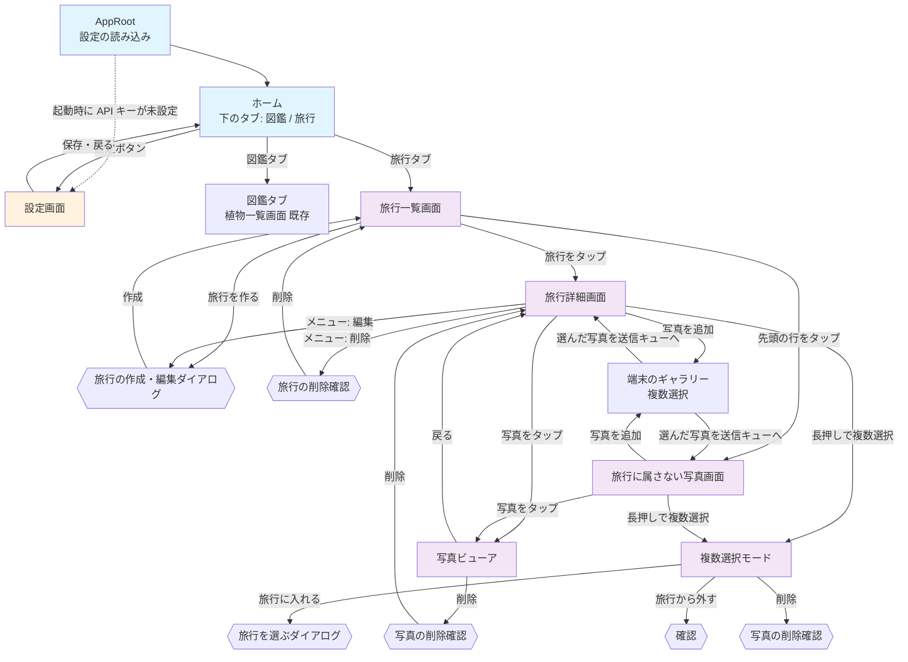

# 旅行アルバム 画面設計

## この文書の位置づけ

旅行アルバムの Flutter アプリ（`mobile/lib/`）の画面を、利用者から見える振る舞い（画面の要素・文言・遷移・ダイアログ・エラーの出方）で書く。
書き方は [docs/03_screen_design.md](../03_screen_design.md)（実装の写し）に合わせる。**この文書は未実装を含む目指す姿**で、
実装した画面は `docs/03_screen_design.md` へ取り込む（開発中はこの一式を正として都度直し、取り込みは機能が固まってから後でまとめて行う。2026-10-12 に人間が決定）。

段階2の画面は実装できる粒度で、段階3・4の画面は骨格で書く。各画面の見出しに段階を付ける。
API の形は [05_api_design.md](./05_api_design.md)、送信や保存のデータの形は [04_data_design.md](./04_data_design.md) を参照する。
文言はこの文書で決めたもので、第3版（設計案）には無い。変えるなら実装前に決める。

---

## 1. 画面一覧

| 画面 | 段階 | 画面上部の表示 | ソース（`mobile/lib/`、予定） |
|---|---|---|---|
| ホーム（下のタブ: 図鑑 / 旅行） | 2 | タブごと | `screens/home_shell.dart` |
| 図鑑タブ（植物一覧画面） | 2・3: 今のまま。4: 図鑑（種類タブ） | SnapPlant | `screens/plant_list_screen.dart`（段階4で `screens/catalog_screen.dart` に差し替え） |
| 旅行一覧画面 | 2 | 旅行 | `screens/trip_list_screen.dart` |
| 旅行の作成・編集ダイアログ | 2 | 旅行を作る / 旅行を編集 | `widgets/trip_edit_dialog.dart` |
| 旅行詳細画面 | 2 | 旅行名 | `screens/trip_detail_screen.dart` |
| 旅行に属さない写真画面 | 2 | 旅行に属さない写真 | `screens/unassigned_photos_screen.dart` |
| 写真ビューア | 2 | （無し。全画面） | `screens/photo_viewer_screen.dart` |
| 旅行を選ぶダイアログ | 2 | 旅行を選ぶ | `widgets/trip_picker_dialog.dart` |
| 送信の進み具合バナー | 2 | — | `widgets/upload_banner.dart`（「写真を追加」ボタンは `widgets/add_photos_button.dart`、送信の列は `services/upload_queue.dart`、EXIF の読み取りは `utils/photo_metadata.dart`） |
| 写真グリッド（複数選択つき） | 2 | — | `widgets/photo_grid.dart`（旅行詳細・未所属・段階3のカテゴリ横断・段階4の項目詳細で共用） |
| カテゴリ横断画面 | 3 | カテゴリ名 | `screens/category_photos_screen.dart` |
| やり直しダイアログ | 3（カテゴリ）・4（識別） | 解析をやり直す | `widgets/reprocess_dialog.dart` |
| 図鑑画面（種類タブ → 項目一覧） | 4 | 図鑑 | `screens/catalog_screen.dart` |
| 図鑑の項目詳細画面 | 4 | 項目名 | `screens/catalog_entry_screen.dart` |
| 設定画面 | 既存 | 設定 | `screens/settings_screen.dart` |

削除・移動の確認は独立した画面ではなく、各画面の上に出るダイアログである。

### 状態の持ち方（段階2）

CLAUDE.md「実装の慣習」の Flutter の構成方針（`setState`、コンストラクタ注入、`Navigator.push`）を守る。
画面をまたいで共有するのは次の2つだけで、どちらも `AppRoot`（`lib/app_root.dart`）が1つ作って各画面のコンストラクタに渡す。

| 共有するもの | 型 | 理由 |
|---|---|---|
| `ApiService` | 既存 | 2タブが同じ設定で通信するので、根で1つ作る（以前は `PlantListScreen` が自分で作っていた） |
| `UploadQueue` | `ChangeNotifier` | 送信は画面を移っても続く（要件 5.2）。画面の `State` に置くと画面を閉じたときに消える |

`UploadQueue` の購読は `ListenableBuilder` で行い、状態管理パッケージは入れない。
「画面をまたいで共有するクライアント状態」（お気に入りなど）はまだ無いので、CLAUDE.md の「見直す条件」には当たらない。

設定（API キー・エンドポイント）の読み込みと「API設定が完了していません」の扱いは `AppRoot` に移す。
今の植物一覧画面の起動時の挙動（API キー未設定なら設定画面を自動で開く、設定画面から戻ると設定を読み直す）は、
`AppRoot` が2タブの外側で同じように行う。植物一覧画面は `ApiService` を受け取って一覧を出すだけになる。
エンドポイントにも既定値は無い（本番の URL をアプリに組み込まない）。API キーかエンドポイントのどちらかが無ければ、タブを出さずに設定を促す表示にし、起動時は設定画面を自動で開く。

## 2. 画面遷移図（段階2）



- 旅行詳細画面と旅行に属さない写真画面は同じ部品（`PhotoGrid`）を使い、違いは「どの写真を出すか」「旅行から外す」の有無だけ
- 写真ビューアは、開いた一覧の写真を左右のスワイプで順に見られる（一覧の並び順のまま）
- 複数選択モードは画面ではなく、旅行詳細・未所属の画面上の状態。戻る操作で解除される

## 3. 全画面共通

[docs/03_screen_design.md](../03_screen_design.md) の「全画面共通」をそのまま引き継ぐ。
加えて旅行アルバムの画面に共通するもの。

- 処理の結果はスナックバーで知らせる。API の失敗の文言は `ApiException.userMessage`（ステータスで決まる固定文言か、サーバの `error.message`）。
  `ApiException` 以外の失敗では画面ごとの固定文言（各画面の表に書く）
- 一覧の読み込みは「読み込み中...」「0件」「取得に失敗」の3状態を持ち、失敗時は「エラーが発生しました」・文言・「再試行」ボタン。
  下に引っ張ると読み込み直す
- **写真の一覧はページで読む。** `GET /api/photos`（と段階4の `GET /api/catalog/entry`）は1回に 100 枚（サーバの既定）を返し、`continuationToken` が `null` でなければ続きがある。
  グリッドの下端に近づいたら次のページを読み、末尾に「読み込み中...」を出す。次のページの取得に失敗したら末尾に「続きを読み込めませんでした」と「再試行」。
  下に引っ張ると先頭から読み直す（トークンは捨てる）。規模が大きくなっても1回に読む量は変わらない（[04 §5.3](./04_data_design.md#53-旅行の写真一覧)）。
  続きを読んでいる間に読み直した場合、遅れて届いた古い続きは捨て、続きは読み直した1ページ目のトークンから読む。
  ページが空でもトークンがあれば続きを読む（サーバは空のページを読み直しても空なら、トークン付きで返すことがある）。
  引っ張って読み直すのは写真の一覧だけで、旅行詳細の見出し（枚数・期間）と旅行に属さない写真の画面の枚数は取り直さない（画面を開き直すと取り直す。複数選択の操作の後と、その画面宛ての写真の送信が一区切りついた後も取り直す。§4.4・§4.5・§4.7）
- **撮影日時はタイムゾーン無しの文字列**（`2026-10-05T12:30:15`）で、端末のタイムゾーンに変換せず「2026年10月5日 12:30」と表示する。
  グリッドの各サムネイルの読み上げのラベルも撮影日時（撮影日時が無ければ「撮影日時なし」）
  （撮影した土地での時刻として扱う。要件 5.2）。`DateTime.parse()` の結果に `toLocal()` を掛けない（Z が無いのでローカル扱いになるが、
  表示のためだけに使い、変換はしない）。撮影日時が無い写真は「撮影日時なし」
- サーバが付ける日時（`createdAt`・`uploadedAt` など。UTC の ISO）は、既存の植物詳細と同じく端末のタイムゾーンに直して表示する
- 旅行の期間は「2026/10/05 〜 2026/10/08」。同じ日なら「2026/10/05」。撮影日時のある写真が無ければ「撮影日時なし」
- 画像は `cached_network_image` で表示する。キャッシュのキーは URL ではなく `photo-<id>`（原寸）/ `thumb-<id>`（サムネイル）。
  **SAS 付き URL は応答のたびに変わるので、URL をキーにするとキャッシュが効かない。** 写真用に上限を上げた `CacheManager` を使う
  （`utils/photo_cache_manager.dart`。既定の 200 件では数百枚の旅行で入れ替わり続ける）。旅行一覧の表紙は応答に写真の id が無いので、
  SAS（クエリ）を除いた Blob の URL から `cover-<ホスト><パス>` をキーにする
- SAS の期限（`urlExpiresAt`）が過ぎた URL は 403 になる。画像を読み込めないサムネイルには「画像を読み込めません」と出し、自動では取り直さない
  （画像そのものが壊れていると取り直しが止まらなくなるため）。下に引っ張れば一覧ごと新しい URL で取り直せる
- サムネイルの読み込み中は灰色の枠だけを出す（3列のグリッドで1枚ずつ文字を出すと読みにくいため）
- 写真の一覧を下に引っ張って読み直す間は今のグリッドを出したままにし、失敗したらエラーの文言をスナックバーで知らせる（グリッドは残す）
- 旅行詳細では、写真の一覧が 404 `TRIP_NOT_FOUND` を返したら（先頭・続き・読み直しのどれでも）、上の失敗の表示ではなく画面全体を「この旅行は削除されています」にする（§4.4）
- **自動の再試行はしない**（既存と同じ）。例外は送信キューで、通信の一時的な失敗（ステータス 0 / 429 / 503）に限って 3 回まで送り直す（§4.7）

## 4. 各画面の詳細設計（段階2）

### 4.1 ホーム（下のタブ）

```
┌─────────────────────────────────────────┐
│ （選んだタブの画面）                    │
│                                         │
│                                         │
├─────────────────────────────────────────┤
│      [図鑑]              [旅行]         │ ← 下のタブ
└─────────────────────────────────────────┘
```

- 下のタブ「図鑑」「旅行」。起動時は「図鑑」（既存の初期画面を変えない）
- タブを切り替えても各タブの画面の状態（スクロール位置、読み込んだ一覧）は保たれる（`IndexedStack`）
- 設定ボタンは両方のタブの画面上部にあり、同じ設定画面を開く
- 設定画面から戻ったとき、エンドポイントと API キーが変わっていなければ、開いていたタブと各タブの状態をそのまま保つ。変わっていれば両方のタブを作り直し、新しい設定で読み直す
- API キーかエンドポイントのどちらかが未保存のときは、下のタブを出さずに「API設定が完了していません」「設定画面で API キーとエンドポイントを入力してください」と「設定を開く」ボタンだけを出す（文言はどちらが無い場合も同じ。起動時は設定画面を自動で開く）
  （設定の読み込みに失敗したときも同じくタブを出さず、「API設定の読み込みに失敗しました」と「再試行」）。設定画面から戻ると設定を読み直す（既存と同じ挙動。`docs/03_screen_design.md` §1 起動時の挙動）

### 4.2 旅行一覧画面

```
┌─────────────────────────────────────────┐
│ 旅行                             [設定] │ ← ヘッダー
├─────────────────────────────────────────┤
│ ┃ 送信中 5/12                           │ ← 送信の進み具合バナー（送信中・失敗ありのときだけ。§4.7）
├─────────────────────────────────────────┤
│ ┌─────────────────────────────────────┐ │
│ │ [写真] 旅行に属さない写真        >  │ │ ← 先頭に固定の行
│ │        8枚                          │ │
│ └─────────────────────────────────────┘ │
│ ┌─────────────────────────────────────┐ │
│ │ [表紙] 北海道 2026秋             >  │ │ ← 旅行（createdAt 降順）
│ │        12枚 · 2026/10/05 〜 10/08   │ │
│ └─────────────────────────────────────┘ │
│ ┌─────────────────────────────────────┐ │
│ │ [表紙] 京都                      >  │ │
│ │        0枚 · 撮影日時なし           │ │
│ └─────────────────────────────────────┘ │
│              (以下同様...)              │
│                              [旅行を作る] │ ← 右下に浮かぶボタン
└─────────────────────────────────────────┘
```

**画面要素：**
- ヘッダー: タイトル「旅行」と設定ボタン
- 送信の進み具合バナー（§4.7）
- 先頭の行「旅行に属さない写真」: 枚数（`GET /api/trips` の `unassignedPhotoCount`）。タップで旅行に属さない写真画面へ。
  この行は旅行ではないので、編集・削除のメニューは無い
- 旅行の一覧: `GET /api/trips` が返す順（作成日時の降順。要件 5.1「新しい旅行が上」）。各行は表紙（最初の写真のサムネイル。無いか読めなければアイコン）、
  旅行名（1行。はみ出す分は省略）、枚数と撮影の期間（`photoCount`・`firstTakenAt`・`lastTakenAt`）。タップで旅行詳細画面へ
- 「旅行を作る」ボタン（右下に浮かぶ）: 旅行の作成ダイアログ（§4.3）

**一覧以外の表示：**

| 状態 | 表示 |
|---|---|
| 読み込み中 | 「旅行一覧を読み込み中...」 |
| 旅行が0件 | 先頭の行は出す。その下に「まだ旅行がありません」「「旅行を作る」から最初の旅行を作りましょう」 |
| 一覧の取得に失敗 | 「エラーが発生しました」、エラーの文言（`ApiException` 以外の失敗では「旅行一覧の読み込みに失敗しました」）、「再試行」ボタン |
| 一覧が出ている状態での読み直しに失敗 | 一覧を出したまま、エラーの文言をスナックバーに出す（下に引っ張れば読み直せる）。読み直しの間も今の一覧を出したままにする |

旅行一覧と未所属の枚数は `GET /api/trips` の1回で取る（枚数と期間はサーバが `GROUP BY` で数え、写真を全部読まない。[04 §5.1](./04_data_design.md#51-旅行一覧)）。

**一覧を読み込み直すタイミング：** 旅行詳細・未所属の画面から戻ったとき、旅行を作ったとき、送信キューの送信が一区切りついたとき（準備中・送信中の写真が無くなったとき。枚数が変わるため。§4.7。ただし、その区切りで新しく入った写真が無い、つまり全部失敗したか全部が別の場所に送信済みだったときは、枚数が変わらないので読み直さない）、下に引っ張ったとき。

### 4.3 旅行の作成・編集ダイアログ

```
┌─────────────────────────────────────┐
│ 旅行を作る                          │ ← 編集時は「旅行を編集」
│                                     │
│ 旅行名                              │
│ ┌─────────────────────────────────┐ │
│ │例：北海道 2026秋                │ │ ← 1行・最大100文字
│ └─────────────────────────────────┘ │
│ メモ（任意）                        │
│ ┌─────────────────────────────────┐ │
│ │                                 │ │ ← 3行・最大1000文字
│ └─────────────────────────────────┘ │
│                                     │
│              [キャンセル] [作成]    │ ← 編集時は「保存」
└─────────────────────────────────────┘
```

- 旅行名: 1行、ヒント「例：北海道 2026秋」、100文字まで入力できる。メモ: 3行、1000文字まで
- 「作成」/「保存」: 前後の空白を除いて検証する。空なら入力欄の下に「旅行名を入力してください」と出して送らない。
  通れば `POST /api/trips`（作成）または `PUT /api/trips/{tripId}`（編集）を呼ぶ。処理中はボタンが「作成中...」/「保存中...」になり押せない
  - 成功: ダイアログを閉じ、「旅行を作成しました」/「旅行を更新しました」。作成後は旅行一覧を読み込み直す。編集後は旅行詳細のタイトルを更新する
  - 失敗: ダイアログに留まり、エラーの文言（`ApiException` 以外では「旅行の保存に失敗しました」）をスナックバーに出す。入力は残る
- 「キャンセル」（ダイアログの外をタップした場合も同じ）: 何もしない

旅行の期間や枚数は入力しない（写真から導く。[04 §1.2](./04_data_design.md#12-旅行type-trip)）。タグも段階2では付けない。

### 4.4 旅行詳細画面

```
┌─────────────────────────────────────────┐
│ [<] 北海道 2026秋                   [⋮] │ ← ヘッダー（戻る・旅行名・メニュー: 編集 / 削除）
│     12枚 · 2026/10/05 〜 10/08          │ ← 枚数と期間
├─────────────────────────────────────────┤
│ ┃ 送信中 5/12                           │ ← 送信の進み具合バナー（この旅行宛ての送信があるとき）
├─────────────────────────────────────────┤
│ ┌──────┐ ┌──────┐ ┌──────┐             │
│ │      │ │      │ │      │             │ ← サムネイルのグリッド（3列。撮影日時順。下端で次のページ）
│ └──────┘ └──────┘ └──────┘             │
│ ┌──────┐ ┌──────┐ ┌──────┐             │
│ │      │ │      │ │  ⟳   │             │ ← 送信中の写真は端末の画像を半透明で表示
│ └──────┘ └──────┘ └──────┘             │
│ ┌──────┐ ┌──────┐                      │
│ │      │ │  !   │                      │ ← 送れなかった写真は「!」
│ └──────┘ └──────┘                      │
│                                         │
│                            [写真を追加] │ ← 右下に浮かぶボタン
└─────────────────────────────────────────┘
```

開くたびに `GET /api/trips/{tripId}`（枚数・期間）と `GET /api/photos?tripId={tripId}`（最初のページ）を取り直す。

**画面要素：**
- ヘッダー: 戻るボタン、旅行名、右上のメニュー（「編集」→ §4.3、「削除」→ 下記）。その下に枚数と期間
- 写真のグリッド（`PhotoGrid`）: 3列の正方形のサムネイル。`GET /api/photos` が返す順（撮影日時の昇順。撮影日時が無い写真はアップロード日時の位置。[04 §5.3](./04_data_design.md#53-旅行の写真一覧)）。
  下端に近づいたら次のページを読む（§3）。日付ごとの見出しは置かない。サムネイルが無い写真（`thumbnailUrl` が null）は原寸をサムネイルの大きさで出す。
  タップで写真ビューア（§4.6）、長押しで複数選択モード（§4.8）
- 送信キューにこの旅行宛ての項目があれば、サーバの写真の後ろに端末の画像を半透明で並べる（送信中は回転するアイコン、失敗は「!」）。
  送信が完了したらその項目は消え、一覧を取り直してサーバの写真として並び直す
- 「写真を追加」ボタン: 端末のギャラリーを開く（複数選択）。選んだ写真はこの旅行宛てに送る（送り方 ①。§4.7）。
  旅行を読み込めるまでと、複数選択モードの間は出さない
- 段階3でヘッダーの下にカテゴリの絞り込みを足す（§5.3）

**一覧以外の表示：**

| 状態 | 表示 |
|---|---|
| 読み込み中 | 旅行の読み込み中は回転する印だけ。旅行を読めた後、写真の一覧を読んでいる間は「写真を読み込み中...」 |
| 0件 | 「まだ写真がありません」「「写真を追加」からギャラリーの写真を送りましょう」 |
| 旅行の取得に失敗 | 画面全体に「エラーが発生しました」、エラーの文言（`ApiException` 以外では「旅行の読み込みに失敗しました」）、「再試行」。編集・削除のメニューは出さない |
| 写真の一覧の取得に失敗 | 旅行名・枚数・期間は出したまま、写真の部分に「エラーが発生しました」、エラーの文言（`ApiException` 以外では「写真の読み込みに失敗しました」）、「再試行」 |
| 旅行が無い（404 `TRIP_NOT_FOUND`） | 「この旅行は削除されています」と表示し、戻るボタンで旅行一覧へ（一覧は読み込み直す）。旅行名と編集・削除のメニューは出さない。旅行の取得（開いたとき・取り直し）だけでなく、写真の一覧（`GET /api/photos?tripId=`）の先頭のページ・続きのページ・下に引っ張った読み直しのどれで分かっても同じで、写真の一覧の失敗の表示（「エラーが発生しました」・「続きを読み込めませんでした」・スナックバー）は出さない。判定は `code` で行い、`code` の違う 404 は「写真の一覧の取得に失敗」などの失敗と同じ扱い |

**削除：** 中の写真をどうするかを利用者が選ぶ（2026-10-12 に人間が決定）。API は `deletePhotos` を必須にしているので、写真が0枚で選択肢を出さないときも `deletePhotos=false` を載せる。

```
┌─────────────────────────────────────┐
│ 旅行を削除                          │
│                                     │
│ 「北海道 2026秋」を削除します。     │
│ 中の写真12枚はどうしますか？        │
│                                     │
│ (•) 写真は残す                      │ ← 既定
│     「旅行に属さない写真」に移ります │
│ ( ) 写真も削除する                  │
│     この操作は元に戻せません        │
│                                     │
│                 [キャンセル] [削除] │
└─────────────────────────────────────┘
```

- 枚数は `GET /api/trips/{tripId}` の `photoCount`（要件 5.1「消す前に枚数を示して確認する」）。0枚なら選択肢を出さず「「京都」を削除しますか？」「キャンセル」「削除」
- 成功の知らせの枚数は応答で決める。0枚の旅行なら括弧書きを付けず「旅行を削除しました」
- 既定は「写真は残す」（誤操作で写真が消えないように）。「写真も削除する」を選ぶと「削除」ボタンが赤くなる
- 「削除」: `DELETE /api/trips/{tripId}?deletePhotos=false|true`（選んだ方。[05 §5.12](./05_api_design.md#512-delete-apitripstripiddeletephotostruefalse)）。処理中はダイアログのボタンが押せず「削除中...」
  - 成功: 「旅行を削除しました（写真12枚は「旅行に属さない写真」に移しました）」または「旅行を削除しました（写真12枚を削除）」を表示して旅行一覧へ戻る（一覧は読み込み直す）。
    枚数は応答の `detachedPhotoCount` / `deletedPhotoCount`
  - 失敗: 確認ダイアログを開いたまま（そのまま再試行もキャンセルもできる）、エラーの文言（`ApiException` 以外では「旅行の削除に失敗しました」）をスナックバーに出す。旅行詳細も閉じない。404 なら成功と同じ扱い（既に無い）
- この旅行宛ての送信が進行中なら、削除の前に「送信中の写真があります。送信を止めて削除しますか？」と出し、「削除」で送信キューのこの旅行宛ての項目を取り消してから削除する。
  それでも削除と重なって届いた写真は消えないが、段階3の掃除のタイマーが未所属に戻すまでどの一覧にも出ない（まれなので許容。[04 §7.3](./04_data_design.md#73-旅行の削除と重なった送信move)）

**一覧を読み込み直すタイミング：** 写真ビューアから戻ったとき（削除したかどうかによらない）、複数選択の操作が完了したとき（見出しの枚数・期間も取り直す。§4.8）、送信が一区切りついて、この旅行宛ての写真が1枚以上送れていたとき（複数選択の操作の後と同じく、先頭のページから読み直し、見出しの枚数・期間も取り直す。§4.7）、下に引っ張ったとき。

### 4.5 旅行に属さない写真画面

旅行詳細画面と同じ部品で、次の点だけ違う。

- ヘッダーは「旅行に属さない写真」で、メニュー（編集・削除）は無い。枚数だけを出す（期間は出さない。枚数は `GET /api/trips` の `unassignedPhotoCount`）
- `GET /api/photos?tripId=none` をページで取る
- 「写真を追加」は旅行を指定せずに送る（送り方 ②。`tripId` のパートを省く）。進み具合バナーは、旅行を指定せずに送った写真だけを数える（§4.7）
- 0件の表示は「旅行に属さない写真はありません」「「写真を追加」で送った写真は、あとから旅行に入れられます」
- 複数選択の操作に「旅行から外す」は無い（「旅行に入れる」と「削除」だけ）。「旅行に入れる」のダイアログはすべての旅行を出す
- 複数選択の操作の後は、写真の一覧と一緒に枚数も `GET /api/trips` で取り直す（開いたときの枚数は旅行一覧から受け取る）。
  枚数の取り直しに失敗したら、枚数は前の値のまま出す（写真の一覧は読み直す。操作の知らせは出ているので、失敗の知らせは足さない）。
  送信が一区切りついて、旅行を指定せずに送った写真が1枚以上送れていたときも、同じく写真の一覧と枚数を取り直す（§4.7）

### 4.6 写真ビューア

```
┌─────────────────────────────────────────┐
│ [<]                              [削除] │ ← 半透明のバー（タップで表示・非表示）
│                                         │
│                                         │
│              原寸の画像                 │ ← 左右のスワイプで前後の写真。ピンチで拡大
│                                         │
│                                         │
├─────────────────────────────────────────┤
│ 2026年10月5日 12:30                     │ ← 撮影日時（無ければ「撮影日時なし」）
│ 北海道旭川市                            │ ← 地名。無ければ緯度・経度「43.7700, 142.3600」、
│                                         │    位置情報が無ければ「位置情報なし」
│ 段階3: [風景]  段階4: サクラ >          │ ← 段階3以降（§5・§6）
└─────────────────────────────────────────┘
```

- 開いた一覧（旅行詳細・未所属）の写真を、一覧と同じ順で左右にスワイプして見られる（`PageView`）。原寸は `imageUrl`、表示までの間はサムネイルを出す。
  一覧がまだ読んでいないページの写真は、読み込んだ末尾の写真まで来たときに一覧が次のページを読む（ビューアは一覧の読み込み済みの配列を共有する）。
  最後のページまで読んでいれば、末尾でそれ以上進まない
- 画面をタップすると上のバーと下の情報の表示・非表示が切り替わる
- 下の情報: 撮影日時、地名（`location.placeName`）。地名が無く緯度・経度があれば小数4桁で出す
- 削除: 確認ダイアログ「写真を削除」「この写真を削除しますか？\nこの操作は元に戻せません。」「キャンセル」「削除」。
  「削除」で `DELETE /api/photos/{photoId}`。成功なら「写真を削除しました」を出して、次の写真へ移る（最後の1枚なら一覧へ戻る）。
  失敗なら留まってエラーの文言（`ApiException` 以外では「写真の削除に失敗しました」）。404 なら成功と同じ扱い
- 送信中・送信失敗の写真（端末にしか無いもの）はビューアで開けない（タップしても何も起きない）

### 4.7 写真の追加と送信の進み具合

**一部実装済み**（PR 7a・7b。`widgets/add_photos_button.dart`・`services/upload_queue.dart`・`utils/photo_metadata.dart`・`widgets/upload_banner.dart`）。
PR 7a: 写真を選ぶ、準備のハッシュと EXIF、同時 2 本の送信、201 の扱い、進み具合バナーの「送信中」と失敗の行・「送り直す」「閉じる」、完了の知らせまで。
PR 7b: 準備が済んだ順に送ることと準備中の表示、自動の送り直し、404、200（別の場所）と完了の知らせの補足、失敗の理由の文言。
サムネイル・地名は PR 7c（[09 §2](./09_implementation_plan.md#2-段階2の-pr-分割)）。

**写真を選ぶ：** 「写真を追加」で `image_picker` の `pickMultiImage()` を開く（既存と同じ画質85・最大1920px。
ハッシュの決定性は実機で確かめ、一致しなければ縮小なしに変える。[02 §6](./02_design_overview.md#6-リスク)）。
選ばずに閉じたら何もしない。読み込みに失敗したら「画像の読み込みに失敗しました」。
選んだうちの一部だけが読めなかったときも同じ知らせを出し、読めた写真は送る（読めた写真まで送らずに捨てない）。

**準備：** 選んだ各ファイルについて、選んだ順に1枚ずつ、別の isolate（`compute`）で次を行う。その間はバナーに「写真を準備中... 3/12」
（準備を終えた枚数/選んだ枚数。読めなかった写真も準備を終えた枚数に数える。準備中の選択が複数あれば、その画面が数える宛先の分を合計する）。

| 処理 | 中身 | パッケージ |
|---|---|---|
| ハッシュ | ファイルのバイト列の SHA-256（16進・小文字）→ `photoId` | `crypto` |
| EXIF | `DateTimeOriginal` → `takenAt`（`YYYY-MM-DDTHH:mm:ss`。無ければ null）、GPS → 緯度・経度（度・分・秒を10進の度に直す。南緯・西経は負。片方しか読めなければ両方 null。無ければ null）。EXIF を読めなくても送信は止めない | `exif` |
| サムネイル | 長辺 320px・画質 70 の JPEG | `flutter_image_compress` |
| 地名 | 緯度・経度があれば、小数3桁に丸めた座標をキーに端末内のキャッシュを引き、無ければ端末の Geocoder で市区町村まで引く。失敗・空応答は null | `geocoding`（[06 §4](./06_processing_design.md#4-地名への変換)） |

準備が済んだ順に `UploadQueue` に入れ、全部の準備を待たずに送り始める。項目は `{ file, photoId, tripId?, takenAt, latitude, longitude, placeName, thumbnail }`。

**送信：** `UploadQueue` が同時 2 本まで `POST /api/photos` を呼ぶ（[05 §5.1](./05_api_design.md#51-post-apiphotos)。送るパートは [05 §8](./05_api_design.md#8-クライアントmobilelibservicesapi_servicedartに足すメソッド)。
撮影日時・緯度・経度が無ければそのパートを省き、旅行に属さない写真の画面から送るときは `tripId` を省く）。
画面を移っても続く（`AppRoot` が持つ）。アプリを終了すると送信待ちは失われる（永続化は段階6）。
設定（API キー・エンドポイント）を変えたときも、送信待ち・失敗の写真は捨てる（前の設定の宛先には送らない。送信中の要求の結果も知らせない）。選び直せば送れる。

| 応答 | 扱い |
|---|---|
| 201 | 完了。準備中の写真も送信中の項目も無くなった（一区切りついた）ときに、送れた写真の宛先の画面（旅行詳細・未所属）と旅行一覧が一覧を読み込み直す（1枚ごとには読み直さない。数百枚の送信で取得とグリッドの作り直しが同じ数だけ起き、スクロール位置も先頭に戻るため） |
| 200（既存） | 完了。応答の `tripId` が送った宛先と違えば、その写真を「送信済み（別の場所）」として数える（宛先の一覧は変わらないので、その宛先の画面は読み直さない） |
| 0（通信失敗。応答が 60 秒返らない時間切れを含む）/ 429 / 503 | 2秒 → 4秒 → 8秒の間隔（失敗を受けてから数える）で最大 3 回送り直す。それでも失敗なら「失敗」。送り直しを待つ間も送信中として数える（バナーは「送信中」のまま、同時 2 本の枠もふさいだまま、一区切りにもならない）。429 は封筒の無い応答（Functions ランタイムの「Too Busy」）も含む。時間切れが無いと、通信が固まったときに送信中のまま枠がふさがり、送り直しも区切りも来ない |
| 404 `TRIP_NOT_FOUND` | 宛先の旅行が消えている。残りの同じ宛先の項目（まだ送っていないものと、一時的な失敗の後で送り直しを待っているもの）も送らずに「失敗」にし、「旅行が見つかりません」。その後に準備が済んだ同じ宛先の写真も、送らずに失敗にする（送っても同じ結果になる。数百枚を選んだときに無駄な要求を送らない）。消えた宛先は、その宛先を数えている画面で「送り直す」を押すまで覚えている（一区切りや「閉じる」の後に同じ旅行へ選び直した写真も送らずに失敗にする。「送り直す」を押すと忘れて送る） |
| その他（400・413・415・500・502） | 「失敗」。文言は `ApiException.userMessage` |

**進み具合バナー：** 旅行一覧・旅行詳細・未所属の画面上部に、準備中の写真かキューの項目があるときだけ出す。

```
┃ 写真を準備中... 3/12                          ← 準備中の写真があるとき（送信中・失敗の行より優先する）
┃ 送信中 5/12                                   ← 送信中（完了数/全体）
┃ 2枚を送信できませんでした（旅行が見つかりません）  [送り直す] [閉じる] ← 失敗があり、送信中の項目が無いとき
```

- 準備中の写真があれば、送信中の項目や失敗した項目があっても準備中の行だけを出す（準備が済んでから送信中・失敗の行に替わる）
- 失敗の行には、理由を括弧で添える。理由はその画面のバナーが数えている失敗した項目のうち、最後に失敗したものの文言（404 `TRIP_NOT_FOUND` は「旅行が見つかりません」、それ以外は `ApiException.userMessage`。`ApiException` 以外は「写真の送信に失敗しました」）

- 「送り直す」: 失敗した項目を再びキューに入れる（準備はやり直さない。0 / 429 / 503 の自動の送り直しも改めて 3 回まで行う）。その画面のバナーが数えている項目だけが対象
- 「閉じる」: 失敗した項目をキューから消す（端末の写真は消えない。選び直せば送れる）。その画面のバナーが数えている項目だけが対象
- 準備中の写真も送信中の項目も無くなったら、送れた分を「12枚を送信しました」とスナックバーで出す（送れた分が 0 枚なら出さない）。
  準備中の写真が残っている間は、先に送れた分があっても知らせない（選んだ写真の途中で知らせて、残りの分でもう一度知らせることはしない）。
  枚数は宛先を問わずその区切りで送れた全部で、どの画面にいても出す（送信を始めた画面を閉じていても出る。`AppRoot` が出す）。
  失敗が無ければバナーを消す。失敗があればバナーは失敗の行（「2枚を送信できませんでした」）に替わり、「送り直す」か「閉じる」まで残る。「送信済み（別の場所）」があれば
  「12枚を送信しました（1枚は送信済みでした。別の旅行か、旅行に属さない写真にあります）」（12枚には送信済みの1枚も含む）
- 旅行詳細では、その旅行宛ての項目だけを数える。旅行に属さない写真の画面では、旅行を指定せずに送った項目だけを数える。旅行一覧では全体を数える
  （数える項目が無い画面にはバナーを出さない。例: 京都宛ての送信中に北海道の詳細を開いても出ない）。準備中の写真も同じく宛先で数える
  （京都宛ての写真の準備中に北海道の詳細を開いても「写真を準備中」は出ず、旅行一覧には出る）

### 4.8 複数選択と、旅行への出し入れ・削除

グリッドの長押しで複数選択モードに入る。長押しした写真が選ばれた状態で入る（「1枚を選択中」）。

```
┌─────────────────────────────────────────┐
│ [×] 3枚を選択中           [すべて選択]  │ ← ヘッダーが置き換わる
├─────────────────────────────────────────┤
│ ┌──────┐ ┌──────┐ ┌──────┐             │
│ │  ✓   │ │      │ │  ✓   │             │ ← 選んだ写真にチェック
│ └──────┘ └──────┘ └──────┘             │
│              (以下同様...)              │
├─────────────────────────────────────────┤
│ [旅行に入れる] [旅行から外す] [削除]    │ ← 下の操作バー（未所属の画面では「旅行から外す」が無い）
└─────────────────────────────────────────┘
```

- 見出しは「N枚を選択中」と「×」「すべて選択」に替わる（旅行名と編集・削除のメニューは出ない）。選んだ写真には読み上げでも「選択中」の状態が付く（選択モード中は選んでいない写真も「選択されていない」と読み上げる。選択モードの外では、サムネイルに選択の状態を付けない。読み上げが全部のサムネイルを「未選択」と読まないように）
- タップで選択を切り替える。「すべて選択」で読み込んだ写真を全部選ぶ（一覧はページで読むので、まだ読み込んでいない続きは入らない。送信中・失敗の写真は選べない）。「×」か端末の戻る操作で解除
  （端末の戻る操作でも画面は閉じない。解除すると選んだ写真も外れ、見出しが元に戻り、下の操作バーが消える）
- 選んだ枚数が 0 になっても選択モードのまま（「×」か戻る操作で抜ける）
- 操作は選んだ写真が 1 枚以上のときだけ押せる
- 操作の後の「一覧を読み込み直す」は、先頭のページから読み直す（「写真を読み込み中...」が出て、スクロール位置も先頭に戻る。下に引っ張ったときのように今の一覧を残したままにはしない）
- 各ダイアログは、送っている間（移動・削除の要求の応答を待つ間）は「キャンセル」と実行のボタンを押せず、外のタップ・戻る操作でも閉じない。
  旅行を選ぶダイアログでは、旅行の行と「新しい旅行を作る」も押せない（送った先と選んでいる旅行が食い違わないように。作成ダイアログを重ねると、送り終えて閉じるときに取り違える）。
  実行のボタンは「入れています...」「外しています...」「削除中...」に替わる（旅行の作成・削除のダイアログと同じ。二重に送らないように）

**旅行に入れる（送り方 ③、要件 5.1.1・5.2）：** 旅行を選ぶダイアログを出す。

```
┌─────────────────────────────────────┐
│ 旅行を選ぶ                          │
│                                     │
│ ( ) 北海道 2026秋   12枚            │ ← GET /api/trips の順。今いる旅行は出さない
│ ( ) 京都             0枚            │
│                                     │
│ [+ 新しい旅行を作る]                │ ← §4.3 のダイアログを開き、作った旅行を選んだ状態にする
│                                     │
│              [キャンセル] [入れる]  │
└─────────────────────────────────────┘
```

旅行の一覧はダイアログを開くたびに `GET /api/trips` で取り直す。読み込み中は「入れる」を押せない。
読み込みに失敗したら、ダイアログの中にエラーの文言（`ApiException` 以外では「旅行一覧の読み込みに失敗しました」）と「再試行」を出す。
旅行を選ぶまで「入れる」は押せない。
「新しい旅行を作る」で作った旅行は一覧の先頭に加わり、先に別の旅行を選んでいても作った旅行の選択に替わる（そのまま「入れる」で作った旅行に入る）。

「入れる」で `POST /api/photos/move { photoIds, tripId }`。200 件を超えるときは 200 件ずつ分けて順に送る（ちょうど 200 件なら 1 回）。

- 成功: ダイアログを閉じ、「3枚を「北海道 2026秋」に入れました」。枚数は応答の `moved` の件数（分けて送ったときは合計）。
  応答の `notFound` が空でなければ「（1枚は見つかりませんでした）」を足す（例「1枚を「京都」に入れました（1枚は見つかりませんでした）」）。
  選択を解除して（選択モードを抜ける）一覧を読み込み直す。旅行詳細では見出しの枚数・期間も `GET /api/trips/{tripId}` で取り直す（未所属の画面は §4.5）。
  取り直しに失敗したら見出しは前の値のまま出す（写真の一覧は読み直す。操作の知らせは出ているので、失敗の知らせは足さない。旅行が既に無い 404 なら「この旅行は削除されています」）
- 失敗: 留まってエラーの文言（`ApiException` 以外では「写真の移動に失敗しました」）。選択は残る（ダイアログで選んだ旅行も選んだまま）。分けて送った途中で失敗したら、送れた分は入っている（押し直すと残りが送られる。同じ写真を再び送っても同じ結果になる）。
  押し直して成功したら、出ている失敗の知らせを閉じてすぐに成功の知らせを出す

**旅行から外す：** 確認ダイアログ「旅行から外す」「3枚を旅行から外しますか？\n写真は「旅行に属さない写真」に移ります。」「キャンセル」「外す」。
「外す」で `POST /api/photos/move { photoIds, tripId: null }`（`tripId` のキーは省かずに `null` を送る。省くとサーバは 400）。成功なら「3枚を旅行から外しました」（枚数は `moved` の件数）。`notFound`・200 件ずつ分けて送ること・成功後の読み直し・失敗の扱いは「入れる」と同じ（失敗したら確認ダイアログに留まる）。

**削除：** 確認ダイアログ「写真を削除」「3枚の写真を削除しますか？\nこの操作は元に戻せません。」「キャンセル」「削除」。
「削除」で `DELETE /api/photos/{photoId}` を 1 枚ずつ順に呼ぶ（同時 2 本まで）。404 `PHOTO_NOT_FOUND`（別の端末で消されたなど）は成功と数える（封筒の無い 404 は失敗と数える）。
1 枚が失敗しても残りは続ける。全部終わったら確認ダイアログを閉じ、「3枚を削除しました」、失敗があれば「2枚を削除しました（1枚は削除できませんでした）」
（全部が失敗しても「0枚を削除しました（3枚は削除できませんでした）」で閉じる。削除では確認ダイアログに留まらない）。
選択を解除して一覧を読み込み直す（消せなかった写真は一覧に残る）。見出しの枚数の取り直しは「入れる」と同じ。

## 5. 段階3の画面（骨格）

### 5.1 写真ビューアへの追加

- 下の情報に**カテゴリ**（写真の `category` 欄。`植物` / `食べ物` / `風景` / `その他`。表示名は `GET /api/catalog/kinds` の `label`、`other` は固定で「その他」。`null`（分類前）なら出さない）
- 分類の状態（`processing.state`）: `pending` / `classifying` は「分類中...」（段階4で `step` が `identify` なら「識別中...」。`identifying` も同じ）、`failed` は「分類に失敗しました」（`step` が `identify` なら「識別に失敗しました」）と「やり直す」ボタン。
  `failed` は自動では再試行されない（[06 §1.3](./06_processing_design.md#13-状態と失敗)）ので、「やり直す」を押さない限りこの表示のまま
- 「やり直す」ボタン（メニュー）: やり直しダイアログ（§5.4）
- 解析中でも、写真の削除・旅行への出し入れ・（段階4の）コメントの編集はできる（「解析中」で操作を止めるロックは無い。[04 §7.4](./04_data_design.md#74-ワーカーの書き込みの決まり)）

### 5.2 カテゴリ横断画面

旅行一覧のヘッダーに「カテゴリ」ボタンを足し、`GET /api/catalog/kinds` の種類（`label`）と「その他」を一覧で出す。カテゴリをタップすると `GET /api/photos?category={category}` を
`PhotoGrid` でページで出す（旅行をまたぐ。要件 5.4「すべての旅行の食べ物の写真」）。複数選択の操作は「削除」だけ。
利用者のタグ（`tags`）での横断は、タグを付ける画面と一緒に後の段階で入れる。

### 5.3 旅行詳細画面のカテゴリの絞り込み

旅行詳細画面（§4.4）のヘッダーの下に、カテゴリのチップを横一列に並べる（要件 5.4）。

```
│ [<] 北海道 2026秋                   [⋮] │
│     12枚 · 2026/10/05 〜 10/08          │
├─────────────────────────────────────────┤
│ (すべて) (植物) (食べ物) (風景) (その他) │ ← 1つだけ選べる。既定は「すべて」
├─────────────────────────────────────────┤
│ ┌──────┐ ┌──────┐ ┌──────┐             │
```

- チップの表示名は §5.1 のカテゴリと同じ。「すべて」が既定で、画面を開き直すと「すべて」に戻る
- チップを選ぶと `GET /api/photos?tripId={tripId}&category={category}` を先頭から取り直す（継続トークンは同じ絞り込みにだけ有効。[05 §5.2](./05_api_design.md#52-get-apiphotos)）。「すべて」は `category` を付けない
- 分類前の写真（`category` が `null`）と、送信中・送れなかった端末の画像は「すべて」のときだけ並べる
- ヘッダーの枚数と期間は絞り込みに関係なく旅行全体のまま
- 絞り込んだ結果が0件なら「この旅行に{表示名}の写真はありません」
- 複数選択（§4.8）は絞り込んだまま使える

### 5.4 やり直しダイアログ

```
┌─────────────────────────────────────┐
│ 解析をやり直す                      │
│                                     │
│ 手がかり（任意）                    │
│ ┌─────────────────────────────────┐ │
│ │例：これはサクラではなくウメ     │ │ ← 3行・最大500文字（contextInfo と同じ）
│ └─────────────────────────────────┘ │
│                               0/500 │
│              [キャンセル] [やり直す]│
└─────────────────────────────────────┘
```

`POST /api/photos/{photoId}/process { step: "classify", hint }`。202 なら「やり直しを受け付けました」。
段階4では `step` を選べる（「カテゴリから」/「名前だけ」）。利用者が直したコメント（`commentSource: "user"`）があればそれを、無ければ前回の `hint` を、手がかりに事前入力する。
受け付けた時点で写真のコメントは消え（[05 §5.7](./05_api_design.md#57-post-apiphotosphotoidprocess段階3)）、結果のコメントで置き換わる。
ダイアログにはその旨を一行で出す（「今のコメントは AI の結果で置き換わります」）。

### 5.5 進み具合

旅行詳細のサムネイルに、分類が済んでいない写真は小さな印を付ける。失敗した写真は「!」。一覧を下に引っ張ると最新の状態になる（自動の更新はしない）。

## 6. 段階4の画面（骨格）

### 6.1 図鑑タブ（種類タブ → 項目一覧）

```
┌─────────────────────────────────────────┐
│ 図鑑                             [設定] │
│ [植物] [食べ物] [風景]                  │ ← 種類タブ（GET /api/catalog/kinds の順）
├─────────────────────────────────────────┤
│ ┌─────────────────────────────────────┐ │
│ │ [表紙] サクラ                 [92%] │ │ ← 項目（名前・信頼度・写真の枚数）
│ │        3枚                          │ │
│ └─────────────────────────────────────┘ │
└─────────────────────────────────────────┘
```

`GET /api/catalog/entries?kind={kind}&offset=&limit=`。項目は文書ではなく、識別済みの写真をサーバが名前でまとめたもの（[04 §3.1](./04_data_design.md#31-項目は写真からまとめる)）。
信頼度・説明・表紙はその名前の写真のうち信頼度が最も高いものから来る。今の植物一覧画面（カード）を置き換える。信頼度のバッジの色分けは既存の4段階を流用。
1回に 50 件（サーバの既定）で、下端に近づいたら `offset` を進めて次のページを読む（§3 の写真の一覧と同じ出方）。`total` が項目の総数なので、読み切ったかは `offset + 読んだ件数 >= total` で分かる。
種類タブを切り替えるたびに先頭から読み込み直す（自動の更新はしない。下に引っ張れば取り直す）。

### 6.2 図鑑の項目詳細画面

```
┌─────────────────────────────────────────┐
│ [<] サクラ                              │
├─────────────────────────────────────────┤
│ 信頼度: [92%]                           │
│ 説明: …                                 │
│ 特徴: …                                 │
│ 学名: Prunus × yedoensis                │ ← kinds の fields を順に回して attributes[key] を出す
│ 科名: バラ科                            │    （無ければ「—」）
├─────────────────────────────────────────┤
│ ┌──────┐ ┌──────┐ ┌──────┐             │ ← この項目の写真（PhotoGrid。旅行をまたぐ）
│ └──────┘ └──────┘ └──────┘             │
└─────────────────────────────────────────┘
```

`GET /api/catalog/entry?kind={kind}&name={name}`（名前は URL エンコード。[05 §5.14](./05_api_design.md#514-図鑑段階4)）。写真は `continuationToken` でページで読む（§3）。写真をタップすると写真ビューアへ。
見出しの「枚数」は `entry.photoCount`（サーバが数えた総数）で、読み込んだページの枚数ではない。
項目を削除する操作は無い（項目は写真の集まりなので、写真を消すか、やり直しで名前を変えれば消える）。

| 状態 | 表示 |
|---|---|
| 読み込み中 | 「項目を読み込み中...」 |
| `entry` が `null`（写真が 0 枚。やり直しで名前が変わった直後など） | 「この項目には写真がありません」と「戻る」。戻ると図鑑の一覧を読み込み直す |
| 取得に失敗 | 「エラーが発生しました」、エラーの文言（`ApiException` 以外では「項目の読み込みに失敗しました」）、「再試行」 |

### 6.3 写真ビューアへの追加

- コメント（AI の一言。`comment`）と「編集」。編集は入力欄のダイアログ（500文字まで）→ `PATCH /api/photos/{photoId} { comment }`。
  `commentSource: "user"` のときは「（編集済み）」と出す
- 図鑑の項目へのリンク（`identification.matchesKind` が true なら `identification.name` →「サクラ >」。タップで項目詳細（§6.2）を `identification.kind`・`name` で開く）
- `identification.matchesKind: false` のときは「分類と合わない写真です。やり直しで手がかりを付けてください」と「やり直す」
- 解析中（`processing.state` が `pending` / `classifying` / `identifying`）でもコメントは編集できる。自動の解析は利用者のコメントを消さない（[06 §3.2](./06_processing_design.md#32-書き込み)）。
  やり直し（§5.4）だけが置き換える

### 6.4 植物図鑑の廃止に伴う画面の削除

画像選択・コンテキスト入力画面、識別結果確認画面、植物詳細画面を削除する（[06 §7](./06_processing_design.md#7-今の植物図鑑の統合と廃止段階4)）。

## 7. 画面遷移のパターン（段階2）

### 旅行を作って写真を送る（送り方 ①）

1. ホーム → 旅行タブ
2. 「旅行を作る」→ 旅行名を入れて「作成」
3. 一覧の旅行をタップ → 旅行詳細
4. 「写真を追加」→ ギャラリーで複数選択
5. 準備 → 送信（バナーに進み具合）。画面を移っても続く
6. 送信が一区切りつくと一覧が更新される

### 旅行を決めずに送り、あとで旅行に入れる（送り方 ②・③）

1. 旅行一覧の先頭「旅行に属さない写真」→ 「写真を追加」→ 送信
2. 送った写真を長押し → 複数選択 → 「旅行に入れる」→ 旅行を選ぶ（または「新しい旅行を作る」）→ 「入れる」
3. 旅行に属さない写真から消え、選んだ旅行に並ぶ

### 写真を見る・削除する

1. 旅行詳細 → 写真をタップ → 写真ビューア（スワイプで前後）
2. 「削除」→ 確認 → 次の写真へ（最後なら一覧へ）

### やり直し・キャンセル

- 各ダイアログの「キャンセル」（外をタップした場合も同じ）はその画面に留まる
- 複数選択モードは「×」か端末の戻る操作で解除する（選択は捨てる）
- 送信の失敗は「送り直す」で再開、「閉じる」で諦める。送った分は取り消せない（サーバの写真を消すには削除する）
