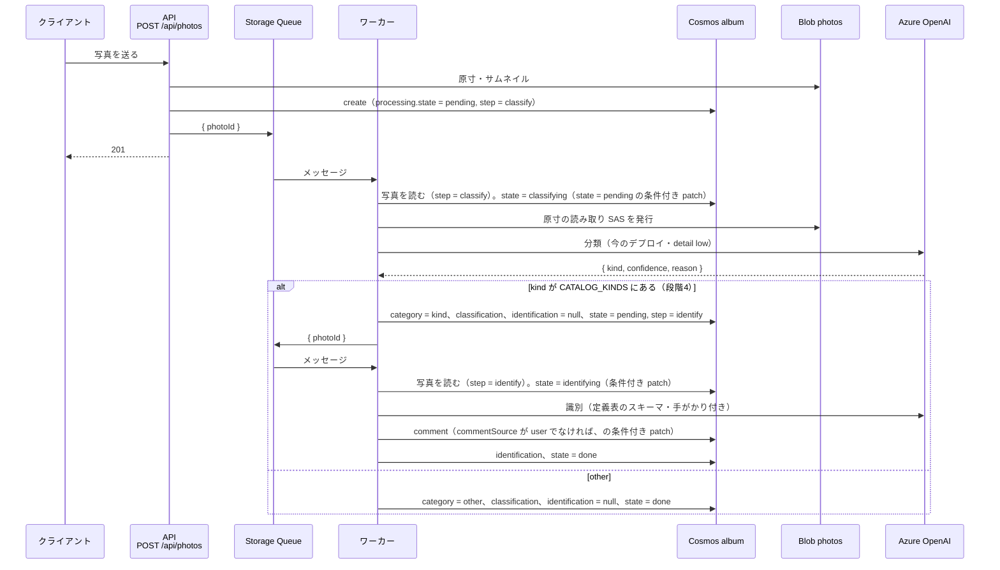

# 旅行アルバム 裏の処理の設計

## この文書の位置づけ

送信を待たせずに裏で行う処理（分類・識別・地名の埋め直し）の設計を書く。段階3・4が中心で、
段階2に関係するのは地名変換（§4 の端末側）だけ。**未実装を含む目指す姿**で、骨格の粒度。
実装したときに `docs/07_api_workflow.md`（ワークフロー）・`docs/06_api_design.md` へ取り込む。

データの項目は [04_data_design.md](./04_data_design.md)、やり直しの API は [05 §5.7](./05_api_design.md#57-post-apiphotosphotoidprocess段階3)、
インフラは [07_infrastructure_design.md](./07_infrastructure_design.md) を参照する。
キューの名前・再試行の回数・タイマーの間隔・モデルの環境変数名は第3版に無く、この文書で決めた。

---

## 1. キューとワーカー（段階3）

### 1.1 構成

| 項目 | 値 | 理由 |
|---|---|---|
| キュー | Azure Storage Queue `photo-processing`（既存のストレージアカウント。`AzureWebJobsStorage` と同じ） | 追加のリソースが要らず、Functions のトリガーが標準で使える。Service Bus は過剰 |
| メッセージ | `{ "photoId": "<id>" }`（JSON） | ワーカーは写真を読み直し、やる処理（`processing.step`）も手がかり（`hint`）も写真から取る。メッセージは「この写真を見ろ」という合図に過ぎない。メッセージに `step` や `hint` を載せると、再投入や重複配信で写真の中身と食い違ったものが届きうる（[04 §7.4](./04_data_design.md#74-ワーカーの書き込みの決まり)） |
| 投入 | API（Azure Functions）から `@azure/storage-queue` の `QueueClient.sendMessage()`（**`dependencies` に置く**） | 投入の失敗を握って応答を変えない、という制御をコードで書ける（出力バインディングは関数の戻り値で送るので、失敗時の扱いを制御しにくい）。`devDependencies` だと本番で読み込めない（CLAUDE.md「CI/CD」） |
| ワーカー | `api/src/functions/processPhoto.ts`。`app.storageQueue('processPhoto', { queueName, connection: 'AzureWebJobsStorage', handler })` | API と同じ Function App（Azure 上の1つのアプリ）に同居 |
| 直列化 | `host.json` の `extensions.queues` で `batchSize: 1`・`newBatchThreshold: 0` | AI のレート上限（TPM）と費用を抑える。1回の旅行で数百枚を一気に投入しても、順に流れる |
| 可視性タイムアウト・再試行 | `visibilityTimeout: 00:01:00`、`maxDequeueCount: 3`。3回失敗すると `photo-processing-poison` に落ちる。**poison キューに特別な対処はしない**（§5） | 一時的な失敗（429・503）は自動で再試行され、恒久的な失敗は止まる。処理の状態は写真の文書が正で、poison の中身は使わない |
| 再投入のタイマー | `api/src/functions/requeueStalePhotos.ts`。`app.timer`、10 分ごと。`processing.state` が `pending` / `classifying` / `identifying` のまま 10 分以上更新されていない写真を再投入（`{ photoId }`。やる処理は写真の `processing.step` にある）。**`failed` と `none` は拾わない** | poison に落ちたもの、投入前にプロセスが落ちたもの、投入に失敗したものを拾う。`attempts` が上限（3 回）なら再投入せず `failed` にする。`failed` を拾わないので、同じ画像で永遠に失敗し続けることが無い（§1.3） |
| 掃除のタイマー | `api/src/functions/sweepAlbum.ts`。`app.timer`、1日1回。文書の無い Blob（1日より古いもの）を消し、消えた旅行を指す写真を未所属に戻し、Blob の無い文書をログに出す | 途中で止まった操作の残骸を消す（[04 §7.2](./04_data_design.md#72-掃除のタイマー段階3)） |

キュー名は環境変数 `PHOTO_QUEUE_NAME`（既定 `photo-processing`）。Terraform で作る（[07 §2](./07_infrastructure_design.md#2-段階3)）。

### 1.2 流れ



- 段階2の `POST /api/photos` は `processing.state: "none"`・`step: null` で保存し、キューには投入しない。段階3で `pending`・`step: "classify"` + 投入に変える
- 段階3で、段階2に送った既存の写真（`state: "none"`）を分類するには、`POST /api/photos/{photoId}/process` を1枚ずつ呼ぶか、
  一度だけ走らせる手動のスクリプト（`api/scripts/enqueueUnclassified.ts`）で投入する。タイマーには `none` を拾わせない（意図せず全件に課金しないため）
- `step: "classify"` のやり直しは、結果の種類が識別対象なら続けて `identify` も投入する（要件 5.5.1「カテゴリの分類も、図鑑の項目の識別も対象」）。
  分類の結果を書くときに `identification` を `null` に戻す（識別が終わるまで図鑑からは一時的に消える。種類が変わったのに古い名前の下に残り続けるよりよい）
- ワーカーの書き込みの決まり（AI の担当の欄だけを patch する、コメントは条件付き patch、ロックや `_etag` の条件は置かない）は [04 §7.4](./04_data_design.md#74-ワーカーの書き込みの決まり)。
  利用者は解析中でもコメント・タグ・旅行を変えられる

### 1.3 状態と失敗

`processing` の遷移。`step` は「次にやる（またはやっている）処理」で、タイマーが再投入するときと、ワーカーがメッセージを受けたときに見る。

| 状態 | 意味 | `step` | 次 |
|---|---|---|---|
| `none` | 裏の処理の対象になっていない（段階2の写真） | `null` | `process` で `pending` |
| `pending` | キューに入っている（または入れようとした） | `classify` / `identify` | ワーカーが取ると `classifying` / `identifying` |
| `classifying` / `identifying` | 処理中 | 同上 | 成功で `done`（分類の後に識別が続くなら `pending`・`identify`）、失敗で `pending`（再試行）か `failed` |
| `done` | 済み | 最後にやった処理 | `process` で `pending` |
| `failed` | 上限まで失敗した。**自動では再試行しない** | 失敗した処理 | `process` で `pending`（`attempts` を 0 に戻す）。これ以外に `failed` から出る経路は無い |

- ワーカーは取り出すたびに `attempts` を +1 し、`updatedAt` を更新する。失敗したら `lastError` に `{ service, status }` 程度を書く（例外のメッセージは入れない。SDK 由来の文言が残り続けるため）
- `attempts >= 3`（`PHOTO_PROCESSING_MAX_ATTEMPTS`、環境変数。[07 §6](./07_infrastructure_design.md#6-設定値の一覧)）で `failed`。それ未満は例外を投げてキューの再試行に任せる
- 担当するときの `state` を処理中にする patch は `FROM c WHERE c.processing.state = "pending"` の条件付き。412 なら別のインスタンスが担当済み（古いメッセージの重複配信）で、何もしない。
  読んだ写真の `state` が `done` / `failed` / `none` でも何もしない
- AI の 429 は `UpstreamError('ai')` のまま投げ、キューの再試行（可視性タイムアウト後）で吸収する

**永遠に回り続けない。** 画像によっては AI が毎回失敗する（応答の検証違反・内容による拒否など）。その写真が自動の再試行を占有し続けないよう、上限で止める。

| 経路 | 止め方 |
|---|---|
| キューの再試行 | `maxDequeueCount: 3` で poison キューに落ちる（[07 §4](./07_infrastructure_design.md#4-hostjson-の変更)）。poison からは戻さず、中身も読まない（§5） |
| 再投入のタイマー | `attempts` が上限なら再投入せず `failed` にする。**`failed` は再投入のクエリに含めない**（[04 §5](./04_data_design.md#5-クエリ) の 5.8） |
| 利用者のやり直し（`process`） | `attempts` を 0 に戻してもう一度だけ 3 回まで試す。やり直しの回数に上限は置かず、費用は AI のデプロイの容量と予算アラートで抑える（§6） |

`failed` の写真は画面に「失敗」と「やり直す」が出る（[03 §5.1](./03_screen_design.md#51-写真ビューアへの追加)）。整合性の表は [04 §7.1](./04_data_design.md#71-操作ごとの表)。

- ワーカーの 1 回の処理は `functionTimeout`（5 分）に収める。AI の呼び出しは 1 枚 1 回なので十分
- 画面は `state` を見て「分類中...」「分類に失敗しました」「やり直す」を出す（[03 §5.1](./03_screen_design.md#51-写真ビューアへの追加)）

## 2. 分類（段階3）

### 2.1 モデルとサービス

| 項目 | 値 |
|---|---|
| デプロイ | 環境変数 `AZURE_OPENAI_CLASSIFY_DEPLOYMENT_NAME`。**未設定なら `AZURE_OPENAI_DEPLOYMENT_NAME`（今のデプロイ）を使う。** 当面は分類にも今の GPT-5 系のデプロイ（`gpt-5.6-luna`。Terraform の `azurerm_cognitive_deployment.gpt5_luna`）をそのまま使い、分類用のデプロイは足さない（2026-10-12 に人間が決定。[02 §5](./02_design_overview.md#5-人間に決めてもらう点推奨付き) #17）。将来 GPT-5 系の nano / mini に変えるときは、Terraform でデプロイを1つ足して環境変数を書き換えるだけ（[07 §2](./07_infrastructure_design.md#2-段階3)）。**TODO: 安価なモデル（nano / mini）への切り替え（要件 5.4）。実測（§6）を見てから行う** |
| 画像 | 原寸の Blob の読み取り SAS（15 分。既存の `TEMP_SAS_EXPIRY_MINUTES` と同じ理由）を `image_url` に、`detail: "low"` |
| サービス | `api/src/services/photoClassifierService.ts`。`OpenAIVisionService` を一般化した `analyze({ deployment, schema, prompt, imageUrl, detail })` を呼ぶ |
| 失敗 | `UpstreamError('ai')`。応答の検証違反も同じ（既存の `identifyPlant()` と同じ扱い） |

`OpenAIVisionService` の一般化: `identifyPlant()` を残したまま、デプロイ名・スキーマ・プロンプトを引数で受ける `analyze()` を足す。
Azure / OpenAI API の分岐、`api-version`、`max_completion_tokens`、`temperature` を指定しない点はそのまま。
`baseURL` にデプロイ名を埋め込む形（`openAIVisionService.ts` 96行）は、デプロイごとにクライアントを作る形に直す。

### 2.2 契約（Structured Outputs）

```json
{
  "type": "object",
  "properties": {
    "kind": { "type": "string", "enum": ["plant", "food", "landscape", "other"],
              "description": "写真の主題のカテゴリ。植物・食べ物・風景のどれでもなければ other" },
    "confidence": { "type": "number", "description": "分類の信頼度（0-100）" },
    "reason": { "type": "string", "description": "判定理由（日本語で簡潔に）" }
  },
  "required": ["kind", "confidence", "reason"],
  "additionalProperties": false
}
```

- `enum` は `Object.keys(CATALOG_KINDS)` + `'other'` から組み立てる（定義表に種類を足すと追従する）
- strict モードの制約（`openAIVisionService.ts` 5〜14行）はそのまま: `minimum` / `maximum` が使えないので 0〜100 はコードで検証する
- プロンプトは「主題を1つ選ぶ。人や動物、建物の内装など当てはまらないものは other」。撮影地（`placeName`）があれば手がかりとして渡す

### 2.3 書き込み

AI の担当の欄だけを1回の patch で `set` する（条件は付けない。[04 §7.4](./04_data_design.md#74-ワーカーの書き込みの決まり)）。`tags`・`comment`・`tripId` には触らない。

- `category = kind`（`other` を含む）。専用の欄なので、利用者のタグと選り分ける処理は無い（[04 §2](./04_data_design.md#2-カテゴリとタグ)）
- `classification = { kind, confidence, model: <デプロイ名>, at: <ISO> }`
- `identification = null`（やり直しで種類が変わったとき、古い識別が図鑑の別の種類に残らないように）
- `kind` が `CATALOG_KINDS` にあれば（段階4）`processing = { state: "pending", step: "identify", attempts: 0, ... }` とし、patch の後に `{ photoId }` を投入する。投入に失敗してもタイマーが拾う。`other` なら `done`

## 3. 識別（段階4）

### 3.1 契約

名前は AI が確定し、第2候補以降は残さない（要件 5.5）。

```
{
  matchesKind: boolean,            // 分類どおりの種類が写っているか。false なら以下は null 可
  name: string | null,             // 命名規則どおりの最も細かい粒度
  confidence: number,              // 0〜100（範囲はコードで検証）
  description: string | null,      // 種類の説明
  characteristics: string | null,  // 見た目の特徴（一言）
  comment: string,                 // この写真への一言。確証が無いときは「〇〇の可能性もある」と補足
  attributes: { <CATALOG_KINDS[kind].fields から> }
}
```

- スキーマは `kind` ごとに定義表から組み立てる（[04 §3.2](./04_data_design.md#32-定義表-catalog_kindsapisrccatalogkindsts)）。`attributes` の各項目は `required` に入れ、任意は `["string","null"]`、`string[]` は `["array","null"]`
- `candidates` は無い。プロンプトで「候補を列挙せず1つに決める。信頼度が低いときは `comment` で補足する」と指示する
- 命名規則は定義表の `namingRule` をプロンプト本文に入れる
- 手がかりは既存の `contextSection`（`openAIVisionService.ts` 137〜141行）と同じ形で渡す:

  ```
  追加情報：
  利用者からの手がかり: <hint>
  撮影地: 北海道旭川市
  撮影日時: 2026-10-05 12:30
  この情報を参考にして、識別の精度を向上させてください。
  ```

  `hint` は `POST /api/photos/{photoId}/process` が保存したもの。無い行は出さない

### 3.2 書き込み

項目の文書は無い（[04 §3](./04_data_design.md#3-図鑑の項目と定義表段階4)）ので、書くのは**写真1枚だけ**（[04 §7.4](./04_data_design.md#74-ワーカーの書き込みの決まり)）。
コメントの条件付き patch と、結果（`identification`・`processing`）の patch の2回で、`_etag` の条件も読み直しも無い。
項目を探す・作る・併合する処理も、写真を付け替える処理も無い。図鑑はこの `identification` を読んでまとめる。

| 結果 | `identification` | `comment` / `commentSource` | `processing` |
|---|---|---|---|
| `matchesKind: true` | `{ kind, matchesKind: true, name: name.trim(), confidence, description, characteristics, attributes, reason: null, model, at }` | `comment`・`"ai"`（下の決まり） | `state: "done"` |
| `matchesKind: false` | `{ kind, matchesKind: false, name: null, confidence, description: null, characteristics: null, attributes: {}, reason: comment, model, at }`。図鑑には出ない | 触らない | `state: "done"`。画面は「分類と合わない」と出す |

`comment` の決まり:

- `comment`・`commentSource: "ai"` の patch に `FROM c WHERE IS_NULL(c.commentSource) OR c.commentSource = "ai"` の条件を付ける。412（利用者がその間にコメントを書いた）なら書かずに結果の patch へ進む
  （送信直後の自動の解析が、利用者がその間に書いたコメントを消さないように）。Cosmos が条件を原子的に評価するので、読んでから書くまでの間を気にしなくてよい
- やり直し（`process`）は受付の時点で `comment` を `null` にする（[05 §5.7](./05_api_design.md#57-post-apiphotosphotoidprocess段階3)）ので、やり直しの結果は必ず書かれる
  （[02 §5](./02_design_overview.md#5-人間に決めてもらう点推奨付き) #9「やり直しは利用者のコメントを上書きする」）。
  利用者の文を失わないよう、アプリのやり直し画面は `commentSource == "user"` なら現在のコメントを、無ければ前回の `hint` を、手がかりに事前入力する

### 3.3 既存の `identifyPlant()` との関係

`PLANT_IDENTIFICATION_SCHEMA`（`openAIVisionService.ts` 15〜84行）と `identifyPlant()` は、植物図鑑の廃止（§7）と同時に消す。
それまでは `analyze()` と並存する。`validateAnalysisResult()` の「範囲はコードで検証」の方針は新しい検証にも引き継ぐ。

## 4. 地名への変換

要件 5.3「緯度・経度を地名（市区町村など）に変換して表示する」と §8「段階と方法は設計で決める」。

### 4.1 比較

| 案 | 費用（推測。要確認） | どこで・いつ | 利点 | 欠点 |
|---|---|---|---|---|
| **a. 端末の Geocoder**（`geocoding` パッケージ → Android `Geocoder.getFromLocation`） | 0 円。API キー不要 | クライアント、送る前（段階2） | 追加のインフラ・秘密情報が無い。端末のロケール（日本語）で返る（推測） | Google Play 開発者サービスが要る（要実測）。応答が無い・遅いことがある。サーバで後から埋め直せない。結果の文字列をクライアントから受け取る（長さの検証のみ） |
| **b. Azure Maps Search（Reverse Geocode）** | Gen2 で月 1,000 トランザクションまで無料、超過は 1,000 件あたり数百円（推測。価格表で確認） | サーバのワーカー、段階3 | Terraform で同じ請求にまとまる。`language=ja-JP`。既存の写真も裏で埋められる | アカウントとキーが増える。1旅行 300 枚で丸めキャッシュ無しだと無料枠に迫る |
| c. OpenStreetMap Nominatim | 無料 | サーバのワーカー | キー不要 | 1 req/s・一括利用禁止で、裏の処理の一斉実行と相性が悪い。稼働率の保証が無い |
| d. 分類 LLM に座標から地名を答えさせる | LLM の費用に含まれる | 段階3 | 追加サービス無し | 市区町村の精度は信頼できない。却下 |
| e. 国土数値情報の行政区域をサーバに同梱 | 0 円 | サーバ | 外部通信無し | データが数十 MB、海外が無い、更新の手間。個人規模には重い |

**決定（2026-10-12）: 段階2で a。b（Azure Maps）は任意で、a が足りないときに「地名が無い写真だけ裏で埋める」補助として足す。iOS に対応するときに改めて検討する**
（a は Google Play 開発者サービスが入っている Android で動く。SC-03K は可。オフラインでは変換できず `placeName: null` で送る。[02 §6](./02_design_overview.md#6-リスク)）。

### 4.2 段階2（端末）

- 送信キューの準備で、EXIF から緯度・経度を読んだ後、小数3桁（≒ 100 m）に丸めた座標をキーにした端末内のキャッシュ（`shared_preferences`）を引き、無ければ `Geocoder` を呼ぶ
- 市区町村の粒度: `Placemark` の `administrativeArea`（都道府県）+ `locality`（市区町村）を連結する（例: 「北海道旭川市」）。どちらも空なら `null`
- 失敗・空応答・タイムアウト（5 秒）は `placeName: null` で送る（**送信を止めない**）。`placeSource: "device"`
- サーバは `placeName` を 1〜100 文字として検証して保存するだけ。写真ビューアに `placeName` を出し、無ければ緯度・経度を出す
- **要実測**: a が SC-03K で動くか、市区町村まで返すか。段階2の PR 7 の実機確認で確かめ、ダメなら b を段階3に繰り上げる

### 4.3 段階3（サーバ・任意）

- `api/src/services/geocodingService.ts` の interface `reverse(lat, lon): Promise<{ placeName: string } | null>` と、Azure Maps の実装
- ワーカーの `classify` の前に、`location` があり `placeName` が無い写真だけ呼ぶ。結果は `type: "geocache"`（[04 §1.5](./04_data_design.md#15-地名のキャッシュtype-geocache段階3任意)）に置いて使い回す
- 呼び出し回数の上限は置かない。費用は AI と同じ考え方（§6）で、Azure Maps 側の設定（無料枠の 1,000 件/月を超えたら予算アラート。可能なら Azure Maps のクォータ）で抑える。
  丸めたキャッシュ（`geocache`）があるので、同じ場所の写真は1回しか呼ばない
- `UpstreamService` に `'geocoding'` を足す。失敗しても分類は続ける（地名は手がかりに過ぎない）
- キー `AZURE_MAPS_KEY` は Terraform の `azurerm_maps_account` から `app_settings` へ

### 4.4 段階4

識別のプロンプトに「撮影地: 北海道旭川市、撮影日時: 2026-10-05 12:30」を `contextSection` と同じ形で入れる（§3.1）。特に風景で効く（要件 5.5）。

## 5. 失敗と再試行のまとめ

| 失敗 | どこで | 扱い |
|---|---|---|
| キューへの投入の失敗（API・ワーカー） | `POST /api/photos`・`process`・分類の後の識別の投入 | どれも写真に `pending`・`step` を書いた後なので、投入に失敗しても成功を返し（201 / 202）、タイマーが `step` を見て再投入する。失敗を返すと「失敗したのに後で勝手に走る」ことになる |
| AI の 429 / 503 | ワーカー | 例外を投げてキューの再試行。3 回で poison → タイマーが `failed` に |
| poison キュー（`photo-processing-poison`）に落ちたメッセージ | — | **特別な対処は要らない**（2026-10-12 に人間が決定）。処理の状態は写真の文書（`processing.state` が `failed` など）が正で、poison の中身は使わない。Storage Queue のメッセージは既定の TTL（7 日）で消える。失敗した写真はアプリに「失敗」と「やり直す」が出る（[03 §5.1](./03_screen_design.md#51-写真ビューアへの追加)）。必要になったら poison キューの件数を監視する程度 |
| AI の応答の検証違反 | ワーカー | 同上（内容が変わる可能性があるので再試行する価値がある）。毎回失敗する画像でも 3 回で `failed` になり、以後は利用者が頼んだときだけ試す（§1.3） |
| Blob の SAS 生成の失敗 | ワーカー | 同上 |
| 担当の patch が 412（`state` が `pending` でない） | ワーカー | 別のインスタンスが担当済み。何もしない |
| コメントの patch が 412（利用者がコメントを書いた） | ワーカー | コメントは書かず、結果の patch に進む（[04 §7.4](./04_data_design.md#74-ワーカーの書き込みの決まり)） |
| 同じメッセージの重複配信 | ワーカー | 担当の条件付き patch と写真の `state` で飛ばす（§1.3） |
| 地名変換の失敗 | ワーカー | ログだけ。分類は続ける |
| 10 分以上 `pending` / `classifying` / `identifying` のまま | タイマー | 再投入（`attempts` 未満）か `failed`。`failed` は拾わない |
| 途中で止まった操作の残骸（孤児 Blob・消えた旅行を指す写真） | 掃除のタイマー | 1日1回消す・戻す（[04 §7.2](./04_data_design.md#72-掃除のタイマー段階3)） |

操作ごとに「途中で失敗したら何が残り、どう直るか」は [04 §7.1](./04_data_design.md#71-操作ごとの表) の表。

## 6. 費用の抑え方

**アプリの中に1日の呼び出し回数のカウンタは置かない**（2026-10-12 に人間が決定。費用は LLM 側のサービスの設定で抑える）。
カウンタを持つと、数える文書・原子的な加算・上限に達したときの「翌日に回す」経路がアプリに増える。代わりに次の3つで抑える。

| 手段 | 何を抑えるか | どこで |
|---|---|---|
| (a) Azure OpenAI のデプロイの容量（1分あたりのトークン数の上限） | **1日の費用の天井**。容量 × 1,000 トークン/分 × 1,440 分 × 単価 を超えない。超えた呼び出しは 429 になり、キューの再試行で翌分以降に流れる（止まらず、遅くなるだけ）。当面は今のデプロイの値（150）のまま（#17）。下げたくなったら Terraform の値を変えるだけ | Terraform の `azurerm_cognitive_deployment.gpt5_luna` の `sku.capacity`（[07 §2](./07_infrastructure_design.md#2-段階3)） |
| (b) Azure の予算アラート | 想定を超えたときに**気づく** | `azurerm_consumption_budget_resource_group`（[07 §2](./07_infrastructure_design.md#2-段階3)） |
| (c) 失敗の自動再試行の上限（3 回。`PHOTO_PROCESSING_MAX_ATTEMPTS`） | 同じ画像で**永遠に呼び続けない**（§1.3） | ワーカーとタイマー |

- **実測を記録する。** 段階3の最初に 10 枚を分類し、応答の `usage`（プロンプト・補完のトークン数）をログに出して `docs/09_backlog.md` の「旅行アルバム（ロードマップ）」に記録する。段階4の識別も同じ。
  容量は当面今のまま（150）でよく、実測で費用が気になったときに下げる（下げても止まらず遅くなるだけ）
- 見積もりの式: 1 枚あたりのトークン × 単価 × 1 旅行の枚数（数百）× 旅行の回数。識別は分類で絞った枚数（`other` を除く）だけ。
  安い GPT-5 系の nano / mini に変えるかは、この実測を見て決める（変えるときは Terraform でデプロイを1つ足し、`AZURE_OPENAI_CLASSIFY_DEPLOYMENT_NAME` を書き換える）
- 利用者のやり直し（`process`）にも回数の上限は置かない。1枚ずつ手で頼む操作で、容量の天井の内側に収まる
- 地名変換（Azure Maps）を足すときも同じ考え方で、アプリに上限を置かず、サービス側の設定と予算アラートで抑える（§4.3）
- 費用に効く設計: 分類は `detail: "low"`（モデルは当面今のデプロイ。安いものに差し替えられる形にしておく）、識別は必要な写真だけ、直列で流す（TPM の上限超えによる再試行の無駄を減らす）

## 7. 今の植物図鑑の統合と廃止（段階4）

要件 5.8。前提: 段階4の新しい図鑑（写真の `identification`・`GET /api/catalog/*`・Flutter の図鑑画面）が先に動いていること。
図鑑の項目は文書として持たないので、**`plants` の記録は写真（`identification.kind = "plant"`）に移すだけ**になる。項目を作る・併合する手順は無い。

| 手順 | 内容 | 担当 |
|---|---|---|
| 1. 退避 | `images` を作業マシンに落とし、`plants` の全ドキュメントを JSON で書き出す（手順は `infrastructure/README.md` に書く） | 人間 |
| 2. 移行 | `api/scripts/migratePlants.ts`（ローカルで実行。冪等）: `plants` を全件読み → `imagePath` の Blob を読んで SHA-256 → `photos/<hash>.jpg` に上げる（上書き）→ `photo` を `create`（既にあれば飛ばして一覧に出す）。写真の中身: `tripId: null`、`category: "plant"`、`tags: []`、`takenAt: null`・`takenAtSource: "none"`、`uploadedAt = plant.createdAt`、`sortAt` は `uploadedAt` を日本時間に直したもの（[04 §1.3](./04_data_design.md#13-写真type-photo)）、`comment = plant.characteristics`・`commentSource: "ai"`、`classification: { kind: "plant", confidence: null, model: "migration", at: plant.createdAt }`（分類 AI は通していないので `confidence` は `null`）、`identification: { kind: "plant", matchesKind: true, name: plant.name, confidence: plant.confidence, description: plant.description, characteristics: plant.characteristics, attributes: { scientificName, familyName }, reason: null, model: "migration", at: plant.createdAt }`、`processing: { state: "done", step: "identify", ... }`、`legacyPlantId`。Blob → `create` の順（[04 §7.1](./04_data_design.md#71-操作ごとの表)）。`imagePath` の Blob が無い植物は飛ばして一覧に出す | メインセッション（スクリプト）、人間（実行） |
| 3. 確認 | アプリの図鑑（種類 = 植物）に旧図鑑の件数が揃うこと。`legacyPlantId` で突き合わせ。手順 2 の一覧（Blob が無い・同じ写真が先にあった）を人間が見て、捨てるか手で入れるかを決める | 人間 |
| 4. アプリ | 図鑑タブを新しい図鑑画面に差し替え、`camera_screen`・`identification_screen`・`plant_detail_screen` と `Plant` 系のモデル、`ApiService` の植物メソッドとテストを削除 | PR |
| 5. API | `upload.ts`・`identify.ts`・`checkDuplicate.ts`・`save.ts`・`updatePlant.ts`・`plants.ts`・`plantDetail.ts`・`cosmosService.ts`・`storageService.ts`（SAS は `utils/blobSas.ts` に移っている）・`types/plant.ts` とテストを削除。`app.ts` の import を外す。`docs/06`・`07`・`README` を更新 | PR |
| 6. インフラ | `images`・`plants` と `STORAGE_CONTAINER_NAME`・`TEMP_STORAGE_CONTAINER_NAME`・`COSMOS_DB_CONTAINER` の `app_settings` を削除。`temp-images` も不要。`plan` で `album`・`photos` に replace が出ないことを確かめる | PR + 人間が apply |

4〜6 は別々の PR。順序は 1→2→3→4→5→6。`legacyPlantId` は移行の突き合わせのためだけの項目で、確認が済んだら残しても消してもよい。
azurerm v5 で `images` の公開設定が落ちる懸念は、6 で `images` が無くなれば消える。
